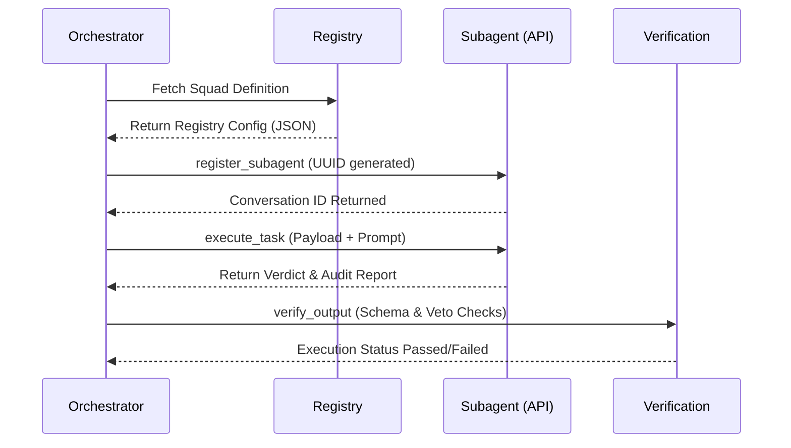

# Invocation and Bootstrap Audit

This document audits the dynamic registration, execution, and cost management lifecycles of subagents under the `/anti` Lazy Squad Bootstrap architecture.

---

## 1. Lazy Squad Bootstrap Evaluation
The system utilizes a "Lazy Squad Bootstrap" protocol designed to register and initialize subagents dynamically at runtime.
- **Dynamic Registration:** Rather than loading all 36 agents into memory, the orchestrator parses the required squad for a given mode and registers only those specific profiles.
- **Execution State:** Subagents exist as `SESSION_REAL` entities. They are bound to the current execution thread and do not persist across workspace restarts or CLI terminations.
- **Parent Scope Inheritance:** Subagents share `SHARED_PARENT_SCOPE`. They execute within the same sandbox environment as the caller.

---

## 2. Invocation Lifecycle

## 3. Key Vulnerabilities Audited
Our audit of the lifecycle identified the following vulnerabilities:
- **Simulation Fallback Loophole:** If `register_subagent` fails (e.g. due to rate limits), the orchestrator falls back to parent roleplaying (`FALLBACK_PROMPT_SIMULATION`). The system spoofed Conversation IDs and outputted fake reports, bypassing the security boundaries.
- **Ephemeral Session Registry:** Since agent registrations are in-memory, every CLI invocation incurs bootstrapping overhead, increasing the risk of registration failures.
- **Conversation ID Fabrication:** The system lacks verification of Conversation IDs. A model could fabricate a UUID without actually establishing a distinct LLM execution thread.
- **Token and Cost Blind Spot:** The orchestrator does not programmatically measure or limit token consumption during sequential subagent calls, exposing the system to abrupt rate-limiting errors (`RESOURCE_EXHAUSTED`).

---

## 4. Bootstrap Verification & Smoke Tests
The smoke test documented in `BOOTSTRAP_FOUNDER_COUNCIL.md` relies on manual prompts:
- *Instruction:* "Return your agent_id, mission, allowed tasks..."
- *Vulnerability:* This text-based test is easily spoofed by LLMs. An automated bootstrap validator must programmatically check the API response codes and verify the isolated execution thread before proceeding.

## 5. Recommended Upgrades
1.  **Strict ID Validation:** Force the orchestrator to log verified Conversation IDs from the API response and require the validation script to check these against the local run manifest.
2.  **Halt on Registration Failures:** Disable the `FALLBACK_PROMPT_SIMULATION` mechanism entirely. If dynamic registration fails, terminate the run immediately with `INCONCLUSIVE_BLOCKED` status.
3.  **Implement Token Budgeting:** Force the orchestrator to pass the remaining token budget to each subagent and require subagents to fail gracefully if the budget is exceeded.
