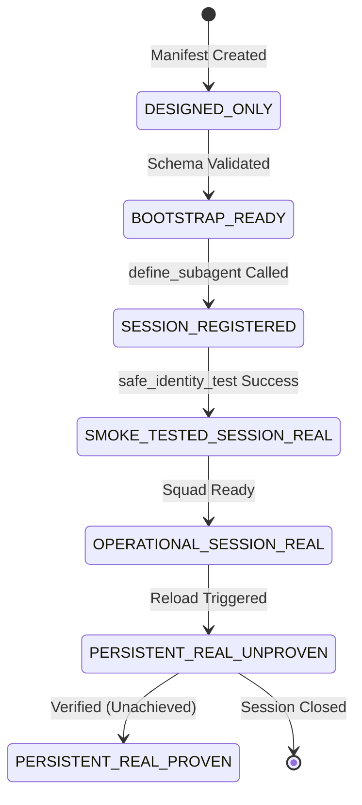

# Round 9: Reality, Bootstrap & Persistence

This document clarifies the session lifecycle of dynamically defined subagents, resolves registration ambiguities, and defines the smoke-test procedure.

## 1. Subagent Lifecycle State Machine

We track the operational reality of our subagent architecture using the following state transitions:

---

## State Definitions

1. **DESIGNED_ONLY:** Config files and schemas exist in `.antigravity-only/agents/`. No in-memory registration.
2. **BOOTSTRAP_READY:** Setup conforms to JSON schema. Ready for define commands.
3. **SESSION_REGISTERED:** The `define_subagent` tool has successfully completed execution for the agent ID in the current session.
4. **SMOKE_TESTED_SESSION_REAL:** The agent responded to the safe identity prompt with its correct name, role, and limits.
5. **OPERATIONAL_SESSION_REAL:** Agent is validated and ready for squad invocation.
6. **PERSISTENT_REAL_UNPROVEN:** The agent has run in one session, but its state across restarts remains unproven.
7. **PERSISTENT_REAL_PROVEN:** (Theoretical) Subagent registrations persist across container restarts. Currently **unproven** (assumed false).

---

## 2. Session Start Validation Checklist

To prevent fake agent execution, the Orchestrator must run this checklist on every fresh session:
- **Check 1:** Run `list_active_subagents`. Verify that all required squad IDs exist.
- **Check 2:** If list is empty, call the define block from `BOOTSTRAP_FOUNDER_COUNCIL.md`.
- **Check 3:** Run `safe_identity_test` on `chief_orchestrator_agent` to confirm routing is active.
- **Check 4:** If define/test fails, fall back to MANUAL prompt role-playing and log the status as `SIMULATED`.

## 3. Failure Handling

If subagent registration fails due to runtime context limits:
1. **Fallback Status:** Set the active status of the affected agents to `SIMULATED`.
2. **Synthesized Execution:** The parent agent will role-play the agent's lenses within the main prompt block.
3. **Log Declaration:** The final report header must declare:
   `Routing Mode: FALLBACK_PROMPT_SIMULATION (In-session registration failed).`
