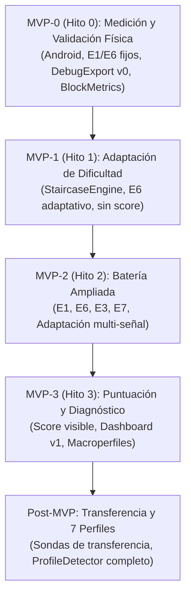

# MindBoost · Velocidad Mental — Plan de Implementación v2.2.3

> Basado en [VelocidadMentalResumen1.md](file:///c:/Users/curro/AndroidStudioProjects/MindOS/VelocidadMentalResumen1.md), las 20 decisiones estratégicas congeladas, las 15 correcciones al plan v1, las 10 correcciones de v2 a v2.1, los refinamientos de v2.2, los ajustes de v2.2.1, los cambios de v2.2.2 y las correcciones de v2.2.3 (TimebasePolicy ANDROID_UI_UPTIME_NANOS, contención de SessionRecord como contenedor de medición, BlockRecord/BlockMetrics explícitos, StaircaseEngine gobernado por BlockMetrics, borrado de DeviceProfile huérfanos, validación física multi-dispositivo en Día 10, thresholds explícitos versionados, QualityDecisionLog de trazabilidad y prohibición estricta de claims psicométricos en MVP-0/1/2).

---
\n\n## 1. Diagnóstico corregido del plan original

### Qué estaba bien

| Área | Estado |
|---|---|
| Modelo cognitivo (6 subcapacidades, separación Ter/v/a) | Sólido, listo |
| Fórmulas VCE, ImpIdx, FatIdx | Listas para codificar con calibración posterior |
| Staircase gateado por precisión | Conceptualmente correcto, necesita endurecimiento |
| Catálogo de 16 ejercicios | Bien definido, correctamente priorizado en 4 fases |
| Filosofía "velocidad útil, no impulsividad" | Principio rector válido |
| Criterios de mejora real vs. efecto práctica | Operacionalizable |

### Qué estaba mal

| Problema | Corrección aplicada |
|---|---|
| MVP demasiado grande (4 ejercicios + baseline 12 min + score visible + sesión completa como unidad atómica) | Dividido en MVP-0/1/2/3. La unidad atómica ahora es la línea vertical: estímulo -> respuesta -> timestamp -> trial -> métrica -> validación (en MVP-0, con adaptación añadida a partir de MVP-1). |
| Sin versionado de parámetros -> datos históricos pierden valor al recalibrar | Versionado obligatorio de métricas, score, generador, staircase, modelo de dificultad, perfil de dispositivo |
| Score con contradicción en el techo | Eliminado el techo artificial y corregida la escala |
| Control motor débil | Añadido control de latencia táctil indirecto (`simpleReactionMedianMs` y `deviceTimingRisk`) |
| Mezcla de bases temporales | Unificada a ANDROID_UI_UPTIME_NANOS en nanos en toda la app |
\n\n## 2. Core del MVP-0 (Hito 0)

El MVP-0 tiene un foco exclusivo en la medición física y la persistencia local de la unidad atómica de datos, eliminando cualquier tipo de adaptación activa, score, sesiones estructuradas o lógica multiplataforma.

### Restricciones estrictas de MVP-0:
1. **Solo Android**: No se incluye código ni adaptadores para iOS.
2. **Sin Adaptación**: Los ejercicios se ejecutan a velocidad y dificultad fijas.
3. **Sin Score**: No se calcula puntuación visible al usuario ni se muestra progreso cognitivo.
4. **Sin Sesión Cognitiva**: No existen sesiones de entrenamiento integradas de usuario de cara a la UI.
5. **Ejercicios mínimos**: Solo se implementan E1 (Destello) en su variante de tiempo de reacción simple y E6 (Multivía) en su variante de elección libre de 2 alternativas.
6. **Medición robusta**: Timestamps basados en monotonic uptime nanos para estímulo y respuesta.

> [!NOTE]
> **Definición de Sesión en MVP-0**: En MVP-0 no existen sesiones cognitivas de entrenamiento de usuario. Sin embargo, se mantiene el contenedor técnico `SessionRecord` (o Measurement Run) para agrupar de forma lógica los bloques, trials y exportaciones. Este contenedor no representa una sesión cognitiva de entrenamiento completa, sino una unidad técnica de medición física.
\n\n## 3. Roadmap de Hitos de Implementación

El desarrollo se realiza por capas acumulativas de complejidad, donde cada hito debe ser validado sintética y físicamente antes de progresar al siguiente.



### Hitos detallados:
- **MVP-0 (Hito 0)**: TrialEngine de medición y persistencia local de trials, bloques, block metrics y measurement runs. Exportador `DebugExport v0` en formato JSON/CSV para análisis de datos brutos en compilaciones de debug.
- **MVP-1 (Hito 1)**: Motor adaptativo unidimensional `StaircaseEngine`. Permite ajustar dinámicamente el deadline en E6 según la precisión (`pc`) registrada en `BlockMetrics`.
- **MVP-2 (Hito 2)**: Integración de 4 ejercicios (E1 Destello, E6 Multivía, E3 Cifrado, E7 Compuerta). Implementación de la adaptación multi-señal (PC + ImpIdx + CV) sobre `BlockMetrics`.
- **MVP-3 (Hito 3)**: Puntuación basada en VCE e IEVP agregadas en `SessionMetrics`. Dashboard v1 con las 3 barras de perfil (velocidad útil, control, estabilidad). Clasificación rápida del usuario en 3-5 macrocategorías cognitivas.
- **Post-MVP**: Clasificación psicométrica en los 7 perfiles cognitivos avanzados, batería de 16 ejercicios y microprotocolos de transferencia funcional.
\n\n## 4. Arquitectura del Sistema (KMP)

El módulo se integra dentro de la estructura modular de MindBoost en Kotlin Multiplatform (KMP).

```
shared/src/commonMain/kotlin/com/example/mindos/
├── design/                 // Design Tokens Centralizados (AppColors, AppSpacing...)
├── boost/                  // Módulo MindBoost
│   ├── speed/              // Feature de Velocidad Mental
│   │   ├── domain/         // Lógica de negocio (Staircase, Métricas)
│   │   │   ├── TrialEngine.kt
│   │   │   ├── StaircaseEngine.kt
│   │   │   ├── DifficultyEstimator.kt
│   │   │   └── MetricEdgeCasePolicy.kt
│   │   ├── data/           // Repositorios y Room DB
│   │   │   ├── database/   // Entidades y DAOs de Room (BlockRecord, TrialRecord...)
│   │   │   └── repositories/
│   │   ├── debug/          // Herramientas de depuración
│   │   │   └── DebugExport.kt // Exportador JSON/CSV de trials y métricas (MVP-0)
│   │   └── presentation/   // ViewModels y UI (Compose Multiplatform)
androidApp/src/main/kotlin/com/example/mindos/
└── boost/
    └── speed/
        └── time/           // Lógica física de temporización Android
            └── TimestampProvider.kt // Choreographer + MotionEvent (Ver §4.1)
```

### Interfaces Clave (Kotlin)

```kotlin
interface TimestampProvider {
    fun getCurrentMonotonicNanos(): Long
    fun getTimestampSource(): TimestampSource
    fun getInputTimestampPrecision(): InputTimestampPrecision
}

interface TrialEngine {
    fun startTrial(difficulty: Double, deadlineNanos: Long?): Long // retorna stimulusUptimeNanos
    fun onResponse(responseUptimeNanos: Long, isCorrect: Boolean): TrialRecord
    fun getTrialHistory(): List<TrialRecord>
}

interface StaircaseEngine {
    fun updateDifficulty(metrics: BlockMetrics): Double // Retorna CCE (0.0 - 1.0) gobernado por bloque
    fun getNextDeadline(cce: Double): Long?
}

interface DifficultyEstimator {
    fun estimateDifficultyBefore(cce: Double, deadlineNanos: Long?): Double
}
```
\n\n### 4.1. TimebasePolicy Android

Todos los timestamps usados para calcular TR pertenecen a una única base temporal monotónica basada en el Uptime del dispositivo.

| Fuente | API | Base temporal | Uso |
|---|---|---|---|
| `Choreographer.FrameCallback#doFrame(frameTimeNanos)` | Todas | `CLOCK_MONOTONIC` | Timestamp de estímulo (`stimulusUptimeNanos`) |
| `MotionEvent.getEventTimeNanos()` | API 34+ | `CLOCK_MONOTONIC` | Timestamp de respuesta (`responseUptimeNanos`) — precisión nanos |
| `MotionEvent.eventTime * 1_000_000L` | API < 34 | `CLOCK_MONOTONIC` (ms → nanos) | Timestamp de respuesta (`responseUptimeNanos`) — precisión millis |

**Reglas de Medición:**
1. `rtNanos = responseUptimeNanos - stimulusUptimeNanos`. Ambos valores provienen de la misma base temporal monotónica (`CLOCK_MONOTONIC`).
2. **stimulusUptimeNanos = frameTimeNanos** obtenido directamente del Choreographer.
3. **responseUptimeNanos** se resuelve de la siguiente forma:
   ```kotlin
   val responseUptimeNanos = if (apiLevel >= 34) {
       motionEvent.eventTimeNanos
   } else {
       motionEvent.eventTime * 1_000_000L
   }
   ```
4. **Prohibición de Mezcla**: Queda estrictamente prohibido restar `SystemClock.elapsedRealtimeNanos()` contra `Choreographer.frameTimeNanos` o contra timestamps de `MotionEvent`.
5. **Separación de Tiempos**: No se deben mezclar timestamps de sesión, timeouts internos o duración total de la aplicación con timestamps de estímulo y respuesta de trials.
6. `SystemClock.elapsedRealtimeNanos()` se puede usar de forma exclusiva para medir duraciones globales de sesión o timeouts de espera internos, pero jamás para calcular `rtNanos`.
7. En API < 34, la precisión se marca de forma obligatoria como `InputTimestampPrecision.MILLIS_DERIVED`.
8. En API 34+, la precisión se marca de forma obligatoria como `InputTimestampPrecision.NANOS_NATIVE`.
9. Cada bloque y sesión registra su `timestampSource: TimestampSource`, `inputTimestampPrecision: InputTimestampPrecision` y `timebase: Timebase`.

**Enums:**
```kotlin
enum class TimestampSource {
    CHOREOGRAPHER_FRAME,
    SYSTEM_CLOCK_MONOTONIC
}

enum class InputTimestampPrecision {
    NANOS_NATIVE,
    MILLIS_DERIVED
}

enum class Timebase {
    ANDROID_UI_UPTIME_NANOS
}
```

> [!IMPORTANT]
> Toda sesión almacena `timestampSource`, `inputTimestampPrecision` y `timebase` en su metadata. Claims de precisión en milisegundos solo se permiten en sesiones con `inputTimestampPrecision = InputTimestampPrecision.NANOS_NATIVE` y `deviceTimingRisk = DeviceTimingRisk.LOW`.
\n\n## 5. Modelos de Datos (Room Entities)

A partir de MVP-0 se definen de forma explícita las entidades `BlockRecord` y `BlockMetrics` para dar soporte al StaircaseEngine a nivel de bloque y evitar deuda técnica.

```kotlin
import androidx.room.Entity
import androidx.room.PrimaryKey
import androidx.room.ForeignKey

@Entity(tableName = "device_profiles")
data class DeviceProfile(
    @PrimaryKey val id: String,
    val deviceModel: String,
    val osVersion: String,
    val apiLevel: Int,
    val simpleReactionMedianMs: Double,
    val deviceTimingRisk: DeviceTimingRisk // LOW, MODERATE, HIGH
)

@Entity(
    tableName = "session_records",
    foreignKeys = [
        ForeignKey(
            entity = DeviceProfile::class,
            parentColumns = ["id"],
            childColumns = ["deviceProfileId"],
            onDelete = ForeignKey.RESTRICT
        )
    ]
)
data class SessionRecord(
    @PrimaryKey val id: String,
    val userId: String,
    val timestampEpochMs: Long,
    val deviceProfileId: String,
    val durationMs: Long
)

@Entity(
    tableName = "block_records",
    foreignKeys = [
        ForeignKey(
            entity = SessionRecord::class,
            parentColumns = ["id"],
            childColumns = ["sessionId"],
            onDelete = ForeignKey.CASCADE
        )
    ]
)
data class BlockRecord(
    @PrimaryKey val id: String,
    val sessionId: String,
    val blockIndex: Int,
    val exerciseId: String,
    val startedAtEpochMs: Long,
    val durationMs: Long?,
    val fixedDifficulty: Double,
    val deadlineNanos: Long?,
    val timestampSource: TimestampSource,
    val inputTimestampPrecision: InputTimestampPrecision,
    val timebase: Timebase
)

@Entity(
    tableName = "trial_records",
    foreignKeys = [
        ForeignKey(
            entity = BlockRecord::class,
            parentColumns = ["id"],
            childColumns = ["blockId"],
            onDelete = ForeignKey.CASCADE
        )
    ]
)
data class TrialRecord(
    @PrimaryKey val id: String,
    val blockId: String,
    val trialIndex: Int,
    val exerciseId: String,
    val stimulusUptimeNanos: Long,
    val responseUptimeNanos: Long,
    val rtNanos: Long,
    val isCorrect: Boolean,
    val isAnticipation: Boolean,
    val isLapse: Boolean,
    val lapseMultiplier: Double,
    val deadlineNanos: Long?,
    val difficultyEstimate: Double,
    val timestampSource: TimestampSource,
    val inputTimestampPrecision: InputTimestampPrecision,
    val timebase: Timebase // always ANDROID_UI_UPTIME_NANOS
)

@Entity(
    tableName = "block_metrics",
    foreignKeys = [
        ForeignKey(
            entity = BlockRecord::class,
            parentColumns = ["id"],
            childColumns = ["blockId"],
            onDelete = ForeignKey.CASCADE
        )
    ]
)
data class BlockMetrics(
    @PrimaryKey val blockId: String,
    val totalTrials: Int,
    val pc: Double, // Proportion Correct (0.0 - 1.0)
    val rtMedianNanos: Double?,
    val rtMeanNanos: Double?,
    val cv: Double?, // Coefficient of Variation
    val lapseRate: Double,
    val anticipationRate: Double,
    val faRate: Double?, // False Alarm Rate
    val omissionRate: Double,
    val impIdx: Double?, // Impulsivity Index
    val fatIdx: Double?, // Fatigue Index (null en bloques iniciales)
    val vce: Double?, // Velocidad Cognitiva Efectiva (Informativa)
    val timestampSource: TimestampSource,
    val inputTimestampPrecision: InputTimestampPrecision,
    val timebase: Timebase
)

@Entity(
    tableName = "session_metrics",
    foreignKeys = [
        ForeignKey(
            entity = SessionRecord::class,
            parentColumns = ["id"],
            childColumns = ["sessionId"],
            onDelete = ForeignKey.CASCADE
        )
    ]
)
data class SessionMetrics(
    @PrimaryKey val sessionId: String,
    val totalTrials: Int,
    val pc: Double,
    val rtMedianNanos: Double?,
    val rtMeanNanos: Double?,
    val cv: Double?,
    val lapseRate: Double,
    val anticipationRate: Double,
    val faRate: Double?,
    val omissionRate: Double,
    val impIdx: Double?,
    val fatIdx: Double?,
    val vce: Double?,
    val timestampSource: TimestampSource,
    val inputTimestampPrecision: InputTimestampPrecision,
    val timebase: Timebase
)

@Entity(
    tableName = "version_snapshots",
    foreignKeys = [
        ForeignKey(
            entity = SessionRecord::class,
            parentColumns = ["id"],
            childColumns = ["sessionId"],
            onDelete = ForeignKey.CASCADE
        )
    ]
)
data class VersionSnapshot(
    @PrimaryKey val sessionId: String,
    val metricsVersion: String, // e.g., "1.0.0"
    val staircaseVersion: String,
    val difficultyModelVersion: String,
    val lapseMultiplier: Double
)

@Entity(
    tableName = "quality_decision_logs",
    foreignKeys = [
        ForeignKey(
            entity = SessionRecord::class,
            parentColumns = ["id"],
            childColumns = ["sessionId"],
            onDelete = ForeignKey.CASCADE
        )
    ]
)
data class QualityDecisionLog(
    @PrimaryKey val id: String,
    val sessionId: String,
    val deviceTimingRisk: DeviceTimingRisk,
    val sessionQuality: SessionQuality,
    val reasons: List<String>, // Listado de motivos en formato string/flags
    val createdAtEpochMs: Long
)
```

### Constantes de Umbrales Psicométricos (Versionadas)

```kotlin
data class MetricThresholds(
    val anticipationThresholdNanos: Long,
    val lapseMultiplier: Double,
    val highCvThreshold: Double,
    val highAnticipationRateThreshold: Double,
    val highOmissionRateThreshold: Double,
    val contaminatedFrameDropThreshold: Double
)
```

Valores iniciales de calibración (Sujetos a recalibración en snapshots de versión):
- `anticipationThresholdNanos` = `100_000_000L` (100 ms)
- `lapseMultiplier` = `2.5`
- `highCvThreshold` = `0.30`
- `highAnticipationRateThreshold` = `0.15`
- `highOmissionRateThreshold` = `0.20`
- `contaminatedFrameDropThreshold` = `0.05` (5% de pérdida de frames invalida el bloque/sesión)
\n\n## 6. StaircaseEngine y Lógica Adaptativa (Fase 1+)

El ajuste de dificultad se implementa a partir de MVP-1 y se refina en MVP-2 con un sistema de adaptación de carga cognitivo multi-señal gateado.

### Reglas de Adaptación del StaircaseEngine:
Sea `CCE` la dificultad actual (Carga Cognitiva Efectiva, entre 0.0 y 1.0). El StaircaseEngine opera bloque a bloque y actualiza la `CCE` para el siguiente bloque utilizando `BlockMetrics` como entrada:

1. **REGLA 1 (SUBIR presión):** Si `pc >= A_high` (0.85) **y** `impIdx <= I_cap` (0.35) **y** `cv <= V_cap` (0.25) **y** sin incremento significativo en la cola lenta (lapsos), reducir el deadline de respuesta (D↓) de forma proporcional al margen de precisión:
   `CCE_next = min(1.0, CCE + delta_up * (pc - A_high + 1))`
2. **REGLA 2 (BAJAR presión):** Si `pc < A_low` (0.70) **o** `impIdx > I_cap` **o** `omissionRate` elevado **o** `anticipationRate` elevado, aumentar el deadline (D↑):
   `CCE_next = max(0.0, CCE - delta_down)`
3. **REGLA 3 (MANTENER presión):** Si `A_low <= pc < A_high`, mantener la dificultad actual para recoger más datos y estabilizar el estimado.
4. **REGLA 4 (ESTABILIZAR):** Si la precisión es alta (`pc >= A_high`) pero el coeficiente de variación `cv` es alto o los lapsos aumentan, mantener el nivel actual e introducir un bloque de estabilización obligatoria, sin permitir subir dificultad.
5. **REGLA 5 (COOLDOWN de fatiga):** Si el `fatIdx` supera el umbral límite en `BlockMetrics`, reducir la carga adaptativa o terminar la sesión en cooldown de forma controlada.

- **BlockMetrics gobierna adaptación**: El StaircaseEngine toma las decisiones basándose estrictamente en las métricas del bloque actual (`BlockMetrics`).
- **SessionMetrics resume rendimiento**: Las métricas globales a nivel de sesión (`SessionMetrics`) se emplean para generar el diagnóstico final e histórico del usuario, pero no deciden las transacciones de dificultad del bucle cerrado.

> [!IMPORTANT]
> **VCE es informativo, no autoritativo para avance.** La métrica de Velocidad Cognitiva Efectiva (VCE) se calcula y se persiste tanto en `BlockMetrics` como en `SessionMetrics`, pero la decisión de subir o bajar la presión la toma exclusivamente el StaircaseEngine utilizando sus gates independientes de precisión (PC), inestabilidad (CV), impulsividad (ImpIdx) y fatiga (FatIdx). VCE nunca es condición suficiente ni necesaria para que el staircase suba la presión.
\n\n## 7. Métricas y Fórmulas

Las fórmulas matemáticas deben implementarse con tipos flotantes de doble precisión (`Double`) y evitar cualquier tipo de conversión silenciosa de valores nulos a cero.

### Fórmulas del Sistema:

1. **Velocidad Cognitiva Efectiva (VCE)**:
   ```
   rtMedianSeconds = rtMedianNanos / 1_000_000_000.0
   VCE = (pc ^ beta) / (rtMedianSeconds * (1.0 + lambda * cv))
   ```
   - `beta` = 2.0 (peso exponencial de precisión).
   - `lambda` = 0.7 (peso de penalización por variabilidad).
   - Si `pc` es 0 o `rtMedianNanos` es nulo, `VCE` es nulo.

2. **Índice de Impulsividad (ImpIdx)**:
   ```
   ImpIdx = wa * faRate + wb * anticipationRate + wc * fastErrorShare + wd * (1.0 - normalizedSSRT)
   ```
   - Pesos por defecto: `wa` = 0.3, `wb` = 0.3, `wc` = 0.2, `wd` = 0.2.
   - `fastErrorShare`: Fracción de errores cometidos con un TR menor que la mediana de TR de los aciertos de la sesión/bloque.
   - **Caso límite sin no-go (MVP-2 / Ejercicios E1 y E6)**: Si `faRate` es nulo (porque el ejercicio carece de condiciones no-go), el peso `wa` se redistribuye proporcionalmente entre `wb` y `wc`:
     `wb' = wb / (wb + wc) = 0.3 / 0.5 = 0.6`
     `wc' = wc / (wb + wc) = 0.2 / 0.5 = 0.4`
     `ImpIdx = wb' * anticipationRate + wc' * fastErrorShare`

3. **Índice de Fatiga (FatIdx)**:
   Se calcula longitudinalmente acumulando bloques:
   ```
   FatIdx = z(slope_VCE_by_block) + z(delta_tau) + z(delta_lapses) + z(vigilance_decrement)
   ```
   - **Caso límite**: Requiere al menos 3 bloques de datos en la misma sesión para calcular la pendiente de caída. Con menos de 3 bloques, `fatIdx = null`. Si `fatIdx` es nulo, la regla de cooldown por fatiga del staircase no puede dispararse.

---

### MetricEdgeCasePolicy

| Situación | Comportamiento |
|---|---|
| 0 trials en bloque | Bloque descartado. Métricas = null. No se usa para staircase ni scoring. |
| 0 trials correctos | PC = 0.0. rtMedianNanos = null. CV = null. VCE = null. El staircase usa solo PC para decidir (REGLA 2 — BAJAR). |
| 1 trial correcto | PC = calculable. rtMedianNanos = ese trial. CV = null (no computable con n=1). VCE = null. |
| 0 trials no-go | faRate = null (no Float). ImpIdx no computable bajo fórmula general; se aplica re-normalización de pesos sin no-go. |
| 0 errores | fastErrorShare = 0.0 (definido, no null — no hay errores rápidos si no hay errores). |
| Todos los trials son anticipaciones | PC y rtMedianNanos se calculan solo sobre no-anticipaciones. Si 0 no-anticipaciones → tratar como 0 trials correctos. |
| deadlineNanos = null | No entra en difficultyEstimateBefore. DifficultyEstimator omite componente de presión temporal. Nunca calcular 1/null. |

**Regla General**: Ninguna métrica nula se convierte silenciosamente en 0. Las capas superiores (staircase, scoring, perfiles) deben manejar nulos explícitamente. Un nulo en VCE significa "no computable", no "score bajo".
\n\n## 8. Criterios de Calidad y Filtros de Dispositivo (DeviceQualityGate)

Para proteger la integridad psicométrica del sistema, se separan los factores técnicos (hardware) de los conductuales (usuario).

### Separación Conceptual:
- **DeviceTimingRisk**: Representa exclusivamente el riesgo de precisión temporal inducido por el hardware y el entorno técnico del dispositivo.
  - `LOW`: Dispositivo de gama alta corriendo en API 34+ con precisión nativa de nanosegundos (`InputTimestampPrecision.NANOS_NATIVE`).
  - `MODERATE`: Dispositivo corriendo en API < 34 con marcas temporales derivadas de milisegundos (`InputTimestampPrecision.MILLIS_DERIVED`).
  - `HIGH`: Dispositivo que reporta inestabilidad crítica en los hilos del Choreographer o latencia excesiva.
- **SessionQuality**: Clasificación psicométrica combinada que evalúa tanto la estabilidad conductual del usuario como el riesgo técnico del dispositivo.
  - `HIGH`: `deviceTimingRisk == LOW` y baja tasa de anticipaciones y lapsos conductuales.
  - `ACCEPTABLE`: `deviceTimingRisk <= MODERATE` y comportamiento estable.
  - `LOW`: Comportamiento errático del usuario (IIV/CV muy elevado, tasa de anticipación muy alta).
  - `CONTAMINATED`: Ruido crítico del sistema, pérdida de frames o interferencia motora detectada que invalida los resultados.

**Regla de Descarte**: Las sesiones con `SessionQuality == CONTAMINATED` se guardan en base de datos para depuración técnica, pero se marcan explícitamente para ser omitidas por el StaircaseEngine y no entran en el cálculo histórico del perfil cognitivo del usuario.
\n\n## 9. Sistema de Puntuación (Fase 3) y Reglas de Producto

La puntuación visible al usuario se implementa en la Fase 3 del desarrollo.

1. **Tres Barras del Perfil Visual**:
   - **Velocidad Útil**: Basada en el percentil de VCE del usuario para esa subcapacidad específica.
   - **Precisión/Control**: Inversa del Índice de Impulsividad (1.0 - ImpIdx) y precisión global (PC).
   - **Estabilidad**: Medida inversa del coeficiente de variación de TR (1.0 - CV) y tasa de lapsos.

2. **Techo de Puntuación**:
   La puntuación global está capada por el rendimiento en control y estabilidad. Si la precisión (`pc`) cae por debajo de 0.80, o la inestabilidad (`cv`) supera 0.30, la puntuación total se penaliza en un 50% de forma matemática, impidiendo que los usuarios obtengan puntuaciones elevadas mediante pulsaciones rápidas pero impulsivas.

3. **Prohibición de Claims Psicométricos en MVP-0/MVP-1/MVP-2**:
   Durante las fases MVP-0, MVP-1 y MVP-2 no se muestran claims de mejora cognitiva, percentiles, diagnósticos, perfiles avanzados ni comparaciones normativas al usuario final. Solo se permiten mensajes operativos o descriptivos de carácter técnico interno.
   - **Ejemplos permitidos:**
     - "Datos registrados correctamente."
     - "Bloque completado."
     - "Precisión del bloque: X%."
     - "Tiempo mediano de respuesta: Y ms."
   - **Ejemplos prohibidos:**
     - "Tu velocidad mental mejoró."
     - "Tienes perfil impulsivo."
     - "Estás por encima del promedio."
     - "Tu capacidad cognitiva aumentó."
\n\n## 10. Diseño de Sesiones y Microprotocolos

1. **Sesión Estándar (10 Minutos)**:
   - Calentamiento (1 min): Ensayos fáciles a baja presión.
   - Calibración (1 min): Determinación rápida del umbral inicial.
   - Núcleo de velocidad (6 min): Bloques de entrenamiento adaptativo.
   - Bloque de control/inhibición (1 min): Foco en retener errores y no-go.
   - Cooldown + Reflexión metacognitiva (1 min).

2. **Pausas e Interrupciones**:
   - Micro-pausas de 20-30 segundos obligatorias entre bloques.
   - Si `fatIdx` supera el umbral límite, el sistema fuerza una pausa larga de 60 segundos antes del siguiente bloque.
   - Si el rendimiento (PC) cae en dos bloques consecutivos por debajo del umbral de calidad, el sistema activa la detención temprana, llevando al usuario directamente a la fase de reflexión metacognitiva y cooldown, evitando terminar la sesión de forma abrupta en un pico de dificultad.
\n\n## 11. Sistema Anti-Estancamiento

El motor adaptativo contiene un sistema para detectar y romper mesetas de aprendizaje:

1. **Detección de Meseta**:
   Se define meseta cuando durante 6 sesiones consecutivas de un mismo ejercicio la VCE se mantiene dentro de una variación menor al 3% sin reducción significativa de TR ni incremento de precisión.

2. **Lógica de Actuación**:
   - **Rotación de Estímulos**: El generador cambia automáticamente el juego de estímulos visuales (p.ej. cambia colores básicos por formas abstractas de contraste variable) para obligar a una nueva re-codificación perceptiva y evitar el efecto práctica específico de patrones familiares.
   - **Cambio de Dominio**: Si la meseta persiste, el planificador de entrenamiento fuerza una rotación de dominio cognitivo (de velocidad perceptiva pura a velocidad con inhibición o cambio de regla) para re-estructurar la carga de trabajo cognitivo en la siguiente sesión.
\n\n## 12. Simulador y Validación Sintética

El simulador es el pilar de verificación de la robustez del sistema y se desarrolla en paralelo al MVP-0.

```
Módulo de Simulación:
├── SyntheticProfile            // Definición de perfiles conductuales sintéticos
├── SyntheticUserRunner         // Simulador de interacción que corre perfiles
└── StaircaseSimulationTests    // Suite de verificación automatizada del Staircase
```

### Perfiles Conductuales Sintéticos:
- **Perfil Impulsivo**: Simula un usuario que responde con muy bajo TR (p.ej. 200 ms) de forma casi constante pero con alta tasa de error en no-go y errores rápidos. Su PC final esperada es ~0.55.
- **Perfil Lento-Preciso**: Simula un usuario muy cauteloso que espera a acumular el 100% de evidencia. TR alto (p.ej. 600 ms) pero con PC constante de 0.98.
- **Perfil Fatigable**: Comienza con una VCE alta y estable, pero a partir del bloque 3 incrementa linealmente su TR, su CV y su tasa de lapsos.

> [!IMPORTANT]
> **Regla de simulación primero**: El simulador se ejecuta como test suite automatizada. Todas las validaciones sintéticas deben pasar al 100% ANTES de que cualquier humano use el sistema. Si un perfil sintético no se comporta como se espera ante el motor adaptativo o las métricas calculadas, el componente bajo test está roto y se bloquea el despliegue a producción.
\n\n## 13. Sondas de Transferencia y Evaluación

1. **Protocolo de Baseline Inicial**:
   - Se ejecuta una única vez al inicio del ciclo de 8 semanas.
   - Duración: 12-15 minutos.
   - Evalúa las 6 subcapacidades con suficientes ensayos para garantizar la estabilidad estadística y fijar el error de medida base.

2. **Sondas No Entrenadas**:
   - Se aplican al final de cada semana de entrenamiento.
   - Paradigmas equivalentes pero con formatos y estímulos no vistos durante la semana.
   - Si la mejora en la VCE semanal no se correlaciona con un incremento en las sondas no entrenadas, la ganancia se reporta internamente como "efecto práctica específico", no como progreso cognitivo generalizado.
\n\n## 14. Gestión de Fatiga e Impulsividad (Longitudinal)

La gestión de fatiga y la prevención de impulsividad se realiza de forma continuada a lo largo del ciclo de entrenamiento:

- **Monitoreo de Impulsividad**: Si un usuario incrementa su `impIdx` en 3 sesiones consecutivas, el sistema disminuye la velocidad base del motor adaptativo y fuerza bloques con alta densidad de no-go para re-entrenar la inhibición.
- **Descargas Programadas (Deload)**: En las semanas 4 y 8 del ciclo de progresión, el volumen y la presión temporal máxima se reducen en un 30% de forma automática en todos los ejercicios para permitir la consolidación del aprendizaje y mitigar la fatiga acumulada.
\n\n## 15. Roadmap Detallado (Hito 0 / MVP-0 Alpha)

El desarrollo del Hito 0 sigue un plan de 10 días para asegurar que la base de medición y validación física en Android sea robusta.

| Día | Tarea | Entregables |
|---|---|---|
| Día 1 | Implementación de `TimestampProvider` en Android | Timestamps CHOREOGRAPHER_FRAME y SYSTEM_CLOCK_MONOTONIC configurados |
| Día 2 | Creación del modelo Room de base de datos | Entidades `TrialRecord`, `BlockRecord`, `BlockMetrics` y `SessionRecord` |
| Día 3 | Lógica de cálculo de `rtNanos` en el `TrialEngine` | Cálculo de TR con unificación ANDROID_UI_UPTIME_NANOS |
| Día 4 | Ejercicio E1 (Destello) en modo fijo | Pantalla y motor del ejercicio con temporización nativa |
| Día 5 | Ejercicio E6 (Multivía) en modo fijo | Pantalla de 2 alternativas fijas con MotionEvent capturado |
| Día 6 | Lógica del simulador sintético para MVP-0 | Runner sintético que genera trials fijos para verificar logs Room |
| Día 7 | Validación sintética completa (Simulador) | Ejecución del 100% de tests sintéticos sobre base de datos Room |
| Día 8 | Exportador de depuración `DebugExport v0` | Exportación JSON/CSV de trials y métricas en debug builds |
| Día 9 | Pruebas físicas con dispositivos de prueba Android | Registro de marcas de tiempo físicas y cálculo del deviceTimingRisk |
| Día 10 | Auditoría de código, cierre de MVP-0 alpha y freeze | Código verificado, freeze de API interna. Comienza ventana de validación física. |

### Criterio de Validación Física Obligatoria (Go/No-Go para MVP-1):
A partir del Día 10 se abre una ventana obligatoria de validación física multi-dispositivo. No se permite iniciar la implementación de MVP-1 hasta haber completado con éxito la validación física en al menos:
- 1 dispositivo con Android API 34+ (`InputTimestampPrecision.NANOS_NATIVE`).
- 1 dispositivo con Android API < 34 (`InputTimestampPrecision.MILLIS_DERIVED`).
- 1 dispositivo de gama media o baja (para descartar jitter extremo).
- 1 dispositivo con alta tasa de refresco (90 Hz o 120 Hz) si está disponible en el laboratorio físico.

> [!IMPORTANT]
> **Regla de simulación primero**: Las pruebas automatizadas del simulador del Día 7 deben pasar al 100% y validar la correcta persistencia e integridad de las marcas de tiempo en Room antes de que las pruebas con humanos del Día 9 sean consideradas válidas o de que se permita el merge a la rama principal.
\n\n## 16. Privacidad, Seguridad y Borrado de Datos

1. **Borrado Transaccional de Datos**:
   - **Derecho de borrado**: El borrado de los datos de un usuario debe ser atómico y transaccional por `userId`. Una única operación de Room anotada con `@Transaction` elimina en cascada todas las filas asociadas en: trials, bloques, block metrics, sesiones, metrics de sesión, snapshots de versión y logs de decisión de calidad.
   - **Manejo de DeviceProfile**: La entidad `DeviceProfile` no se borra directamente por `userId` si está compartida. La transacción de borrado de datos elimina los registros específicos del usuario y finalmente limpia las instancias huérfanas de `DeviceProfile` sin sesiones asociadas.
   - **Código conceptual de borrado**:
     ```kotlin
     @Transaction
     suspend fun deleteUserData(userId: String) {
         deleteQualityLogsByUserId(userId)
         deleteVersionSnapshotsByUserId(userId)
         deleteBlockMetricsByUserId(userId)
         deleteSessionMetricsByUserId(userId)
         deleteTrialsByUserId(userId)
         deleteBlocksByUserId(userId)
         deleteSessionsByUserId(userId)
         deleteOrphanDeviceProfiles()
     }
     ```

2. **Protección de Datos de Depuración**:
   - **Debug exports**: Los archivos exportados por `DebugExport v0` contienen marcas temporales y datos de comportamiento altamente sensibles. En compilaciones de tipo release, `DebugExport` está completamente deshabilitado. En compilaciones de desarrollo (debug), su acceso está protegido mediante un toggle de desarrollador oculto en la UI de configuración de la app. Los archivos exportados se guardan localmente en el almacenamiento privado de la aplicación.
\n\n## 17. Glosario de Términos

- **TR (Tiempo de Reacción)**: Tiempo transcurrido entre la aparición del estímulo visual y el registro físico de la pulsación táctil.
- **Ter (Tiempo No Decisional)**: Componente del tiempo de reacción que representa los procesos periféricos de codificación visual y ejecución motora del dedo.
- **v (Tasa de Deriva / Drift Rate)**: Velocidad de acumulación de información cognitiva para tomar una decisión.
- **a (Umbral de Cautela / Boundary)**: Nivel de evidencia que el sistema cognitivo requiere antes de confirmar una respuesta.
- **IIV (Variabilidad Intraindividual)**: Variación en el rendimiento de un mismo sujeto a lo largo del tiempo o dentro de la misma sesión.
- **CV (Coeficiente de Variación)**: Relación entre la desviación estándar y la media de los tiempos de reacción (`CV = SD / Mean`).
- **SSRT (Stop Signal Reaction Time)**: Tiempo que tarda el cerebro en cancelar una respuesta ya iniciada tras recibir la señal de stop.
- **VCE (Velocidad Cognitiva Efectiva)**: Métrica agregada que mide el rendimiento neto descontando la inestabilidad y penalizando exponencialmente la falta de precisión.
- **ImpIdx (Índice de Impulsividad)**: Métrica que agrupa las falsas alarmas, anticipaciones y errores rápidos para identificar respuestas automáticas no controladas.
- **FatIdx (Índice de Fatiga)**: Medida longitudinal que estima el decremento de rendimiento y el aumento de lapsos atencionales intra-sesión.
\n\n## 20. Checklist de Aceptación v2.2.3

| # | Criterio | Verificación |
|---|---|---|
| 1 | No se mezclan bases temporales incompatibles | `rtNanos` = `responseUptimeNanos - stimulusUptimeNanos`, ambos CLOCK_MONOTONIC |
| 2 | Existe fallback API < 34 | `MotionEvent.eventTime * 1_000_000L` con `inputTimestampPrecision = InputTimestampPrecision.MILLIS_DERIVED` |
| 3 | Todo cálculo de TR registra fuente y precisión | `timestampSource` + `inputTimestampPrecision` en TrialRecord, BlockMetrics y SessionMetrics |
| 4 | Simulador se ejecuta antes que humanos | Regla explícita en §12 y en el roadmap |
| 5 | `deadlineNanos` nullable no entra en operaciones aritméticas | DifficultyEstimator omite componente temporal si es nulo |
| 6 | VCE no autoriza avance por sí sola | VCE informativo; staircase usa gates independientes (PC, ImpIdx, CV...) |
| 7 | Casos límite métricos definidos | Tabla de comportamiento de MetricEdgeCasePolicy en §7 |
| 8 | Métricas null no se convierten silenciosamente en 0 | Regla explícita en MetricEdgeCasePolicy en §7 |
| 9 | DeviceTimingRisk y SessionQuality separados | DeviceTimingRisk = hardware; SessionQuality = combinado |
| 10 | MVP-2 no promete ProfileDetector | ProfileDetector empieza en MVP-3 |
| 11 | MVP-3 no confirma 7 perfiles prematuramente | Macroclasificación 3–5 categorías en MVP-3; 7 perfiles en Post-MVP |
| 12 | DebugExport v0 y Dashboard v1 separados | DebugExport v0 en MVP-0; Dashboard v1 en MVP-3 |
| 13 | Borrado por usuario transaccional definido | `@Transaction` Room elimina todas las tablas asociadas por userId y limpia DeviceProfile huérfanos |
| 14 | Debug data protegida en release | Developer toggle oculto; DebugExport deshabilitado en release |
| 15 | Nomenclatura unificada | Identificadores de código en inglés camelCase; prosa y documentación en español |
| 16 | Sin contradicciones en base temporal | Nomenclatura unificada a ANDROID_UI_UPTIME_NANOS con Choreographer + MotionEvent |
| 17 | Trazabilidad del QualityDecisionLog | Registradas las razones detalladas por las que una sesión se marca como CONTAMINATED o LOW |
| 18 | Criterio de validación multi-dispositivo en Hito 0 | Ventana obligatoria de validación física sobre 4 perfiles técnicos en Día 10 |
| 19 | Thresholds iniciales codificados | Definida clase MetricThresholds con valores de inicialización para anticipación (100ms), lapse (2.5), etc. |
| 20 | Prohibición de claims psicométricos | Verificación de que en MVP-0/1/2 la UI no muestra claims de progreso o perfiles cognitivos |
\n\n## 21. Cambios aplicados en v2.2.3

1. **Nomenclatura ANDROID_UI_UPTIME_NANOS** (§4.1): Reemplazado `MONOTONIC_NANOS` por `ANDROID_UI_UPTIME_NANOS` en `Timebase`.
2. **Fórmula Uptime en nanos** (§4.1): Establecida la regla de cálculo `rtNanos = responseUptimeNanos - stimulusUptimeNanos` con fallback para API < 34.
3. **Reglas de no mezcla de tiempo** (§4.1): Explicado detalladamente que `SystemClock.elapsedRealtimeNanos()` no se usa para TR, ni se mezclan tiempos de sesión con marcas de trials.
4. **Typo Choreographer** (§4.1): Corregido `CLOREOGRAPHER_FRAME` a `CHOREOGRAPHER_FRAME`.
5. **Definición de Sesión en MVP-0** (§2): Aclarado que `SessionRecord` es un contenedor técnico (Measurement Run) y no una sesión de entrenamiento cognitivo integrada.
6. **BlockRecord y BlockMetrics** (§5): Añadidos al modelo de Room para separar datos por bloque, reduciendo deuda técnica.
7. **TrialRecord referenciado a bloque** (§5): Actualizado `TrialRecord` para relacionarse directamente con `BlockRecord` mediante `blockId` en lugar de indexación vaga.
8. **StaircaseEngine gobernado por bloque** (§4, §6): Modificada firma a `StaircaseEngine.updateDifficulty(metrics: BlockMetrics)` para que el bucle cerrado opere sobre métricas de bloque.
9. **Borrado de DeviceProfile Huérfanos** (§16): Implementado flujo `@Transaction` de Room que preserva perfiles compartidos y elimina huérfanos.
10. **Día 10 Alpha Freeze** (§15): Modificado a "Alpha Freeze" y API Freeze, abriendo una ventana de validación física obligatoria multi-dispositivo antes de MVP-1.
11. **Thresholds explicitados** (§5): Definida clase `MetricThresholds` con valores tentativos iniciales (anticipación de 100ms, lapse de 2.5, cv de 0.30, etc.) listos para codificación.
12. **QualityDecisionLog** (§5): Entidad Room nueva para guardar los motivos cualitativos por los que una sesión es catalogada como de baja calidad o contaminada.
13. **Prohibición de Claims Psicométricos** (§9): Añadida cláusula estricta que prohíbe claims cognitivos o diagnósticos en UI durante las fases MVP-0/1/2.
