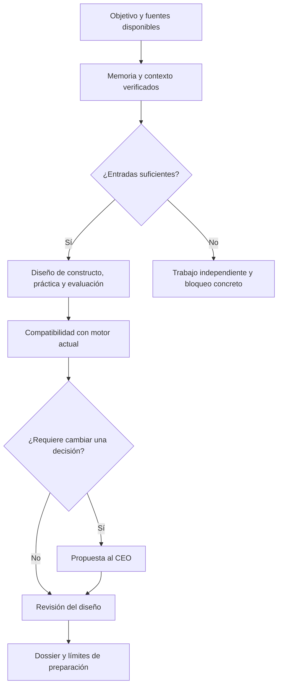

# Arquitectura conceptual de /exer

Versión del diseño: 1.0 · Fecha: 2026-09-15 · Producto: Molvex.

Este documento fija el diseño del sistema de instrucciones antes de redactar sus módulos. Es una especificación propuesta para el encargo actual; no acredita aprobación del CEO sobre cambios futuros, instalación, implementación, eficacia ni acceso al proyecto vivo.

## 1. Resultado que debe producir

`/exer` transforma contexto verificable de Molvex y un objetivo cognitivo en diseños profesionales de ejercicios, comparados, trazables, revisados y suficientemente determinados para una fase posterior de implementación. Puede diseñar un ejercicio, una familia, la cobertura de un bloque o una ampliación delimitada del catálogo. No desarrolla la app, no programa ejercicios, no conecta métricas ni modifica el motor.

Su objetivo es maximizar la mejora cognitiva útil y defendible en la población objetivo, con personalización individual prudente. El rendimiento dentro del ejercicio es una observación intermedia. La transferencia y la durabilidad se investigan por separado. Ninguna instrucción permite garantizar eficacia, superioridad absoluta o un óptimo biológico universal.

## 2. Alternativas consideradas

| Alternativa | Ventaja | Problema para este encargo | Disposición |
|---|---|---|---|
| Un único prompt gigante | Se puede pegar de una vez | Mezcla historia, políticas, fuentes y decisiones; dificulta actualizar el motor sin contradicciones | No elegido como estructura principal |
| Una organización con miles de agentes fijos | Apariencia de cobertura exhaustiva | Coste, duplicación, errores correlacionados y coordinación sin beneficio demostrado | No elegido |
| Instrucciones modulares, especialistas por necesidad y contratos comunes | Cobertura profunda, memoria trazable, actualizaciones parciales y revisión independiente | Exige entradas claras y comprobación del entorno | Elegido para el paquete |

La ambición de escala se convierte en una obligación de cubrir especialidades y buscar fallos. No se convierte en una cifra ficticia de trabajadores, agentes simultáneos o capacidad equivalente.

## 3. Componentes y contratos

| Componente | Entrada | Salida | Autoridad |
|---|---|---|---|
| Lanzador e instalador futuro | ZIP e instrucciones del CEO | Sistema de instrucciones disponible y activación comprobada | Solo configuración del comando autorizada |
| Resolver de contexto | Fuentes, decisiones, grafo, snapshot y auditoría | Contexto vigente con procedencia y conflictos | No crea hechos ni aprobaciones |
| Coordinador | Objetivo y contexto | Alcance, tareas, integración y veredicto | Responsable del resultado; no suplanta al CEO |
| Diseño científico | Constructos y evidencia | Mecanismo, alternativas, cobertura y falsación | Hipótesis de diseño, salvo evidencia aplicable |
| Diseño de práctica | Mecanismo y restricciones | Procedimiento, contenido, feedback, progresión y dosis | No declara mejora demostrada |
| Medición y validación | Observables y usos deseados | Métricas, pruebas independientes y plan empírico | No concede oficialidad por diseño |
| Adaptador de motor | Estado actual verificado y auditoría | Compatibilidad y diferencias propuestas | El motor actual y vNext permanecen separados |
| Revisores | Diseño congelado y fuentes | Hallazgos reproducibles y disposición | Un bloqueo sustentado no se anula por mayoría |
| Memoria | Hechos nuevos y decisiones autorizadas | Actualización trazable e informe de cambios | No promueve recomendaciones a canon |

## 4. Flujo con dos decisiones independientes

La ruta desde propuesta al CEO hacia revisión permite revisar una alternativa pendiente; no la convierte en decisión aprobada. Un diseño que depende de ella se entrega condicionado. La falta de evidencia oficial puede bloquear medición sin impedir diseñar entrenamiento.

## 5. Separaciones estructurales

1. **Producto:** modalidad profesional y modalidad sencilla, ambas entrenamiento serio.
2. **Finalidad de una ejecución:** tutorial, entrenamiento, probe o evaluación.
3. **Plan comercial:** Free o Elite; no se presupone correspondencia con la modalidad.
4. **Madurez del ejercicio:** diseñado, implementado, revisado técnicamente, investigado con humanos.
5. **Elegibilidad de la sesión:** entrenamiento, provisional, oficial, inválida, con requisitos de ranking aparte.
6. **Evidencia:** lo decidido, lo observado en archivos, lo probado, lo inferido y lo investigado empíricamente.
7. **Motor:** actual observado, decisión aprobada con implementación comprobada o desconocida y alternativa vNext pendiente. «No verificado» no significa «no implementado».

Se pueden combinar estos ejes, pero ninguno sustituye al otro. «Profesional» no significa perfil oficial; «sencillo» no significa Free; «diseñado» no significa validado.

## 6. Memoria de proyecto

Se aprovecha Obsidian para consultar notas y relaciones curadas; Graphify para las consultas y relaciones que realmente ofrezca la instalación identificada. No se presupone un proveedor, repositorio, comando, schema o propiedad de Graphify por su nombre.

El grafo aporta navegación y relaciones. Toda decisión importante debe poder regresar a una fuente. El canon histórico documentado es `docs/context_pack`; primero hay que comprobar si existe una decisión posterior autorizada. Los snapshots históricos se conservan.

La orden de actualizar memoria ya autoriza reconciliar hechos desactualizados con evidencia y decisiones vigentes. Cualquier cambio de significado, política, arquitectura, umbral o preferencia —incluso pequeño— requiere presentar una propuesta al CEO antes de adoptarlo. Se actualiza una vista derivada sin reescribir la historia.

## 7. Flexibilidad del motor

Cada requisito de un ejercicio se vincula a una capacidad del motor con versión y evidencia. Se permiten cinco resultados: compatible demostrado; compatible condicionado; requiere mejora propuesta; desconocido; incompatible. Una limitación actual no decide qué ejercicio es científicamente mejor. Una mejora científicamente deseable tampoco se presenta como capacidad implementada.

La llegada posterior de la auditoría desencadena análisis de impacto por dependencia. Se reabren solo los dossiers afectados por cambios en constructos, métricas, adaptación, versiones o elegibilidad. No se rediseña todo el catálogo por defecto.

## 8. Trabajo profundo con final definido

El sistema hace una revisión de requisitos/contexto, otra de mecanismo y práctica, y una revisión crítica integrada. Corrige los defectos relevantes del alcance. Usa presupuestos operativos explícitos para alternativas, revisiones y lote; no convierte un presupuesto agotado en aprobación.

Si persiste un bloqueo, produce el mejor resultado condicionado posible, con evidencia faltante, pregunta exacta y trabajo independiente terminado. La investigación futura se registra con una pregunta falsable y criterio de reentrada. No hay un objetivo de generar más documentos, más agentes o más revisiones por sí mismos.

## 9. Criterio de suficiencia del paquete

El paquete debe permitir que otro agente:

- Recupere las decisiones pertinentes de los once adjuntos sin ejecutar órdenes históricas fuera del encargo.
- Compruebe memoria y motor sin afirmar acceso inexistente.
- Diseñe práctica de alta calidad con hipótesis de aprendizaje, transferencia y límites claros.
- Determine qué falta para implementar, medir y demostrar eficacia por separado.
- Proponga cualquier cambio al CEO sin aplicarlo silenciosamente.
- Revise resultados con especialidades reales y exponga la falta de independencia cuando proceda.
- Instale después la entrada correcta de Codex sin prometer que un archivo Markdown crea por sí solo un slash command nativo.

## 10. Revisión conceptual previa a redacción

Se han contrastado de forma independiente los requisitos científicos y los de producto/gobernanza con los adjuntos. Decisiones incorporadas antes de redactar el resto:

- Conservar los ocho motores de producto sin equipararlos a las once dimensiones internas mencionadas en el Decision Log.
- No tratar el prompt de auditoría adjunto como una auditoría ejecutada.
- Conservar las respuestas 1B/2B/3A/4A de la conversación como decisiones históricas explícitas aplicables, salvo instrucciones posteriores.
- Aplicar la petición actual de consulta incluso para cambios pequeños del canon.
- Mantener por separado finalización documental, disponibilidad real del comando y validación de los ejercicios futuros.

La revisión final del paquete, las pruebas de uso y sus límites se documentan en [revision/01_INFORME_DE_REVISION.md](revision/01_INFORME_DE_REVISION.md).
