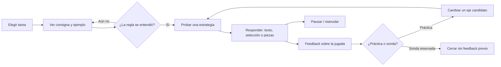

# Molvex · Creatividad
## 30 modelos de práctica con filtro de calidad

| Versión | Fecha | Estado | Destino / uso |
|---|---|---|---|
| 1.0 | 2026-10-04 | Propuesta conceptual completa · `DESIGN_ONLY / CONDITIONAL` | App móvil iOS + Android · práctica local |

> Este catálogo reúne treinta modelos descritos como contratos de tarea, no treinta funciones disponibles ni treinta capacidades separadas. El filtro editorial acredita que cada propuesta tiene una jugada, ejemplo, lectura posible, eje de demanda, atajo, acceso y falsador. No acredita eficacia, calibración, equivalencia de plataformas ni cambio en tareas cotidianas. Ninguna propuesta autoriza por sí misma código, banco, puntuación oficial o publicación.

## Brief y puerta de admisión

La petición de «entrenar al máximo» se concreta en más oportunidades de probar operaciones creativas distintas con instrucciones comprensibles, variación controlada y feedback que describa la tarea. No significa añadir prisa, texto o complejidad visual porque sí, ni promete un cambio fuera de las tareas practicadas.

Un modelo solo entra en esta cartera si tiene:

1. Una operación observable que no sea un cambio de tema o de ilustración de otra ficha.
2. Una secuencia jugable completa y una respuesta de ejemplo que permita debatir la regla.
3. Un dato que se pueda registrar con denominador claro, separando lo observable de la calidad semántica no observada.
4. Un único eje candidato para graduar la tarea, sin números inventados ni presión temporal por defecto.
5. Un atajo realista, un confusor móvil/accesible y un resultado que haría retirar o rediseñar la ficha.
6. Un estado y linaje explícitos, sin convertir documentación en disponibilidad de producto.

La evidencia aconseja cautela, no inmovilismo: un metaanálisis amplio de 169 estudios encontró una media sin ajustar de 0,53 desviaciones estándar y estimaciones ajustadas por sesgo de publicación de 0,29–0,32; también señaló limitaciones metodológicas y uso frecuente de una sola medida. Por ello este catálogo separa rendimiento en la tarea entrenada, material nuevo y resultados cotidianos, y no atribuye al producto efectos que no se han medido. [Sio y Lortie-Forgues, 2024](https://pubmed.ncbi.nlm.nih.gov/38635185/)

En muestras organizacionales, otra síntesis encontró efectos en resultados de aprendizaje, pero resultados conductuales no significativos en el conjunto analizado; solo ocho estudios medían resultados conductuales. Esto refuerza el uso de pruebas independientes y diferidas antes de ampliar lo que se comunica. [McKay et al., 2024](https://doi.org/10.1111/caim.12605)

### Qué significan las treinta propuestas

| Clase editorial | Modelos | Lectura correcta |
|---|---:|---|
| Tipo actual cercano | M01–M02 | Hay dos identidades alcanzables en el catálogo local; la instrucción declarada no demuestra que el sistema fuerce la operación descrita. |
| Variante / rediseño | M03–M13 | Extiende una forma de generación o cambio de marco; solo merece identidad propia si produce una demanda diferenciable en pruebas piloto. |
| Respuesta o banco nuevos | M14–M28 | Requiere estructura, regla, contenido, pantalla o validador adicionales; hoy no se puede ejecutar desde el contrato observado. |
| Overlay | M29 | Añade elección/reflexión a una sesión; no es otro juego ni una medida independiente. |
| Sonda reservada | M30 | Protocolo de evaluación futura con estímulos apartados; no se mezcla con entrenamiento ni adaptación. |

El número treinta es editorial. No fija el tamaño del catálogo inicial: la recomendación es pilotar pocas familias complementarias y fusionar las que no produzcan predicciones distintas.

## Mapa gráfico de cobertura

```mermaid
flowchart TB
  C["CREATIVIDAD · generar, cambiar marco, combinar y revisar"]
  C --> G["01–05 · Generar variaciones"]
  C --> F["06–11 · Reformular el problema"]
  C --> R["12–18 · Recomponer recursos"]
  C --> E["19–23 · Elaborar y evaluar"]
  C --> A["24–28 · Asociar y representar"]
  C --> P["29–30 · Reflexión y sonda reservada"]
  G --> M01["01 Usos alternativos"]
  G --> M02["02 Giro de categoría"]
  G --> M03["03 Ejemplos por función"]
  G --> M04["04 Consecuencias ramificadas"]
  G --> M05["05 Un estímulo, varias necesidades"]
  F --> M06["06 Reescribir el objetivo"]
  F --> M07["07 Cambiar de punto de vista"]
  F --> M08["08 Cambiar de escala"]
  F --> M09["09 Invertir un supuesto"]
  F --> M10["10 Alterar una restricción"]
  F --> M11["11 Formular problemas distintos"]
  R --> M12["12 Fusionar dos objetos"]
  R --> M13["13 Combinar dos funciones"]
  R --> M14["14 Usar tres elementos dados"]
  R --> M15["15 Diseñar con recursos limitados"]
  R --> M16["16 Sustituir un recurso ausente"]
  R --> M17["17 Mantener función, cambiar forma"]
  R --> M18["18 Diseñar una secuencia sin conexión"]
  E --> M19["19 Elaborar en tres pasadas"]
  E --> M20["20 Revisar con nueva condición"]
  E --> M21["21 Elegir según criterio explícito"]
  E --> M22["22 Priorizar dos criterios"]
  E --> M23["23 Buscar un punto de fallo"]
  A --> M24["24 Mapear una analogía"]
  A --> M25["25 Resolver una asociación convergente"]
  A --> M26["26 Completar una figura"]
  A --> M27["27 Recomponer con piezas visuales"]
  A --> M28["28 Cerrar una historia con elementos dados"]
  P --> M29["29 Elegir estrategia · overlay"]
  P --> M30["30 Material nuevo · sonda reservada"]
```



Los grupos ordenan decisiones de diseño; no son factores ni garantizan independencia entre modelos. Riesgos principales de solapamiento: M01/M03/M04/M05 generan texto abierto; M06/M09/M10/M11 reformulan una consigna; M12–M18 comparten diseño bajo restricciones; M19/M20/M21/M22/M23 mezclan elaboración, elección y evaluación; M24/M25/M26/M27/M28 cambian dominio de respuesta. La comparación piloto debe decidir qué pares se fusionan.

## Estado observado y linaje

La inspección del árbol de trabajo del 2026-10-04 encontró dos identidades alcanzables: `EX01_SUPPRESS_FIRST_IDEA` y `EX02_CATEGORY_ROTATION`. El banco de prompts visible contiene ocho objetos para EX01 y seis temas para EX02; la selección usa seed local. La pantalla recoge ideas en texto. La rúbrica local cuenta cadenas distintas tras recortar espacios y descartar respuestas de menos de dos caracteres para la señal de cantidad; también calcula palabras medias por idea. El validador comprueba tiempo no negativo, respuesta no vacía y mínimo de ideas distintas. No clasifica el significado de cada respuesta.

Consecuencia importante: EX01 comunica «omite la primera idea obvia», pero la ruta observada no identifica ni bloquea esa primera idea. EX02 comunica rotar de ángulo, pero no obliga a elegir ni verifica categorías. La rúbrica común no evalúa novedad semántica, diversidad de categorías, cumplimiento de restricciones ni plausibilidad. Estas son instrucciones/intenciones del ejercicio, no resultados medidos. La sesión persiste las respuestas de texto en el almacén local; no se vio sincronización remota en la política observada. La durabilidad y paridad real de almacenamiento en iOS no se verificaron.

El runtime observado mantiene las rutas de IA generativa, red y telemetría remota desactivadas; los prompts son locales y estáticos. La interfaz actual de texto puede inspirar propuestas de respuesta abierta, pero no permite inferir soporte para etiquetas por idea, selección estructurada, collage, dibujo o analogía con validador. No se ejecutaron builds ni tests. El árbol ya estaba sucio, y el informe de Graphify consultado se generó desde otro commit; no se refrescó. Estas observaciones anclan el documento al working tree visto, no a un baseline limpio.

### Estados de ficha

| Estado | Significado |
|---|---|
| `LIVE_TYPE` | Identidad cercana existe en el catálogo local. No prueba que la instrucción quede implementada o puntuada como se describe. |
| `VARIANT / REDESIGN` | Familia próxima ya descrita; identidad separada pendiente de evidencia diferencial. |
| `REQUIRES_NEW_RESPONSE` | Pide reglas, respuesta estructurada, selección, construcción visual o etapas que no se desprenden del contrato actual. |
| `OVERLAY / PROTOCOL` | Acompaña a otra tarea y no suma una identidad de juego. |
| `PROBE_ONLY` | Material apartado, sin feedback ni adaptación durante su uso de evaluación. |

El documento histórico `docs/mindboost_exercise_design/03_8_Creatividad.md` propuso ocho líneas: supresión del primer impulso, rotación de categorías, síntesis con restricciones, analogías, elaboración, restricciones negativas, reencuadre e improvisación temporal. Se reutiliza como linaje, no como aprobación. Se conserva la generación abierta, el reencuadre, recombinación y elaboración; se retira la presión temporal del núcleo por mezclar tecleo con producción de ideas. Los filtros lingüísticos de rareza/sinonimia y las puntuaciones compuestas allí descritos no se adoptan: no son fiables solo por estar escritos y pueden favorecer respuestas raras o el dominio del vocabulario.

## Contrato común de experiencia

### Flujo móvil



```text
┌────────────────────────────┐
│ Creatividad       02 / 06  │
│                            │
│ ¿Qué cambia en esta ronda? │  <- una regla visible
│ [pista / elemento A]       │
│ [pista / elemento B]       │
│                            │
│ Tu propuesta               │
│ ┌────────────────────────┐ │
│ │                        │ │  <- texto ampliable o piezas
│ └────────────────────────┘ │
│ [Añadir]        [Pausar]    │
│ Propuestas guardadas: 3     │
│ [Ver criterio] [Continuar]  │
└────────────────────────────┘
```

La ilustración es un wireframe del contrato futuro, no una captura ni una pantalla existente. Evitar temporizador visible por defecto, feedback que sugiera rareza, rachas o comparaciones sociales. El ejemplo enseña la regla de la tarea, no una respuesta para copiar. En sondas, ocultar feedback y explicación hasta el cierre.

### Respuesta, medida y dificultad

- En respuesta abierta local, puede describirse cantidad exacta de cadenas distintas, cantidad de palabras y autoselección de etiquetas. No se deduce que dos frases tengan significados distintos, que cumplan una condición o que una idea sea mejor que otra.
- En tareas cerradas, usar solo reglas con respuesta verificable por clave o relaciones formales: aciertos / ítems válidos, y errores por clase / oportunidades de esa clase. El acierto de un ítem no es una medida global.
- En construcción visual, la completitud solo se calcula si el contrato fija qué cuenta como elemento o requisito cumplido. No puntuar belleza, novedad o calidad por una heurística de formas.
- Sin puntuación compuesta única para el bloque. Valores no disponibles se conservan como ausentes; omisión, interrupción, respuesta inválida y error de tarea son estados distintos.
- Cada modelo propone un solo eje: por ejemplo, número de marcos, cantidad de elementos o número de pasadas. No elevar dos ejes a la vez. Sin datos de pilotaje, los niveles numéricos y el algoritmo de adaptación quedan pendientes.
- La familiaridad con teclado, velocidad de lectura, vocabulario, visión, motricidad y comprensión de la consigna pueden imitar cambios en el resultado. No usar tiempo como eje por defecto.

### iOS, Android y acceso

- Mantener la regla, identificadores de contenido, orden y resultado determinista iguales en iOS y Android. Esta paridad no se ha verificado en dispositivo.
- Texto corto, ampliable, editable con teclado del sistema, etiquetas accesibles para VoiceOver/TalkBack, foco visible y controles táctiles suficientemente grandes. No depender solo de color, sonido, gesto fino o animación.
- Los modelos visuales ofrecen una alternativa de elección accesible. Si esa alternativa cambia la operación, se registra como forma distinta y no se declara equivalente sin comparación.
- Interrupción/llamada/background: permitir pausa y reanudación desde el mismo estado; si no se puede conservar, cerrar como incompleta sin señal adversa.
- Sin permisos sensibles, conexión, voz ni generación en vivo. No enviar ideas ni texto libre a telemetría. Reducir el texto libre persistido a lo mínimo aprobado; la implementación actual conserva la lista de ideas en el registro local, por lo que el periodo de conservación y su necesidad deben quedar explícitos antes de ampliar el banco.

## Los 30 modelos

### Zona 1 · Generar variaciones

#### M01 · Usos alternativos
**Estado/linaje:** `LIVE_TYPE` · EX01. **Operación:** salir del uso convencional de un objeto cotidiano.

**Jugada:** aparece «clip». Se invita a proponer usos diferentes; ejemplos de tutorial: señalador de página, gancho para una etiqueta ligera, sujetar temporalmente dos papeles. Se acepta una idea por entrada; la persona puede corregir antes de cerrar.

**Lectura / eje:** en la versión local, cadenas distintas y palabras por idea; denominador: respuestas no vacías de una ronda. Eso no determina si el uso funciona o es semánticamente distinto. Eje futuro: familiaridad del objeto, solo tras pilotaje; no aumentar cantidad objetivo y presión a la vez.

**Atajo / acceso / falsador:** repetir sinónimos o variantes de puntuación; mostrar duplicados literales, no fingir detectar sinónimos. Teclado accesible y opción de dictado solo si se valida aparte. Retirar la ficha si personas interpretan que el contador certifica calidad o si el resultado depende sobre todo de rapidez de tecleo.

#### M02 · Giro de categoría
**Estado/linaje:** `LIVE_TYPE` · EX02. **Operación:** cambiar de marco para generar respuestas, no quedarse en una sola clase de ejemplo.

**Jugada:** tema «cosas que ayudan a orientarse»; la pantalla rota rótulos visibles: «objeto», «señal», «acción». Ejemplo: mapa plegable / sonido acordado / preguntar a una persona. La secuencia de rótulos sería contenido nuevo: hoy el tema no hace cumplir una rotación.

**Lectura / eje:** contar rótulos distintos elegidos por la persona y respuestas asociadas; denominador: oportunidades con rótulo explícito. Autotag no demuestra pertenencia semántica. Eje: número de cambios de marco, no duración.

**Atajo / acceso / falsador:** repetir una idea bajo rótulos diferentes. Mantener el rótulo visible y permitir elegirlo con teclado/lector. Retirar o fusionar si el etiquetado subjetivo no concuerda entre usuarios o no cambia la estrategia observada.

#### M03 · Ejemplos desde una función
**Estado/linaje:** `VARIANT / REDESIGN` de M01. **Operación:** encontrar objetos o acciones distintos que comparten un resultado funcional.

**Jugada:** «¿Qué puede mantener una puerta abierta sin sujetarla con la mano?» Ejemplos: cuña, tope, cinta. La consigna permite respuestas de categorías distintas, no una lista de sinónimos de «tope».

**Lectura / eje:** cadenas distintas por consigna; autoselección de tipo de respuesta, siempre descriptiva. Eje: amplitud de la función pedida, graduada por banco revisado.

**Atajo / acceso / falsador:** usar varias palabras para un mismo dispositivo. Un conjunto cerrado validado podría ofrecer modo de elección. Retirar si el banco favorece objetos regionales o conocimiento del hogar.

#### M04 · Consecuencias ramificadas
**Estado/linaje:** `VARIANT / REDESIGN`; pariente de la familia «consecuencias» en tareas abiertas. **Operación:** desplegar consecuencias distintas de un cambio hipotético.

**Jugada:** «El mercado del barrio solo abre por la tarde durante una semana. ¿Qué cosas tendrían que cambiar?» Ejemplos de ramas: organización de entregas, horarios de quienes trabajan, forma de avisar. No hay una única lista correcta.

**Lectura / eje:** cantidad de ramas autodeclaradas y pasos de consecuencia escritos; denominador: oportunidades respondidas. No inferir profundidad a partir de palabras medias. Eje: pasos de consecuencia solicitados.

**Atajo / acceso / falsador:** enumerar reformulaciones de un solo efecto. Ofrecer un organizador opcional «personas / objetos / horarios» que no cuente como respuesta. Retirar si comprensión del escenario domina al mecanismo buscado.

#### M05 · Un estímulo, varias necesidades
**Estado/linaje:** `VARIANT / REDESIGN` de M01/M07. **Operación:** conservar el estímulo y cambiar el resultado que necesita una persona ficticia.

**Jugada:** aparece una caja plegable y una tarjeta de necesidad: «guardar algo sin que se moje»; luego, en otro ensayo, «transportar piezas pequeñas sin que se mezclen». Una respuesta posible para la primera: cubierta temporal bajo un banco; para la segunda: separadores interiores.

**Lectura / eje:** rondas completadas por necesidad y propuestas distintas por estímulo. Eje: distancia entre necesidades predefinidas, validada por revisión de contenido; no rotar objeto y necesidad a la vez.

**Atajo / acceso / falsador:** conservar la misma solución y cambiar la frase. Etiquetas de necesidad explícitas y lectura en voz del sistema si se solicita. Retirar si las necesidades contienen conocimiento cultural tácito.

### Zona 2 · Reformular el problema

#### M06 · Reescribir el objetivo
**Estado/linaje:** `VARIANT / REDESIGN` del reencuadre histórico. **Operación:** convertir un objetivo de solución en preguntas de diseño alternativas.

**Jugada:** punto de partida: «¿Cómo hacemos que la fila avance más rápido?». Reformulaciones ejemplo: «¿Cómo reducimos cuántas personas necesitan hacer la fila?» y «¿Cómo hacemos útil el tiempo de espera?». La persona genera una nueva pregunta, no una solución final.

**Lectura / eje:** cantidad de formulaciones no idénticas y selección del marco usado; no puntuar pertinencia semántica automáticamente. Eje: número de elementos del brief inicial.

**Atajo / acceso / falsador:** reescribir la misma pregunta con palabras distintas. Dar un ejemplo de cambio de objetivo y permitir respuesta breve. Retirar si evaluadores independientes no distinguen la intención entre formulaciones.

#### M07 · Cambiar de punto de vista
**Estado/linaje:** `VARIANT / REDESIGN` de M05/M06. **Operación:** describir una necesidad desde un rol ficticio con condiciones dadas.

**Jugada:** una mesa compartida debe conservar materiales en orden. Rótulos explícitos: «persona con una mano ocupada», «persona que entra al final» y «persona que necesita guardar rápido». Ejemplo: bandejas de devolución visibles para la segunda situación.

**Lectura / eje:** respuesta por rol y roles distintos probados; denominador: roles mostrados. No afirma comprensión empática ni valora la respuesta por el rol sin una rúbrica humana aparte. Eje: cantidad de roles.

**Atajo / acceso / falsador:** aplicar una solución genérica a todos. Leer los roles textualmente y no codificar supuestas necesidades personales. Retirar si el éxito depende de estereotipos o de información no incluida en la tarjeta.

#### M08 · Cambiar de escala
**Estado/linaje:** `VARIANT / REDESIGN` de M06. **Operación:** replantear un brief desde persona, grupo o sistema.

**Jugada:** «Los lápices se pierden en una sala de estudio». Ronda individual: una persona necesita guardar el suyo; grupo: varias personas comparten el material; sistema: cómo se reponen y devuelven. Se generan tres briefs, no se exige calcular cantidades.

**Lectura / eje:** escalas con brief propio / escalas presentadas. Eje: escala objetivo (las tres tarjetas son condiciones, no niveles simultáneos). Evitar sumar cantidad de ideas como calidad.

**Atajo / acceso / falsador:** sustituir «yo» por «todos» sin cambiar el problema. Plantilla breve por escala; alternativa lineal sin drag. Retirar si solo añade lectura o planificación extensa.

#### M09 · Invertir un supuesto
**Estado/linaje:** `VARIANT / REDESIGN` de reencuadre. **Operación:** hacer explícito un supuesto del brief y probar qué pasa si no se cumple.

**Jugada:** supuesto recibido: «Para avisar, hay que emitir un sonido». Pregunta: «¿Y si el aviso no puede hacer ruido?». Ejemplos: señal visual pactada o vibración en un dispositivo ya disponible; no se presentan como recomendaciones universales.

**Lectura / eje:** supuestos elegidos y alternativas anotadas / ensayos. Eje: cantidad de supuestos visibles. Etiquetar la respuesta como exploración, no como detección de una verdad oculta.

**Atajo / acceso / falsador:** negar la frase sin proponer escenario alternativo. Dar un ejemplo no puntuado y permitir texto o tarjetas. Retirar si el supuesto parece una regla técnica o social que la persona debe conocer.

#### M10 · Alterar una restricción
**Estado/linaje:** `VARIANT / REDESIGN` de tareas bajo restricciones. **Operación:** cambiar una condición del brief y generar una alternativa bajo la nueva regla.

**Jugada:** «Diseñar una etiqueta reutilizable»; ronda inicial sin material impuesto, siguiente ronda sin adhesivo. Respuesta posible: una cinta con cierre mecánico. Solo cambia una condición entre rondas.

**Lectura / eje:** condición incorporada por respuesta, marcada por la persona; denominador: rondas con una restricción clara. La interfaz no valida el cumplimiento textual. Eje: una condición añadida.

**Atajo / acceso / falsador:** ignorar la condición y repetir la primera respuesta. Mantenerla a la vista y ofrecer check «la tuve en cuenta» separado del texto. Retirar si el check se confunde con prueba de cumplimiento.

#### M11 · Formular problemas distintos
**Estado/linaje:** `VARIANT / REDESIGN` de M06. **Operación:** separar observación inicial de distintas necesidades posibles.

**Jugada:** observación: «En la entrada se acumulan paraguas mojados». Formular dos preguntas de diseño con foco diferente: espacio, identificación o secado. Son ejemplos de marcos; no se declara que alguno sea el problema real.

**Lectura / eje:** preguntas distintas por escena, anotadas por la persona o por revisión humana del piloto. Eje: número de elementos de escena proporcionados.

**Atajo / acceso / falsador:** cambiar solo el verbo. Incluir pistas de «quién / cuándo / qué resultado»; una a una para lectores de pantalla. Retirar si la pregunta presupone una solución única.

### Zona 3 · Recomponer recursos

#### M12 · Fusionar dos objetos
**Estado/linaje:** `REQUIRES_NEW_RESPONSE` · forma de recombinación inspirada en la propuesta histórica de síntesis. **Operación:** combinar dos objetos o funciones para responder a un brief.

**Jugada:** tarjetas «caja pequeña» + «pinza»; brief «mantener visibles y juntos dos papeles». Idea de ejemplo: una pinza fijada al borde de la caja sostiene las hojas por separado. El tutorial admite soluciones diferentes.

**Lectura / eje:** elementos del par usados según selección explícita, no por clasificación de texto libre; denominador: pares presentados. Eje: distancia funcional entre objetos, que necesita revisión del banco.

**Atajo / acceso / falsador:** mencionar los objetos sin combinarlos. Permitir marcar cada pieza usada en una lista, teclado alternativo. Retirar si los pares no admiten solución o dependen de destreza manual.

#### M13 · Combinar dos funciones
**Estado/linaje:** `VARIANT / REDESIGN` de M12. **Operación:** integrar dos resultados funcionales, no necesariamente dos objetos.

**Jugada:** funciones dadas «guardar» y «señalar». Crear una solución que haga ambas cosas para una mesa de materiales compartidos. Ejemplo: un separador con zona visible para indicar si un hueco está ocupado.

**Lectura / eje:** funciones marcadas como presentes por el usuario / funciones del brief. Eje: número de funciones a integrar, una variación cada vez; no puntuar elegancia.

**Atajo / acceso / falsador:** describir dos soluciones separadas. Mostrar ambas metas durante toda la respuesta. Retirar si la gente interpreta que basta enumerarlas en una frase.

#### M14 · Usar tres elementos dados
**Estado/linaje:** `REQUIRES_NEW_RESPONSE`. **Operación:** integrar todos los elementos de un conjunto cerrado en una propuesta.

**Jugada:** piezas «papel», «cuerda» y «pinza», brief «hacer visible una nota junto a una mesa». Ejemplo: colgar la nota de la cuerda y fijar la cuerda con la pinza. El ejemplo se usa para enseñar la regla, no como respuesta exclusiva.

**Lectura / eje:** casillas de elementos usados / 3; denominador: respuestas enviadas. Casillas no verifican el sentido semántico de la propuesta. Eje: número de elementos obligatorios.

**Atajo / acceso / falsador:** marcar todo sin incorporarlo al diseño. Pedir una ubicación o relación entre piezas, con opción por pasos. Retirar si la validación de uso requiere interpretación ambigua.

#### M15 · Diseñar con recursos limitados
**Estado/linaje:** `REQUIRES_NEW_RESPONSE`; variante de problema con límites de recursos. **Operación:** producir una solución usando únicamente un inventario mostrado.

**Jugada:** objetivo: ordenar tarjetas para una actividad; recursos disponibles: papel, lápiz y una caja vacía. Una solución de ejemplo usa la caja como bandeja y el papel como etiquetas. No se requiere comprar nada ni conocer marcas.

**Lectura / eje:** recursos seleccionados / recursos disponibles, y revisión de la persona sobre cuáles usó. Eje: tamaño del inventario válido. No puntuar «coste» sin precios y condiciones explícitos.

**Atajo / acceso / falsador:** introducir recursos no mostrados. Botón «otro» solo si se registra separado; inventario en texto y símbolos. Retirar si la respuesta depende de experiencia económica o doméstica.

#### M16 · Sustituir un recurso ausente
**Estado/linaje:** `VARIANT / REDESIGN` de M15/M17. **Operación:** preservar una función declarada reemplazando una pieza que no está disponible.

**Jugada:** «No hay soporte para el cartel; debe quedar visible en una mesa». Alternativas posibles: apoyar el cartel en una caja estable o sujetarlo con una pinza a un borde. El brief explicita qué significa «visible».

**Lectura / eje:** funciones del brief que el usuario marca como conservadas / funciones incluidas. Eje: cantidad de recursos ausentes, empezando por uno.

**Atajo / acceso / falsador:** añadir el recurso que falta o cambiar la función objetivo. Dejar los requisitos anclados a la vista. Retirar si el requisito es físicamente imposible o ambiguo.

#### M17 · Mantener función y cambiar forma
**Estado/linaje:** `REQUIRES_NEW_RESPONSE`; familia de diseño inverso. **Operación:** conservar el resultado útil y alterar la forma de la solución.

**Jugada:** función: «marcar temporalmente una página sin dañarla». Forma inicial: una tira de papel. Variante: una pieza reutilizable que encaja en el borde; se invita a crear otra forma. No se requiere dibujarla en primera versión.

**Lectura / eje:** solución alternativa por función y forma indicada; denominador: brief completados. La respuesta se revisa en piloto, no con un comparador léxico. Eje: cantidad de propiedades de la forma que se deben conservar.

**Atajo / acceso / falsador:** cambiar el material pero no el modo de uso. Preguntar «¿qué parte hace el trabajo?»; respuesta de texto o selección. Retirar si la función inicial no queda comprendida.

#### M18 · Diseñar una secuencia sin conexión
**Estado/linaje:** `REQUIRES_NEW_RESPONSE`; variante de diseño con recursos. **Operación:** ordenar pasos para conseguir una meta sin una herramienta concreta.

**Jugada:** meta: avisar a un grupo que la sala cambia de ubicación sin usar internet. El usuario ordena tres tarjetas posibles: mensaje en tablón, persona enlace, nota en puerta; puede proponer un paso extra. Ninguna opción sirve en todos los contextos.

**Lectura / eje:** pasos ordenados que respetan las dependencias dadas / pasos válidos; denominador: secuencias terminadas. Eje: cantidad de pasos, no tiempo.

**Atajo / acceso / falsador:** poner cualquier orden o asumir que todos ven el tablón. Presentar una restricción de acceso explícita y versión lineal accesible. Retirar si la tarea refleja lectura de interfaz más que construcción de proceso.

### Zona 4 · Elaborar y evaluar

#### M19 · Elaborar en tres pasadas
**Estado/linaje:** `REQUIRES_NEW_RESPONSE`; línea histórica de elaboración incremental. **Operación:** expandir una propuesta añadiendo contexto y luego una relación de uso.

**Jugada:** pasada 1: «señalador». Pasada 2: «un señalador para una carpeta compartida». Pasada 3: «se fija al borde y cambia de lado cuando se devuelve la carpeta». Las tres entradas son etapas, no tres respuestas independientes.

**Lectura / eje:** etapas terminadas / 3 y palabras por etapa, con descripción; la cantidad de palabras no es profundidad por sí sola. Eje: número de pasadas solicitadas.

**Atajo / acceso / falsador:** alargar la frase sin añadir información nueva. Mostrar preguntas guía distintas en cada pasada. Retirar si lectores y usuarios no distinguen contexto de detalle decorativo.

#### M20 · Revisar con una nueva condición
**Estado/linaje:** `REQUIRES_NEW_RESPONSE`; variante incremental de M19. **Operación:** revisar una solución ya escrita tras recibir una condición concreta.

**Jugada:** idea inicial: «dejar las tarjetas en una caja». Nueva condición: «cada persona debe poder devolver una tarjeta sin ayuda». El usuario edita su propuesta; puede añadir separadores o una abertura frontal.

**Lectura / eje:** versiones guardadas y condición que la persona marcó que intentó incorporar. No se juzga automáticamente si la modificación resuelve el problema. Eje: una condición nueva por revisión.

**Atajo / acceso / falsador:** volver a escribir la idea anterior sin cambio. Conservar versión inicial editable y enseñar la condición junto a ella. Retirar si el cambio solicitado no tiene una solución razonable.

#### M21 · Elegir según criterio explícito
**Estado/linaje:** `REQUIRES_NEW_RESPONSE`; tarea de selección dentro del proceso creativo, no de generación abierta. **Operación:** escoger entre alternativas con atributos visibles y una meta clara.

**Jugada:** tres propuestas para mover notas: bandeja, carpeta, pinza. La tabla indica «se puede reutilizar», «cabe en un bolsillo», «se sujeta a la mesa». El brief prioriza bolsillo. La respuesta correcta es la carpeta únicamente si el banco validado define así sus atributos.

**Lectura / eje:** elecciones que satisfacen el criterio / ítems válidos. Eje: número de criterios explícitos por elección, empezando por uno.

**Atajo / acceso / falsador:** adivinar por la longitud o la posición de opción. Balancear atributos y orden; teclado accesible. Retirar si el criterio no determina una elección única o la clave contradice la tabla.

#### M22 · Priorizar dos criterios en tensión
**Estado/linaje:** `VARIANT / REDESIGN` de M21. **Operación:** hacer visible una preferencia al elegir entre opciones con ventajas distintas.

**Jugada:** opción A es ligera y de un solo uso; opción B es más pesada y reutilizable. Se pide elegir cuál condición importa más en un escenario dado y explicar la decisión en una frase. No existe respuesta universal correcta.

**Lectura / eje:** criterio elegido y justificación opcional / decisiones completas. No convertir preferencia en capacidad ni juzgar la solución sin rúbrica contextual. Eje: cantidad de criterios presentados.

**Atajo / acceso / falsador:** elegir al azar y dar una razón genérica. Pedir que se seleccione primero el criterio; texto breve opcional. Retirar si los escenarios codifican valores personales como hechos.

#### M23 · Buscar un punto de fallo
**Estado/linaje:** `VARIANT / REDESIGN` con solapamiento de Lógica. **Operación:** revisar una propuesta para anticipar en qué condición deja de funcionar.

**Jugada:** propuesta: «poner las llaves de la sala en una caja sin etiqueta». Escenarios explícitos: entra una persona sustituta; la caja se mueve a otra mesa. El usuario selecciona el escenario que rompe la propuesta y propone una revisión.

**Lectura / eje:** casos de fallo señalados / casos sembrados, más revisión opcional. Es una tarea de análisis de diseño y no se agrega a los resultados de generación. Eje: cantidad de condiciones de prueba.

**Atajo / acceso / falsador:** marcar todos los escenarios como fallo. Incluir controles que no rompen la propuesta; selección no cronometrada. Retirar o mover de bloque si su rendimiento se explica mejor por razonamiento lógico general.

### Zona 5 · Asociar y representar

#### M24 · Mapear una analogía
**Estado/linaje:** `REQUIRES_NEW_RESPONSE`; opción de respuesta cerrada. **Operación:** conservar una relación entre pares, no sus palabras superficiales.

**Jugada:** «la etiqueta identifica la carpeta como la llave identifica la cerradura». Se presentan cuatro pares candidatos; la clave debe preservar la relación que el ítem define. Otro ensayo cambia todos los objetos y mantiene la relación.

**Lectura / eje:** emparejamientos correctos / ítems válidos; denominador por estructura. Es convergente y requiere clave inequívoca. Eje: número de relaciones que deben componerse.

**Atajo / acceso / falsador:** emparejar por tema compartido en vez de función relacional. Equilibrar familiaridad léxica, leer las relaciones y probar la clave con revisión humana. Retirar si admite más de una respuesta razonable.

#### M25 · Resolver una asociación convergente
**Estado/linaje:** `REQUIRES_NEW_RESPONSE`; frontera con Lenguaje. **Operación:** inferir un término que conecta varias pistas breves.

**Jugada:** banco en español elaborado y revisado: tres pistas conducen a una respuesta única. Antes de cerrar cada ítem, comprobar que pistas y solución funcionan en español de España y no dependen de una traducción literal. No se fija aquí un ejemplo de banco no validado.

**Lectura / eje:** solución correcta / ítems respondidos; registrar omisión aparte. Eje: distancia asociativa calibrada por panel piloto. No sumar al bloque sin decisión sobre solapamiento con Lenguaje.

**Atajo / acceso / falsador:** descartar por vocabulario regional, género gramatical o pistas muy conocidas. Aceptar únicamente variantes previstas en el banco; prueba de comprensión antes de puntuar. Retirar si el nivel educativo domina las respuestas.

#### M26 · Completar una figura
**Estado/linaje:** `REQUIRES_NEW_RESPONSE`; forma visual abierta. **Operación:** dar una función o interpretación a un trazo parcial.

**Jugada:** se muestra un arco abierto y una línea corta. La persona puede completar o seleccionar entre dibujos posibles y luego elegir una etiqueta de función: «protege», «conecta», «señala» u «otra». Ejemplos de tutorial no se repiten en la ronda.

**Lectura / eje:** respuestas completadas y etiquetas elegidas / ensayos; no puntuar atractivo visual ni cantidad de trazos. Eje: número de segmentos parciales.

**Atajo / acceso / falsador:** hacer un dibujo complejo solo para ocupar área. Alternativa por selección y descripción textual; verificar accesibilidad de contraste, zoom y lector. Retirar si motricidad fina o práctica de dibujo domina el resultado.

#### M27 · Recomponer piezas visuales
**Estado/linaje:** `VARIANT / REDESIGN` de M26, con objetivo funcional. **Operación:** combinar piezas geométricas para representar una solución a una meta.

**Jugada:** piezas: círculo, dos barras, rectángulo; meta: indicar una dirección en un tablero. Una combinación posible usa la barra larga como flecha y el círculo como punto de origen. Se admiten respuestas equivalentes si el modo las representa.

**Lectura / eje:** metas representadas con el inventario disponible / metas mostradas. La clave valida solo las reglas gráficas acordadas, no novedad de diseño. Eje: cantidad de piezas.

**Atajo / acceso / falsador:** arrastrar piezas sin relación con la meta. Modo de teclado con lista y orden; no depender de arrastre. Retirar si la interfaz altera la regla o si la dificultad motora explica errores.

#### M28 · Cerrar una historia con elementos dados
**Estado/linaje:** `REQUIRES_NEW_RESPONSE`; forma narrativa y frontera con Lenguaje. **Operación:** integrar elementos y dar cierre a una escena breve.

**Jugada:** elementos obligatorios: «llave», «pasillo», «nota»; se pide un final en dos frases donde cada elemento tenga una función. Tutorial: la llave abre una puerta, la nota indica a quién entregar una caja. No se evalúa estilo literario.

**Lectura / eje:** elementos que la persona marca como incorporados / 3 y cierre enviado / relatos empezados. No usar cantidad de palabras como calidad narrativa. Eje: número de elementos requeridos.

**Atajo / acceso / falsador:** insertar palabras sin relación con la escena. Ofrecer opción de dictado solo en prueba aparte, botón para ampliar campo y modo de selección. Retirar del núcleo si comprensión lingüística domina la jugada.

### Zona 6 · Piezas transversales

#### M29 · Elegir estrategia y revisar el proceso
**Estado/linaje:** `OVERLAY / PROTOCOL`; acompaña M01, M06, M12 o M19. **Operación:** elegir deliberadamente una vía antes de responder y luego indicar si se mantuvo o cambió.

**Jugada:** antes de M01, seleccionar «buscar otra función», «cambiar de usuario» o «combinar objetos». Al final, indicar cuál se usó y qué llevó a cambiarla. Las opciones describen una intención, no prueban el proceso interno.

**Lectura / eje:** estrategia elegida y autoinforme posterior por sesión; denominador: sesiones con respuesta a ambas preguntas. No es métrica de rendimiento ni un ejercicio por separado. Eje: número de estrategias ofrecidas.

**Atajo / acceso / falsador:** escoger la opción que suena deseable después de terminar. Preguntar antes y después, sin penalización. Retirar si añade carga o cambia notablemente el tiempo de la tarea base.

#### M30 · Sonda con material nuevo
**Estado/linaje:** `PROBE_ONLY`; protocolo, no juego añadido. **Operación:** explorar si una regla practicada aparece ante estímulos inéditos y una forma distinta.

**Jugada:** después de un piloto de M01, presentar un objeto nunca visto y mantener la consigna, sin ejemplo, contador de meta, corrección ni adaptación durante la ronda. Una sonda diferida podría usar otra familia solo si se justifica la distancia de demanda.

**Lectura / eje:** la métrica se congela antes del estudio y se calcula por separado para material practicado, material nuevo y tarea independiente. No usar sus respuestas para seleccionar estímulos ni ajustar dificultad.

**Atajo / acceso / falsador:** recordar el mismo ejemplo o recibir pistas de rondas previas. Banco reservado, control de exposición y formas contrabalanceadas. La sonda no se usa si la clave o el criterio no tienen fiabilidad demostrada.

## Catálogo candidato y selección inicial

### Comparación de opciones

| Ficha | Mecanismo que añade | Complejidad futura | Riesgo principal | Disposición ahora |
|---|---|---|---|---|
| M01 Usos alternativos | Producción abierta a partir de objeto | Baja-media | Cantidad confundida con calidad | Conservar tipo; corregir expectativa de lo que realmente se registra |
| M02 Giro de categoría | Alternancia de marco | Media | Autotag y regla no forzada | Rediseñar cue visible y probar comprensión |
| M06 Reescribir objetivo | Formulación de problema | Media | Evaluación subjetiva de marcos | Candidata para prueba de usabilidad |
| M12 Fusionar dos objetos | Recombinación bajo brief | Media | Contenido ambiguo y clasificación semántica | Candidata si la respuesta puede ser autoexplicada sin score de calidad |
| M19 Elaborar en tres pasadas | Desarrollo por etapas | Media | Longitud confundida con elaboración útil | Comparar pasadas y respuesta final, sin score compuesto |
| M21 Elegir según criterio | Selección verificable | Media | Clave puede ser ambigua | Solo tras banco cerrado revisado |
| M26 Completar una figura | Representación visual abierta | Alta | Motricidad y práctica de dibujo | Explorar como modalidad aparte, no como equivalente de texto |
| M24–M25 | Asociación relacional / convergente | Media | Solapamiento con Lógica o Lenguaje | Mantener fuera del primer lote hasta decisión de límites |
| M29–M30 | Estrategia / sonda | Baja-media | Confundir reflexión con resultado | Mantener solo en protocolo, sin sumar al conteo jugable |

La selección inicial más defendible para un piloto de comprensión sería M01, un rediseño de M02, M06, M12 y M19. M21 añade una forma cerrada verificable si su banco queda inequívoco. M26 debe probarse por separado. Es una recomendación documental, no una aprobación de desarrollo. Las otras propuestas permanecen como opciones sujetas a fusión, revisión de contenido o descarte.

### Progresión y feedback

La adaptación futura tendría que ajustar el único eje que define cada ficha, y solo después de verificar que la consigna se comprendió y las respuestas son interpretables. La ventana, los umbrales, el tamaño de muestra y la función de transición no están fijados: requieren piloto, distribución real de respuestas y criterios aprobados. Un único intento no habilita una subida ni una etiqueta sobre la persona.

Feedback admitido como diseño: «Has probado tres marcos distintos», «La condición nueva sigue visible; revisa si tu propuesta la incorpora» o «Has completado las tres pasadas». No decir que la idea es brillante, única o superior sin evaluación humana y evidencia adecuada. En las sondas, feedback posterior únicamente.

## Plan de validación antes de cualquier ascenso

| Gate | Pregunta | Método propuesto | Condición de salida |
|---|---|---|---|
| Contenido | ¿El escenario tiene una lectura única y culturalmente neutral? | Revisión independiente del banco, entrevistas cognitivas en español de España y registro de desacuerdos | Todo ítem ambiguo se corrige o retira antes de pilotar |
| Comprensión | ¿La persona puede explicar con sus palabras qué operación pide la tarea? | Tutorial y prueba sin límite de tiempo con principiantes adultos | Si la respuesta correcta depende de adivinar la intención, rediseñar consigna |
| Acceso móvil | ¿Texto, selección y piezas son utilizables con teclado, zoom, VoiceOver/TalkBack y baja motricidad? | Pruebas físicas separadas en iOS y Android; interrupción, rotación y retorno | No declarar paridad hasta ejecutar ambos targets y documentar fallos |
| Proceso | ¿La respuesta refleja la operación prevista y no vocabulario, velocidad, familiaridad o gesto? | Observación de proceso, entrevista breve y análisis de errores | Si una explicación rival predomina, reducir alcance o separar modalidad |
| Consistencia | ¿Las formas paralelas y el criterio producen orden estable suficiente para el uso previsto? | Formas contrabalanceadas; evaluadores cegados para texto abierto en muestra de investigación | Umbral definido antes de ver resultados; si no alcanza, training-only descriptivo |
| Aprendizaje cercano | ¿La práctica cambia el rendimiento en material nuevo de la misma familia frente a control activo? | Diseño preregistrado, comparador y outcome independiente del flujo de práctica | Reportar efecto, intervalo, pérdidas y condiciones; no usar solo ítems entrenados |
| Duración | ¿El patrón persiste tras una pausa? | Medida diferida con estímulos reservados | Sin resultado diferido, solo se comunica rendimiento inmediato |
| Vida cotidiana | ¿Cambian productos o conductas fuera de la app? | Outcome funcional observable y evaluado por separado | No inferirlo de cantidad de ideas, feedback ni autopercepción |

No se fijan duración de intervención, muestra, umbrales de aceptación ni dosis. Primero hacen falta pilotos de comprensión y estimaciones de varianza; después se registra el plan y el resultado, incluidos los nulos. En estudios de entrenamiento organizacional, la estimación inmediata superó a la diferida y las medidas de comportamiento fueron escasas; [el artículo detalla esos límites](https://doi.org/10.1111/caim.12605).

La evaluación de respuestas abiertas necesita especial cuidado: en una muestra de estudiantes, los usos alternativos tuvieron mejores propiedades de fiabilidad que tareas de instancias y consecuencias, y los métodos de puntuación produjeron resultados distintos. Eso justifica no tratar los modelos M03/M04 como intercambiables con M01. [Silvia et al., 2011](https://doi.org/10.1016/j.tsc.2010.06.001). También se han observado diferencias entre métodos de puntuación para tareas abiertas; el método apropiado depende del test y su uso, no puede copiarse como fórmula universal. [Plucker, Qian y Wang, 2011](https://doi.org/10.1002/j.2162-6057.2011.tb01081.x)

## Disposición y continuidad

- `document_completion`: `COMPLETE` para este dossier conceptual de treinta modelos.
- `design_disposition`: `CONDITIONAL`; conservar dos tipos cercanos, rediseñar con evidencia y someter los demás modelos a diferenciación y revisión de contenido.
- `readiness`: `DESIGN_ONLY`. No cambia IDs, taxonomía, scoring, flags, almacenamiento, runtime ni publicación.
- Revisión secuencial del autor; no independiente. No se cambió código, no se ejecutaron tests/builds, no se hizo prototipo ni piloto humano.
- `NOT_VERIFIED`: calidad del contenido, familiaridad cultural, comprensión real, datos de sesiones suficientes, dificultad, consistencia, cualquier adaptación, paridad física iOS/Android, retención y resultados fuera de la tarea.
- Datos: no exportar texto creativo libre. Antes de una función nueva, decidir finalidad, retención y borrado; el almacén actual conserva ideas textuales localmente. No incluirlas en analítica remota.
- Decisiones pendientes: elegir si asociación convergente pertenece a este bloque o a Lenguaje/Lógica; decidir si una modalidad visual justifica identidad propia; aprobar qué datos locales son necesarios. Ninguna decisión se infiere del cierre documental.

### Fuentes principales

- [Ut Na Sio y Lortie-Forgues (2024), metaanálisis y evaluación crítica de cinco décadas de estudios](https://pubmed.ncbi.nlm.nih.gov/38635185/). Incluye 169 estudios y examina el sesgo de publicación y la calidad de diseño.
- [McKay et al. (2024), síntesis de entrenamiento en entornos organizacionales](https://doi.org/10.1111/caim.12605). Separa aprendizaje, conducta y rendimiento; la población y las medidas no equivalen a usuarios de Molvex.
- [Silvia et al. (2011), fiabilidad de tareas de respuesta abierta](https://doi.org/10.1016/j.tsc.2010.06.001). Compara usos, instancias y consecuencias; el resultado no establece propiedades de estos modelos.
- [Plucker, Qian y Wang (2011), comparación de métodos de puntuación](https://doi.org/10.1002/j.2162-6057.2011.tb01081.x). Advierte que el resultado depende del método usado.
- [Propuesta histórica de ocho líneas](../../mindboost_exercise_design/03_8_Creatividad.md). Se cita como antecedente interno, no como fuente de aprobación o ejecución.

---
**Límite de lectura:** mapa de candidatos para Molvex; no constituye una especificación ejecutable, validación científica del producto ni promesa de resultado.
