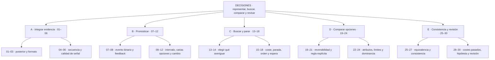
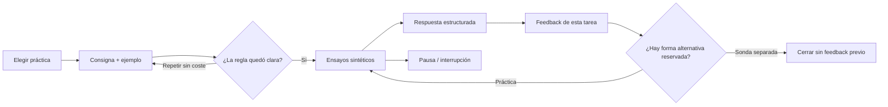

# Molvex · Decisiones
## 30 modelos de práctica con filtro de calidad

| Versión | Fecha | Estado | Destino |
|---|---|---|---|
| 1.0 | 2026-10-04 | Propuesta conceptual · `DESIGN_ONLY / CONDITIONAL` | App móvil iOS + Android · tareas sintéticas |

> Treinta contratos de tarea no equivalen a treinta ejercicios disponibles ni a treinta capacidades independientes. Cada modelo supera un filtro editorial de jugada completa, regla interpretable, señal observable, eje único de reto, riesgo y criterio de descarte. No acredita rendimiento del producto, cambio personal, paridad entre plataformas ni resultados fuera de la tarea practicada. El catálogo no autoriza cambios de código, IDs, scoring, perfil, datos o publicación.

## Encargo y filtro de entrada

«Entrenar al máximo» significa aquí ofrecer práctica variada de operaciones concretas: representar incertidumbre, integrar evidencia, elegir qué averiguar, saber cuándo detener la búsqueda y comparar opciones con reglas explícitas. No significa añadir complejidad, rapidez o presión por sí mismas. Las treinta propuestas emplean situaciones ficticias, valores comprobables y resultados reversibles; no solicitan decisiones personales sensibles ni recomiendan qué elegir fuera de la app.

Una ficha entra solo si responde satisfactoriamente a estas seis preguntas:

1. ¿Qué operación observable realiza la persona, y qué motor vecino no debe confundirse con ella?
2. ¿Puede jugarse con una consigna breve, un ejemplo completo y una regla de respuesta verificable?
3. ¿La señal tiene numerador, denominador y errores distinguibles, sin inferir cualidades que la tarea no observa?
4. ¿Hay un solo eje propuesto para variar la demanda, sin fijar valores de adaptación antes de pilotar?
5. ¿Se contempla el atajo más probable, la alternativa de acceso y un resultado que obligaría a retirar o fusionar la propuesta?
6. ¿Queda claro si el linaje es código observado, propuesta histórica o contrato nuevo?

### Lo que aporta la evidencia

La literatura de competencia en decisiones organiza tareas distintas —aplicar reglas dadas, comparar opciones, consistencia probabilística, confianza y costes ya incurridos, entre otras— y advierte que sus resultados también pueden depender de experiencia, motivación, regulación afectiva y familiaridad con números. Es un mapa de operaciones posibles, no una escala única que esta app pueda heredar. [Bruine de Bruin, Parker y Fischhoff, 2020](https://journals.sagepub.com/doi/10.1177/0963721420901592)

La práctica de pronósticos con feedback individualizado ha reducido la descalibración en ciertos conjuntos de tareas. La evidencia publicada subraya que hacen falta varios juicios, resultados claros y contenido relativamente homogéneo; la generalización a otros dominios o formatos sigue siendo pregunta abierta. Por eso M07–M12 exigen outcomes sintéticos resolubles y M09 reserva una forma diferente para una comprobación separada. [Stone, 2023](https://onlinelibrary.wiley.com/doi/10.1002/bdm.2334)

Un metaanálisis educativo sobre reducción de sesgos halló un efecto agregado pequeño en tareas objetivo, junto con riesgo de sesgo alto o incierto en todos los estudios y dudas sobre profundidad y alcance de los aprendizajes. Un experimento de campo con estudiantes de posgrado halló un resultado prometedor para una intervención concreta y un caso empresarial concreto; no justifica prometer el mismo efecto a usuarios de Molvex. En este catálogo, M28 se limita a escoger evidencia que discrimina hipótesis y no lleva etiquetas personales. [Revisión y metaanálisis, Nature Human Behaviour, 2025](https://www.nature.com/articles/s41562-025-02253-y); [Sellier, Scopelliti y Morewedge, 2019](https://openaccess.city.ac.uk/id/eprint/22233/)

El valor de información y las tareas de parada permiten formular políticas óptimas solo si el generador especifica probabilidades, costes y consecuencias sin ambigüedad. M15–M18 condicionan cualquier feedback normativo a un modelo explícito y testeado; si el problema no tiene política única justificable, el resultado queda descriptivo. [Bhattacharjya y Deleris, 2014](https://doi.org/10.1287/deca.2014.0298)

## Cartera editorial

| Zona | Modelos | Operación que reúne | Linaje observado en este dossier |
|---|---:|---|---|
| A · Integrar evidencia | M01–M06 | Estimar, traducir formatos y actualizar creencias | M01 enlaza Bayes Arena; M02–M04 son variantes; M05–M06 proponen contrato nuevo |
| B · Pronosticar con incertidumbre | M07–M12 | Emitir probabilidades, intervalos o distribuciones y revisar su correspondencia con resultados | E3 es propuesta histórica; el resto amplía el contrato |
| C · Buscar y parar | M13–M18 | Elegir pruebas, valorar información y terminar una búsqueda secuencial | M15 enlaza E8 histórica; otros son contratos nuevos o variantes |
| D · Comparar alternativas | M19–M24 | Clasificar reversibilidad, aplicar reglas, respetar límites y detectar dominancia | M19 enlaza el triaje existente; M22/M23 enlazan E5/E7 históricas |
| E · Consistencia y revisión | M25–M30 | Comparar presentaciones equivalentes, resultados inciertos, costes pasados e hipótesis | M28 enlaza E6 histórica, depurada; resto son contratos nuevos |

Los grupos son una organización de producto, no cinco escalas ni cinco compartimentos independientes. Los modelos próximos deben competir en una prueba piloto: si sus respuestas, errores y predicciones no se distinguen, se fusionan. No se fija que Molvex deba publicar los treinta.



## Estado del bloque en el árbol observado

La inspección del working tree del 2026-10-04 encontró una ruta común en [`DecisionsRootScreen`](../../../shared/src/commonMain/kotlin/com/mindos/app/features/mindboost/decisiones/presentation/ui/DecisionsRootScreen.kt): check-in → Bayes Arena → triaje de reversibilidad → resultado. En las clases observadas, el [check-in](../../../shared/src/commonMain/kotlin/com/mindos/app/features/mindboost/decisiones/presentation/DecisionCheckInStateHolder.kt) genera 20 estímulos GO/NO-GO y entrega una señal de disponibilidad de sesión; [Bayes Arena](../../../shared/src/commonMain/kotlin/com/mindos/app/features/mindboost/decisiones/presentation/BayesArenaStateHolder.kt) trabaja con cinco escenarios por defecto; el [triaje](../../../shared/src/commonMain/kotlin/com/mindos/app/features/mindboost/decisiones/presentation/ReversibilityTriageStateHolder.kt) trabaja con seis tarjetas por defecto. Los dos últimos reciben una semilla desde la sesión anfitriona. Estos recuentos describen defaults/código leído, no exposición completa ni calidad de la señal.

Los dos state holders de tarea y sus pantallas, junto con el check-in, son las únicas tres rutas de tarea observadas en esa raíz. El check-in es un contexto previo, no una cuarta familia de práctica del catálogo. Los ocho planteamientos E1–E8 de `docs/mindboost_exercise_design/03_6_Decisiones.md` se tratan como linaje documental, no como ocho funciones. La auditoría histórica del módulo y la ruta actual concuerdan en esa distinción, aunque el árbol de trabajo está sucio y las conclusiones se limitan a lo leído.

El estado de Bayes Arena observado recoge una probabilidad posterior, confianza y tiempo de pantalla; el cambio del control ahora se recibe como dato explícito. Aun así, el resumen observado sustituye ausencia de datos por cero y promedia ensayos que necesitan una regla de suficiencia y exclusión. El triaje registra acierto, latencia y cumplimiento de ventana, pero el resumen no aplica un mínimo por clase. El check-in calcula exactitud, variación del tiempo y fatiga subjetiva; no se interpreta aquí como práctica aislada de decisiones. No se ejecutaron tests ni builds para este catálogo. Los archivos comunes no prueban equivalencia en un iPhone.

**Lectura de estados:** `LIVE_LINEAGE` = hay ruta ejecutable cercana observada, sin aprobación de calidad; `HISTORICAL_DESIGN` = aparece como idea en el documento E1–E8, sin ejecución atribuida; `VARIANT` = cambia una dimensión de demanda, pero debe demostrar diferencia frente a su familia; `NEW_CONTRACT` = exige respuesta, contenido o regla que no se observó; `PROBE_CANDIDATE` = forma futura reservada, aún no incluida como modelo de práctica.

## Contrato móvil común



```text
┌──────────────────────────────┐
│ Decisiones          03 / 08  │
│                              │
│ Prioridad del caso:  ●●○○    │
│ Evidencia A:         ▰▰▱▱▱   │
│ Evidencia B:         ▰▰▰▱▱   │
│                              │
│ Tu estimación:               │
│  ───────●────────  60 %      │
│                              │
│ [Confirmar]        [Pausar]  │
│                              │
│ Confianza (si procede): ○○○  │
└──────────────────────────────┘
```

El dibujo enseña una posible pantalla de M01; no es una captura ni una pantalla aprobada. Cada tarea debe ofrecer tutorial repetible y sin penalización, feedback ligado a una regla visible, pausa y salida sin señal adversa. En tareas que no tengan clave objetiva se informa de elecciones y criterios declarados, no se fabrica una respuesta universal.

- **Contenido:** solo casos ficticios, conjuntos generados con respuesta derivable y datos mínimos de práctica. No recopilar elecciones personales sobre salud, dinero, empleo, relaciones o asuntos legales. Evitar texto libre cuando una selección estructurada conserva la operación.
- **Métrica:** preferir aciertos / ensayos válidos, error de estimación con unidad, decisiones de parada frente a la política computable, o violaciones / oportunidades. Separar omisión, error, interrupción y respuesta inválida. No crear una puntuación global del bloque a partir de estos treinta modelos.
- **Tiempo:** no usar rapidez como criterio principal. La medición temporal observada depende del estado de pantalla y requiere una comprobación técnica específica antes de influir en cualquier resultado agregado.
- **Dificultad:** cada tarjeta propone una sola variable. No se asignan rangos ni subidas automáticas sin distribución de ítems, prueba de comprensión y piloto. La estrategia correcta no se vuelve más difícil por hacer el texto más largo.
- **Acceso:** texto breve y ampliable; iconos con rótulo; soporte de lector de pantalla y foco; controles grandes; elección con botones accesible como alternativa a gestos. Color, sonido, animación y tiempo no son el único canal. Si la alternativa altera la tarea, se registra como forma diferente hasta compararla.
- **iOS / Android:** mantener regla, contenido versionado y salida funcionalmente iguales; revisar VoiceOver/TalkBack, escalado de texto, interrupciones y reanudación en dispositivos reales. Esta paridad está pendiente de comprobación.
- **Datos:** sesiones sintéticas y resumen mínimo; no enviar respuestas o diarios al grafo de proyecto ni a sistemas externos. Retención, base legal y finalidad requieren revisión propia antes de persistir contenido adicional.

## Los 30 modelos

### Zona A · Integrar evidencia

#### M01 · Actualiza la estimación
**Estado / linaje:** `LIVE_LINEAGE` · Bayes Arena, E1. **Operación:** mover una probabilidad previa al incorporar una observación cuyo acierto y falso positivo se conocen.

**Jugada:** la pantalla muestra que 10 de cada 100 piezas tienen una marca oculta; un lector reconoce 80 de cada 100 piezas marcadas y se equivoca en 10 de cada 100 sin marca. Se presenta una lectura positiva. De las 100 piezas, 8 son positivos verdaderos y 9 positivos falsos: el posterior es 8 de 17, aproximadamente 47 %. La persona elige su estimación y luego ve el conteo y la fracción, calculados con los parámetros del ensayo.

**Señal / eje:** error absoluto entre respuesta y posterior esperado; denominador: ensayos válidos con actualización no trivial. Eje candidato: separación entre tasa de acierto y falsos positivos. **Riesgo / falsador:** control deslizante fino puede dominar el cálculo; usar pasos amplios y confirmar que el valor por defecto se registra correctamente. Rediseñar si el error cambia más al sustituir el gesto que al cambiar la evidencia, o si ensayos sin actualización aparecen como aciertos perfectos.

#### M02 · La misma evidencia, en frecuencias
**Estado / linaje:** `VARIANT` de M01. **Operación:** resolver el mismo problema representado como conteos naturales en lugar de porcentajes.

**Jugada:** se presenta el caso anterior mediante un grupo de 100 iconos: diez pertenecen al grupo marcado; de esos, ocho activan el lector; entre los otros noventa, nueve también lo activan. La persona selecciona el tamaño del grupo que coincide con el resultado positivo y calcula cuántos proceden del grupo marcado. El ejemplo de tutorial usa otro conjunto de números.

**Señal / eje:** error en conteo posterior por ensayo; denominador: casos válidos. Eje: representación del mismo conjunto, tratada como condición experimental, no como incremento de dificultad. **Riesgo / falsador:** agrupación visual puede convertirlo en conteo perceptivo. Retirar la forma si iconos y lectura no conducen a la misma regla o si desaparece el componente probabilístico.

#### M03 · Cambia solo la frecuencia inicial
**Estado / linaje:** `VARIANT` de M01. **Operación:** conservar el valor de la evidencia y comprobar cómo cambia la estimación al cambiar la frecuencia inicial del evento.

**Jugada:** dos rondas usan el mismo lector y el mismo resultado positivo. En una, el grupo contiene 10 casos con marca por cada 100; en otra, 40 por cada 100. La respuesta no se corrige al repetir el mismo posterior: la evidencia observada es idéntica, pero la referencia inicial difiere.

**Señal / eje:** error absoluto separado por condición de frecuencia; denominador: ensayos válidos en cada condición. Eje: proporción inicial de casos. **Riesgo / falsador:** memorizar una sola secuencia de respuestas o leer la barra como valor exacto. Variar las formas manteniendo los mismos parámetros matemáticos; fusionar con M01 si no aporta una predicción distinta.

#### M04 · Evidencia que llega por partes
**Estado / linaje:** `VARIANT` de E1. **Operación:** actualizar una estimación varias veces en el orden en que se revela información.

**Jugada:** se fija una frecuencia inicial. Aparece una señal positiva de un dispositivo; la persona estima. Luego llega un segundo control independiente y vuelve a estimar. El último dato contradice parcialmente la primera señal. El tutorial muestra que la estimación cambia tras cada evidencia, no solo al final.

**Señal / eje:** suma de errores absolutos en cada actualización y error al cierre; denominador: actualizaciones válidas por caso. Eje: cantidad de revelaciones. **Riesgo / falsador:** recordar el primer número o acumular carga de memoria en vez de actualizar. Mostrar el historial completo y comparar después con historial resumido; fusionar con M01 si la secuencia no añade demanda observable.

#### M05 · ¿Qué señal separa las hipótesis?
**Estado / linaje:** `NEW_CONTRACT`. **Operación:** elegir la observación que más distingue entre dos explicaciones ficticias.

**Jugada:** una máquina produce piezas con una de dos averías posibles. Se ofrecen tres comprobaciones: una ocurre con frecuencia similar en ambas averías; otra es habitual en A y poco habitual en B; la tercera ocurre en ninguna. Se pregunta cuál resultado sería más informativo para distinguir A de B, antes de mostrar el resultado.

**Señal / eje:** elección de la comprobación con mayor razón de verosimilitud absoluta; denominador: preguntas con una única mejor prueba. Eje: proximidad entre las tasas de las dos hipótesis. **Riesgo / falsador:** resolver por palabras que sugieren una avería. Reemplazar por símbolos balanceados; retirar si distintas pruebas empatan o si el lenguaje determina la respuesta.

#### M06 · Ajusta por fiabilidad de la fuente
**Estado / linaje:** `NEW_CONTRACT`. **Operación:** integrar una señal según la calidad conocida de quien la produce.

**Jugada:** dos sensores notifican una condición. El panel muestra su historial sintético: el sensor A acierta 8 de 10 veces; el B, 6 de 10. Ambos alertan ahora. La persona elige qué alerta pesa más y estima la probabilidad final. La clave usa tasas conocidas en el generador.

**Señal / eje:** error de posterior y elección de orden de fiabilidad; denominador: pares de señales válidos. Eje: distancia entre las tasas de ambos sensores. **Riesgo / falsador:** confundir historial de sensores independientes con señales duplicadas. Cada ficha de datos indica independencia o dependencia; retirar la serie si esa regla no se comprende sin ayuda externa.

### Zona B · Pronosticar con incertidumbre

#### M07 · Probabilidad de un evento sintético
**Estado / linaje:** `HISTORICAL_DESIGN` · E3, no observado como ruta ejecutable. **Operación:** asignar una probabilidad antes de un evento aleatorio con distribución conocida.

**Jugada:** se muestra una urna virtual con 30 piezas claras y 70 oscuras. La persona estima la posibilidad de extraer una pieza clara, confirma y luego ve una extracción generada con reposición. Una serie de rondas permite comparar la probabilidad declarada con resultados efectivamente obtenidos.

**Señal / eje:** pérdida cuadrática por pronóstico cuando existe outcome resuelto, acompañada de acierto; denominador: pronósticos válidos. Eje: probabilidad base del evento. **Riesgo / falsador:** juzgar una probabilidad por un solo resultado. El feedback separa resultado puntual de correspondencia acumulada; no mostrar una curva por debajo del mínimo muestral definido en un estudio.

#### M08 · Panel de calibración por grupos
**Estado / linaje:** `VARIANT` de M07. **Operación:** revisar cómo se relacionan los niveles de confianza usados con la frecuencia de acierto de una serie homogénea.

**Jugada:** tras resolver varias rondas de una misma familia de urnas, la persona ve una tabla: «estimaciones cercanas a 60 %: 6 aciertos de 10». El feedback señala el número observado y el tamaño de muestra, sin proyectar una línea personal con una base pequeña. Se ofrece una nueva serie independiente para aplicar una estrategia.

**Señal / eje:** diferencia entre proporción pronosticada y proporción resuelta en grupos de confianza; denominador: casos cerrados por grupo. Eje: cantidad de ensayos por bloque, pendiente de suficiencia. **Riesgo / falsador:** bins escasos o outcomes correlacionados producen un panel inestable. No emitir resumen cuando falte soporte; retirar si el usuario interpreta el azar de una serie como señal estable.

#### M09 · Intervalo que debe cubrir
**Estado / linaje:** `NEW_CONTRACT`. **Operación:** expresar un rango plausible alrededor de una cantidad que se sorteará.

**Jugada:** un generador extraerá una cantidad entre 0 y 100 de acuerdo con una distribución mostrada. La persona marca un intervalo del que espera que salga el valor. Al cierre se enseña si quedó dentro; a lo largo de muchas rondas se comparan cobertura y amplitud. Una banda más amplia cubre más casos, pero informa menos.

**Señal / eje:** proporción cubierta y amplitud mediana, siempre informadas por separado; denominador: valores resueltos. Eje: anchura permitida del intervalo. **Riesgo / falsador:** puntuar solo cobertura premia rangos inútilmente amplios. Retirar si el criterio no trata de modo explícito cobertura y amplitud o si el control del móvil dificulta marcar límites.

#### M10 · Distribuye probabilidad entre tres resultados
**Estado / linaje:** `NEW_CONTRACT`. **Operación:** repartir un total de probabilidad entre alternativas mutuamente excluyentes.

**Jugada:** un generador elegirá una de tres formas. La persona reparte 100 puntos entre círculo, triángulo y cuadrado con controles de pasos grandes; al confirmar, el sistema sortea una forma según la distribución presentada y muestra el resultado. El tutorial permite corregir el total antes de cerrar.

**Señal / eje:** puntuación probabilística multiclase definida antes del piloto y tasa de total válido; denominador: distribuciones confirmadas. Eje: número de resultados posibles. **Riesgo / falsador:** destreza con tres controles y confusión entre puntos y porcentajes. Ofrecer entrada accesible de un valor cada vez; descartar si el total consume más esfuerzo que la distribución.

#### M11 · Combina dos sucesos
**Estado / linaje:** `NEW_CONTRACT`. **Operación:** derivar la probabilidad conjunta usando frecuencia conjunta visible y no multiplicar datos sin conocer su dependencia.

**Jugada:** una tabla sintética de 100 piezas muestra 20 con marca A, 30 con marca B y 8 con ambas. La pregunta es la proporción con A y B. Después aparece una tabla parecida donde A y B sí son independientes; el ejemplo enseña que la relación entre eventos debe estar especificada.

**Señal / eje:** error en proporción conjunta por caso; denominador: tablas válidas. Eje: dependencia indicada entre dos sucesos. **Riesgo / falsador:** calcular el producto de porcentajes por hábito sin mirar la tabla o confundir «y» con «o». La consigna usa diagramas y etiquetas consistentes; retirar si el vocabulario domina la tarea.

#### M12 · Revisa el pronóstico tras un cambio
**Estado / linaje:** `NEW_CONTRACT`. **Operación:** modificar una distribución prevista cuando cambia una condición declarada del generador.

**Jugada:** un recipiente contiene piezas de dos formas en una proporción inicial. Se muestra una extracción y una regla de reposición que altera la mezcla. La persona vuelve a repartir probabilidad entre formas. En un ensayo de control, la extracción se repone y la mezcla no cambia; así se observa si la respuesta sigue a la regla, no a la mera novedad visual.

**Señal / eje:** error antes/después de cambio por ronda; denominador: casos con distribución objetivo calculable. Eje: magnitud del cambio en la mezcla. **Riesgo / falsador:** memoria de la proporción anterior o lectura de animaciones. Mostrar la composición vigente de forma accesible y retirar si la respuesta no sigue el cambio conocido.

### Zona C · Buscar y parar

#### M13 · Elige la prueba que más informa
**Estado / linaje:** `NEW_CONTRACT`. **Operación:** escoger entre preguntas posibles la que mejor separa dos estados desconocidos.

**Jugada:** una caja tiene símbolo A o B, con probabilidad inicial igual. La prueba X da un círculo en 8 de cada 10 casos A y en 2 de cada 10 B; la prueba Y lo da en 6 de cada 10 A y 4 de cada 10 B. Si ambas cuestan lo mismo, X separa más los estados. La persona elige prueba antes de verla y luego clasifica la caja.

**Señal / eje:** pruebas con mejor ganancia informativa seleccionadas / pruebas elegibles; denominador: ensayos con una respuesta de referencia única. Eje: solapamiento entre resultados de cada prueba. **Riesgo / falsador:** seleccionar la tarjeta más detallada por apariencia. Igualar longitud y arte; parar si la prueba de referencia cambia con una suposición no visible.

#### M14 · Compara coste y precisión de una fuente
**Estado / linaje:** `NEW_CONTRACT`. **Operación:** elegir entre fuentes sintéticas considerando calidad conocida y coste declarado.

**Jugada:** una fuente revela una señal con precisión alta por tres unidades; otra tiene precisión menor y coste cero. La persona elige una, recibe la señal y decide si seguir investigando. El generador define el resultado y la consecuencia para cada opción, con ejemplos de cálculo durante el tutorial.

**Señal / eje:** utilidad esperada lograda respecto a la política óptima reproducible; denominador: casos con parámetros completos. Eje: coste relativo de la fuente elegida. **Riesgo / falsador:** asumir que pagar siempre compra más calidad. Incluir fuentes con distintos perfiles; retirar si el óptimo requiere valorar preferencias no suministradas.

#### M15 · ¿Vale la pena otra evidencia?
**Estado / linaje:** `HISTORICAL_DESIGN` · E8. **Operación:** decidir si una señal adicional compensa su coste dado el estado actual.

**Jugada:** dos estados son igual de probables; elegir el correcto da 10 puntos y el incorrecto, 0. Una señal adicional identifica el estado correctamente en 8 de cada 10 ensayos y cuesta 1 punto. Sin señal, elegir al azar rinde 5 puntos esperados; con la señal se elige el estado indicado y se obtienen 8 puntos esperados antes del coste, 7 después. La referencia es «ver una señal más».

**Señal / eje:** decisiones alineadas con la política calculada / casos válidos; denominador: situaciones cuyo cálculo produce una opción estrictamente preferible. Eje: coste marginal de la señal. **Riesgo / falsador:** el resultado depende de una premisa escondida o empates tratados como error. Hacer visibles supuestos; retirar si no existe política única o el cálculo no reproduce casos de borde.

#### M16 · Acepta o sigue buscando
**Estado / linaje:** `NEW_CONTRACT`. **Operación:** establecer un umbral de parada en una secuencia de opciones que se revelan de una en una.

**Jugada:** hay tres etapas. La primera oferta es 3; continuar cuesta 1 y la segunda oferta será 0 u 8, con igual probabilidad. Si se llega a la última etapa, la oferta será 4 y obtenerla cuesta 1. La política de referencia es continuar desde 3; después, aceptar 8 o continuar desde 0 hacia 4, que deja un valor neto de 3. Se calcula por inducción hacia atrás para este juego finito.

**Señal / eje:** pérdida sintética frente a política de referencia y posición de parada; denominador: secuencias completas. Eje: cantidad de opciones restantes. **Riesgo / falsador:** confundir azar puntual con calidad de política o aprovechar reinicios para revelar la secuencia. Las repeticiones son independientes; retirar si el reinicio ofrece información adicional no prevista.

#### M17 · ¿Cambiaría con otro orden?
**Estado / linaje:** `VARIANT` de M04/M15. **Operación:** comprobar si la misma información produce una estimación final distinta por el orden de presentación.

**Jugada:** dos mitades de un caso contienen las mismas señales; en una ronda llegan A-B-C y en otra C-A-B. La persona actualiza el valor tras cada señal. Al final puede comparar ambas rutas con el cálculo común de las tres evidencias.

**Señal / eje:** diferencia entre estimaciones finales de secuencias emparejadas; denominador: pares completos. Eje: fuerza de contradicción entre señales. **Riesgo / falsador:** recordar la respuesta anterior o aprender orden fijo. Aleatorizar orden y usar contenido paralelo; fusionar con M04 si el orden no cambia la estrategia observable.

#### M18 · Espera breve o acción inmediata
**Estado / linaje:** `NEW_CONTRACT`. **Operación:** valorar una espera que puede aportar información frente a decidir antes bajo costes explícitos.

**Jugada:** una compuerta se abre ahora con resultado incierto o puede esperar una ronda para recibir una señal. Esperar tiene un coste fijo que se muestra en el panel. La persona elige ahora o espera; no hay cuenta atrás ni bonus de rapidez. Un resultado se genera conforme al modelo visible.

**Señal / eje:** utilidad esperada contra la referencia explícita y acción escogida por condición; denominador: casos con resultado computable. Eje: coste de espera. **Riesgo / falsador:** leer el ejercicio como prueba de paciencia. Retirar si el resultado depende de velocidad de toque o si la espera no añade una señal cuantificable.

### Zona D · Comparar alternativas

#### M19 · Clasifica cuánto cuesta deshacer
**Estado / linaje:** `LIVE_LINEAGE` · Reversibility Triage, E2. **Operación:** clasificar una acción ficticia según coste y tiempo de reversión explícitos.

**Jugada:** una tarjeta muestra dos acciones. En una, un ajuste se puede revertir sin coste; en otra, confirmar destruye el borrador y obliga a reconstruirlo. La persona elige la que requiere revisión previa. En una fase separada, si la tarea lo permite, debe esperar una ventana indicada antes de cerrar la segunda opción.

**Señal / eje:** aciertos separados por clase y cumplimiento de ventana / oportunidades por clase. Eje: distancia entre costes de reversión. **Riesgo / falsador:** aprender el icono o responder siempre «revisar». Rotar presentación y balancear proporciones; revisar el mínimo por clase antes de resumir. Rediseñar si el coste no se puede inferir de los datos mostrados.

#### M20 · Prueba pequeña antes de comprometer
**Estado / linaje:** `NEW_CONTRACT`. **Operación:** seleccionar una acción reversible que permita observar una señal antes de una decisión costosa.

**Jugada:** un equipo ficticio debe escoger entre dos rutas; puede activar una simulación de una unidad para observar un resultado, o asignar todos los recursos a una ruta. La tarjeta especifica coste, reversibilidad y lo que revela cada prueba. El tutorial compara el resultado esperado de ambas políticas.

**Señal / eje:** ganancia esperada de la acción inicial según el generador; denominador: casos con una ruta de prueba preferible. Eje: coste de la prueba reversible. **Riesgo / falsador:** privilegiar siempre «probar» aunque no informe. Mantener visibles coste y señal posible; retirar si la experiencia no permite distinguir prueba informativa de demora.

#### M21 · Aplica una regla de prioridad
**Estado / linaje:** `NEW_CONTRACT`. **Operación:** usar un orden lexicográfico dado, comparando el primer criterio y avanzando al siguiente solo si hay empate.

**Jugada:** el tutorial da la regla «primero menos consumo, después menor tiempo». Se presentan tres medios de transporte sintéticos con ambos valores. La persona ordena dos opciones; si el consumo empata, solo entonces mira el tiempo. El feedback muestra el primer criterio que resolvió la comparación.

**Señal / eje:** comparaciones acordes a la regla / pares válidos; denominador: pares presentados. Eje: cantidad de criterios en el orden. **Riesgo / falsador:** clasificar por un atributo visual o recordar la tabla. Aleatorizar posiciones y usar números grandes legibles; retirar si la regla no se puede explicar con el ejemplo sin memorizar un caso.

#### M22 · Pondera dos atributos declarados
**Estado / linaje:** `HISTORICAL_DESIGN` · E5/E7. **Operación:** comparar alternativas usando pesos numéricos que la propia consigna fija.

**Jugada:** una tarea pide maximizar duración y minimizar consumo, con pesos 2 y 1 ya indicados; la regla visible es `2 × duración − consumo`. A ofrece 8 puntos de duración y 3 de consumo, resultado 13; B ofrece 6 y 1, resultado 11. La referencia es A bajo esa regla concreta. La persona no aporta preferencias personales: el objetivo es ejecutar la fórmula suministrada.

**Señal / eje:** elecciones alineadas con la función visible / comparaciones válidas; denominador: casos con orden único. Eje: diferencia entre puntuaciones finales. **Riesgo / falsador:** carga aritmética se vuelve el factor principal. Mantener sumas simples y permitir panel de cálculo accesible; fusionar con M21 si el resultado es solo una regla memorizada.

#### M23 · Asigna dentro de un límite
**Estado / linaje:** `HISTORICAL_DESIGN` · E7. **Operación:** distribuir recursos escasos entre opciones cumpliendo restricciones explícitas.

**Jugada:** hay 10 unidades para tres proyectos ficticios. A devuelve 4 por unidad y admite hasta 3; B devuelve 3 por unidad y requiere al menos 2; C devuelve 2 por unidad. Con asignaciones enteras, la solución de referencia es A=3, B=2, C=5: retorno 28, restricciones cumplidas. La persona reparte con botones de incremento/decremento; el feedback separa retorno y restricciones.

**Señal / eje:** retorno / óptimo junto con restricciones violadas / restricciones evaluables. Eje: cantidad de restricciones simultáneas. **Riesgo / falsador:** el solver debe tener una respuesta exacta compartida por tarea y feedback; el gesto no debe introducir carga motora relevante. Si la comprobación exhaustiva no puede demostrar el óptimo y sus empates, excluir la ficha.

#### M24 · Detecta una alternativa dominada
**Estado / linaje:** `NEW_CONTRACT`. **Operación:** descartar una opción que no supera a otra en ningún atributo y pierde en al menos uno.

**Jugada:** tres baterías ficticias ofrecen horas de uso y peso. Una dura igual que otra pero pesa más; una tercera dura más y pesa más, por lo que sigue habiendo un intercambio real. La persona toca el par que permite descartar una opción sin conocer preferencias personales.

**Señal / eje:** pares dominados identificados / pares con dominancia estricta; denominador: pares válidos. Eje: cantidad de atributos. **Riesgo / falsador:** interpretar un intercambio como dominancia. Mostrar dirección de cada atributo y ofrecer explicación tras responder; retirar si el banco incluye empates o atributos no comparables sin declararlo.

### Zona E · Consistencia y revisión

#### M25 · Dos marcos, mismos resultados
**Estado / linaje:** `NEW_CONTRACT`. **Operación:** reconocer que dos descripciones positivas y negativas corresponden a la misma distribución de resultados.

**Jugada:** dos lotes tienen «70 de 100 piezas correctas» y «30 de 100 piezas incorrectas». En una pantalla se muestra tasa de éxito; en otra, tasa de fallo. La persona indica si representan la misma composición y escoge la proporción común. El feedback conserva ambos marcos en pantalla.

**Señal / eje:** equivalencias correctamente emparejadas / pares válidos; denominador: pares emparejados. Eje: distancia de la proporción al punto medio. **Riesgo / falsador:** memoria de la ficha previa. Presentar pares nuevos y alternar lados; retirar si la carga de lectura altera la equivalencia.

#### M26 · Porcentaje o grupo de cien
**Estado / linaje:** `VARIANT` de M02/M25. **Operación:** mantener una misma lectura probabilística ante expresiones numéricas equivalentes.

**Jugada:** «25 %» aparece en una ronda; «25 de cada 100» aparece en otra con los mismos datos. La persona compara las dos estimaciones y marca si cambió su lectura. No se mezclan cambios de marco, frecuencia inicial y calidad de evidencia en el mismo ensayo.

**Señal / eje:** diferencia absoluta entre respuestas emparejadas; denominador: pares completados. Eje: escala del denominador, solo tras pilotar. **Riesgo / falsador:** la persona puede interpretar el porcentaje como fracción distinta. Enseñar una equivalencia de ejemplo; fusionar con M02 si ambos formatos generan el mismo patrón de error.

#### M27 · Completa la distribución
**Estado / linaje:** `NEW_CONTRACT`. **Operación:** identificar la probabilidad que falta para completar un conjunto exhaustivo de resultados.

**Jugada:** una ruleta tiene tres sectores posibles. Dos están descritos como 20 % y 35 %; se pregunta la proporción del sector restante. El tutorial indica que los tres sectores cubren todas las posibilidades y que no hay solapamiento.

**Señal / eje:** proporción restante correcta / ítems válidos; denominador: distribuciones exhaustivas. Eje: número de resultados. **Riesgo / falsador:** sumar sin verificar que no falte un resultado. La condición de exhaustividad se repite en texto y gráfico; retirar si las etiquetas dejan abierta otra salida.

#### M28 · Busca el dato que podría cambiar la hipótesis
**Estado / linaje:** `HISTORICAL_DESIGN` · E6, rediseñado sin etiquetas de sesgo. **Operación:** elegir una observación que distinga una hipótesis preferida de una alternativa rival.

**Jugada:** una planta ficticia crece poco. La hipótesis A atribuye el resultado a falta de luz; la B, a falta de agua. Una lectura de humedad baja aparece en 8 de cada 10 casos B y 2 de cada 10 A; una lectura de color aparece en 6 de cada 10 casos de cada hipótesis. La persona elige qué lectura separa más las dos explicaciones. La tarea compara predicciones, no quién defiende una postura.

**Señal / eje:** selección de la observación con mayor separación predictiva / ensayos con opción única; denominador: preguntas válidas. Eje: solapamiento de predicciones entre hipótesis. **Riesgo / falsador:** pistas narrativas o experiencia de jardinería. Usar símbolos y tasas completas; descartar si una persona experta en el tema obtiene ventaja por conocimiento no presentado.

#### M29 · Ignora el coste ya irreversible
**Estado / linaje:** `NEW_CONTRACT` · principio presente en tareas de competencia adulta. **Operación:** comparar opciones con resultados futuros, sin contar como recuperable un gasto ya hecho.

**Jugada:** un robot ficticio consumió 4 unidades que ya no pueden recuperarse. Desde ahora puede continuar por A, con retorno futuro 3, o cambiar a B, con retorno futuro 7 y coste adicional 1. El valor futuro de B es 6 frente a 3 de A, así que la referencia es B; el gasto pasado no altera esos valores. Una ronda emparejada omite el gasto ya incurrido.

**Señal / eje:** elección alineada con retornos futuros / pares válidos; denominador: casos con saldo futuro estrictamente distinto. Eje: tamaño del gasto pasado, sin alterar el futuro. **Riesgo / falsador:** el gasto anterior puede cambiar legítimamente la información disponible; se declara como hundido solo cuando no cambia el futuro. Retirar si cambia la opción óptima al incluirlo.

#### M30 · Elige según el peor caso permitido
**Estado / linaje:** `NEW_CONTRACT`. **Operación:** seleccionar una alternativa usando una regla explícita de protección frente a resultados adversos.

**Jugada:** cada ruta ficticia muestra un rango de resultados posibles. La consigna dice «elige la ruta cuyo mínimo garantizado sea mayor»; no pregunta cuál es universalmente mejor. A tiene rango 4–9 y B, 6–8; bajo esta regla, la referencia es B. Una segunda ronda usa otra regla visible para enseñar que el criterio cambia la respuesta.

**Señal / eje:** elecciones que cumplen el criterio / ensayos válidos; denominador: comparaciones con mínimo único. Eje: solapamiento entre los rangos. **Riesgo / falsador:** generalizar la regla de mínimo a situaciones donde la consigna pide retorno medio. Mantener la regla visible y separar condiciones; retirar si las condiciones premian estrategias distintas sin declararlo.

## Diferenciación, fusión y admisión final

| Familias a contrastar | Diferencia que debe observarse | Fusión o descarte si… |
|---|---|---|
| M01–M04 | estimación final, formato y secuencia producen patrones de error distintos | la representación o el orden no cambia la operación que la persona ejecuta |
| M05–M06, M13–M14, M28 | comparar señales, elegir fuente y escoger prueba separadora no son la misma respuesta | las pruebas disponibles no presentan una única separación matemática |
| M07–M12 | evento binario, feedback acumulado, intervalo, distribución multiclase y revisión ante cambio | outcomes escasos, correlacionados o sin verdad de referencia suficiente |
| M15–M18 | coste marginal, secuencia de opciones, orden de señales y esperar una nueva observación son políticas diferentes | el modelo de utilidad o de parada no se puede resolver y testear de forma exacta |
| M19–M24 | clasificar reversibilidad, preservar opciones, aplicar reglas, asignar y detectar dominancia | el resultado depende de preferencias que no aparecen en la consigna |
| M25–M30 | equivalencia, completar distribuciones, revisar hipótesis y aplicar reglas de incertidumbre | el acierto proviene solo de repetir una regla superficial o se confunden reglas rivales |

**Admisión documental:** 30 propuestas completas y defendibles como contratos de práctica. **Disposición de diseño:** `CONDITIONAL`; priorizar piloto de contenido con un subconjunto pequeño y fusionar por evidencia de respuesta, no por ilustración distinta. **Preparación:** `DESIGN_ONLY`; las propuestas no heredan autorización de implementación. Dos linajes (`M01`, `M19`) requieren reparar y volver a revisar las limitaciones de su ruta cercana antes de cualquier uso agregado; la ruta de check-in no se cuenta como modelo independiente. Las restantes exigen banco, reglas, interfaz o validadores nuevos.

### Gates antes de considerar una ficha para implementación

1. Revisión de cada clave y de los casos límite por dos revisores de contenido; en tareas probabilísticas, reproducción independiente del cálculo de referencia.
2. Entrevistas de comprensión con participantes adultos diversos en numeración, lectura, edad y acceso; corregir consignas antes de observar rendimiento.
3. Pruebas de banco contra respuestas fijas, empates, ausencias, reinicio, orden de estímulos y alternativas accesibles.
4. Pilotaje que separe entrenamiento, familiarización y una forma reservada; evaluar estabilidad y utilidad de cada señal para el uso previsto antes de agregarla.
5. Prueba de la mecánica real en Android e iOS, incluyendo pausas, pantalla ampliada, VoiceOver/TalkBack, latencia de entrada y recuperación tras interrupción.
6. Decisión expresa de cartera y de finalidad para cada tarea; ninguna cifra propuesta en este documento cambia gates, elegibilidad o perfil.

## Referencias y alcance

- Bruine de Bruin, W., Parker, A. M. y Fischhoff, B. (2020). Revisión sobre competencia en decisiones. Current Directions in Psychological Science, 29(2), 186–192. [DOI](https://doi.org/10.1177/0963721420901592). Describe facetas y medidas; no evalúa Molvex.
- Stone, E. R. (2023). *Automated calibration training for forecasters*. Journal of Behavioral Decision Making. [DOI](https://doi.org/10.1002/bdm.2334). Dos estudios de feedback en pronósticos; los autores delimitan la necesidad de outcomes repetidos y claros y la posible especificidad de dominio.
- Swaryandini, D. A. et al. (2025). *Systematic review and meta-analysis of educational approaches to reduce cognitive biases among students*. Nature Human Behaviour. [DOI](https://doi.org/10.1038/s41562-025-02253-y). Población educativa; efecto pequeño en tarea objetivo y limitaciones de riesgo de sesgo y alcance.
- Sellier, A. L., Scopelliti, I. y Morewedge, C. K. (2019). *Debiasing training transfers to improve decision making in the field*. Psychological Science, 30(9), 1371–1379. [DOI](https://doi.org/10.1177/0956797619861429). Estudio específico con estudiantes de posgrado y un caso empresarial; no se generaliza al catálogo.
- Bhattacharjya, D. y Deleris, L. A. (2014). *The Value of Information in Some Variations of the Stopping Problem*. Decision Analysis, 11(3), 189–203. [DOI](https://doi.org/10.1287/deca.2014.0298). Base formal para problemas secuenciales; no valida la política de ninguna ficha sin probar su cálculo.

**Límite de inferencia:** completar una tarea, reducir su error o acercarse a su política de referencia solo describe el desempeño en esa versión y sesión. La retención, otras formas, otros motores y resultados cotidianos requieren evidencia separada con diseños y muestras apropiados. No se realizó estudio humano ni se ejecutaron pruebas de app para redactar este catálogo.
