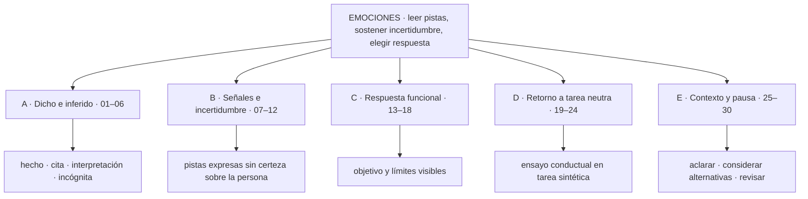
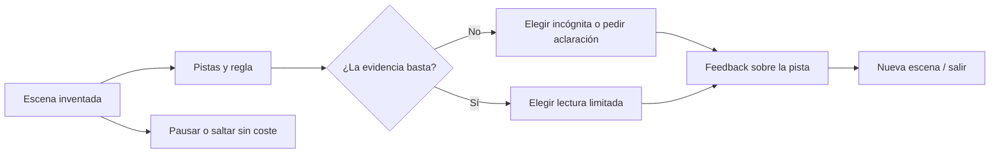

# Molvex · Emociones
## 30 modelos de práctica con límites explícitos

| Versión | Fecha | Estado | Destino |
|---|---|---|---|
| 1.0 | 2026-10-04 | Propuesta conceptual · `DESIGN_ONLY / CONDITIONAL` | App móvil iOS + Android · escenas ficticias de baja intensidad |

> Treinta modelos editoriales no equivalen a treinta rutas disponibles, treinta capacidades separadas ni a una medida fiable de cómo se siente alguien. Las propuestas practican operaciones acotadas con señales inventadas y claves visibles. No autorizan cambios de código, puntuación oficial, perfiles personales, almacenamiento de texto íntimo, despliegue ni afirmaciones sobre resultados fuera de la tarea.

## Encargo y filtro de entrada

Este bloque puede practicar lectura cuidadosa de señales expresadas, separación entre observación e interpretación, tolerancia a la ambigüedad y elección de una respuesta funcional en un escenario inventado. No puede observar directamente la vivencia privada de una persona mediante una elección en pantalla. Por ello, el lenguaje de cada ejercicio describe qué información trae el estímulo y qué respuesta satisface la regla del juego; no declara cuál es el estado real de una persona.

Una propuesta entra solo si cumple todo lo siguiente:

1. El escenario es ficticio, cotidiano, de baja intensidad y completamente prescindible.
2. La respuesta correcta se deriva de una regla visible o de pistas expresas; nunca de adivinar una intención oculta.
3. Si caben varias lecturas, la tarea permite elegir «no se puede determinar» o más de una interpretación aceptable.
4. No pide autobiografía, nombres reales, conversaciones privadas, imágenes del usuario ni revelaciones sensibles.
5. Una respuesta no se convierte en etiqueta personal, diagnóstico, recomendación de ayuda ni estimación del temperamento.
6. Cada métrica propuesta tiene un denominador observable; el autorreporte opcional, si existiera, no puntúa la capacidad.

### Evidencia y límite de inferencia

Un ensayo aleatorizado pequeño con adultos sanos estudió un programa específico de práctica de cognición social. Sus resultados favorables se limitaron a ciertos resultados de reconocimiento facial y atribuciones erróneas dentro de las tareas usadas; no validan estas propuestas ni autorizan inferir cambios en la vida diaria. [Schoeneman Patel et al., 2022](https://pubmed.ncbi.nlm.nih.gov/36424990/).

Un estudio en línea posterior de práctica de reconocimiento de expresiones obtuvo resultados dependientes de la comparación y la medida; algunos contrastes no mostraron una diferencia clara entre grupos en el cambio observado. La evidencia no justifica tratar una clave de app como lectura universal de emociones. [Estudio experimental, Royal Society Open Science, 2023](https://royalsocietypublishing.org/doi/10.1098/rsos.230372).

La interpretación de frases y escenas depende de idioma, cultura, contexto y convenciones. En este catálogo, una clave solo describe la señal impresa o la decisión que satisface una regla sintética. Una respuesta no certifica lo que una persona sintió, quiso decir o hará fuera de la pantalla.

## Cartera editorial

| Zona | Modelos | Operación | Linaje |
|---|---:|---|---|
| A · Separar lo dicho de lo inferido | M01–M06 | Identificar hechos, palabras expresas, pensamientos citados e incógnitas | M01–M03 amplían EM3; los otros contratos nuevos |
| B · Leer señales con incertidumbre | M07–M12 | Combinar pistas textuales sin convertirlas en certeza | Contratos nuevos, excepto formas vecinas de EM3 |
| C · Elegir una respuesta funcional | M13–M18 | Usar objetivo y límites explícitos en un diálogo ficticio | Contratos nuevos; no miden la conducta real |
| D · Volver a una tarea neutral | M19–M24 | Practicar continuidad tras una interrupción o palabra afectiva leve | M19–M21 enlazan EM1/EM2 solo como vecindad; EM22–M24 son contratos nuevos |
| E · Contexto, perspectiva y pausa | M25–M30 | Retener varias lecturas, pedir aclaración y revisar una conclusión | Contratos nuevos; no se asignan etiquetas personales |

Las zonas organizan propuestas de producto, no escalas independientes. EM1 y EM2 son tareas de control de respuesta/continuación con palabras leves o material perceptivo: no deben presentarse como evaluación de emoción por el mero hecho de aparecer bajo este bloque. EM3 clasifica frases neutras en categorías funcionales. Seis rutas futuras o ampliadas pueden acabar siendo una sola familia si sus errores no se distinguen.



### Linaje actual observado

En el árbol leído, `EmotionCatalogIds.kt` declara quince IDs, pero la lista ejecutable se deriva de `EmotionExerciseGenerators.kt`, donde aparecen tres generadores: EM1 Pausa, EM2 Recuperación y EM3 Separador. No se equiparan quince definiciones con quince tareas jugables. La documentación anterior E1–E8 y catálogos históricos no se trata como estado ejecutable actual.

| Estado | Lectura de esta inspección |
|---|---|
| EM1 · Pausa | La tarea muestra palabras afectivas leves como distractores y luego un ensayo de parada; las palabras no son la respuesta. Vecina de control/inhibición, no tarea directa de lectura emocional. |
| EM2 · Recuperación | Tarea perceptiva izquierda/derecha con dificultad escalonada; el resultado primario se relaciona con precisión después de un error. No se observó contenido afectivo en el estímulo. Su pertenencia a este bloque requiere justificación de producto y evaluación separada. |
| EM3 · Separador | Clasifica frases neutras en cuatro categorías funcionales; hay conjunto de evaluación retenido separado. Una etiqueta describe la frase del juego, nunca el estado de quien juega. |
| M01–M30 | Propuestas `NEW_CONTRACT` o variantes; no implementadas por este documento. |

La inspección fue estática sobre un working tree con cambios concurrentes; no se ejecutaron pruebas ni builds. Los hallazgos describen solo los archivos citados y no sustituyen un estado de release.

## Experiencia móvil compartida



```text
┌──────────────────────────────┐
│ Emociones         03 / 08    │
│                              │
│ En esta escena ficticia:     │
│ «El tren ya salió», dijo     │
│ Alex. Luego guardó el mapa.  │
│                              │
│ ¿Qué sabemos por el texto?   │
│ ○ Alex está enfadado         │
│ ○ Alex dijo que el tren      │
│   había salido               │
│ ○ No se indica cómo se siente│
│                              │
│ [Responder]       [Pausar]   │
└──────────────────────────────┘
```

Wireframe conceptual, no captura ni interfaz aprobada. Contenido opcional y neutral, botón visible para salir, texto ampliable, lector de pantalla y navegación por foco. Ningún color, tono de voz, gesto, temporizador o señal sonora es imprescindible. No se usan retratos, expresiones faciales ni archivos de audio de personas.

**Reglas comunes:** separar lo que el personaje dice de lo que el texto confirma; evitar claves basadas en una supuesta universalidad de expresiones; no pedir que el usuario relacione el caso consigo; permitir omitir la escena; no ofrecer consecuencias de puntuación por rapidez. Feedback: explicar la pista textual y la regla, no juzgar una respuesta como rasgo del usuario. No guardar respuestas en texto libre. Un autorreporte voluntario de comodidad, si alguna prueba futura lo necesitara, se almacenaría separado, no cambiaría el resultado y requeriría evaluación de datos propia.

## Los 30 modelos

Cada denominador incluye solo ensayos presentados y respondidos con una regla válida. Pausas, saltos, errores técnicos y abandono quedan separados. Ninguna señal se agrupa en una cifra de «inteligencia emocional». Un eje por modelo es candidato, no ajuste aprobado.

### Zona A · Separar lo dicho de lo inferido

#### M01 · Qué dice el texto
**Linaje:** `LIVE_LINEAGE` · EM3 Separador, ampliado. **Operación:** clasificar una oración por su contenido literal antes de añadir una lectura.

**Ronda resuelta:** «La puerta se cerró a las seis». Opciones: hecho del relato / pensamiento citado / impulso / dato no indicado. Clave: **hecho del relato**. La frase no dice qué siente el personaje ni por qué cerró la puerta.

**Señal:** clasificación correcta / oraciones respondidas por categoría. **Eje:** cantidad de detalles en la oración. **Atajo/confusión:** elegir siempre “hecho” porque la frase es corta. **Acceso/falsador:** texto narrado y lectura por sistema; retirar si el verbo en la clave no está literalmente expresado o si el banco mezcla inferencia con observación.

#### M02 · Separa cita y pensamiento
**Linaje:** `LIVE_LINEAGE` · EM3 Separador, variante. **Operación:** distinguir una frase pronunciada de una idea que el relato atribuye explícitamente al personaje.

**Ronda resuelta:** «“No me viene bien ahora”, dijo Sam. Pensó que podría contestar mañana». Pregunta qué parte fue hablada. Clave: **“No me viene bien ahora”**; “podría contestar mañana” aparece como pensamiento narrado.

**Señal:** fuente de cada cláusula correctamente seleccionada / cláusulas preguntadas. **Eje:** cantidad de cambios entre cita y pensamiento. **Atajo:** guiarse solo por comillas o cursiva. **Acceso/falsador:** conservar rótulos “dijo/pensó” además de tipografía; retirar ítems cuya puntuación dependa de formato visual.

#### M03 · Hecho, interpretación o incógnita
**Linaje:** `LIVE_LINEAGE` · ampliación de EM3. **Operación:** no convertir una acción observable en una atribución privada.

**Ronda resuelta:** relato: «Noa leyó el mensaje, dejó el móvil sobre la mesa y salió». «Dejó el móvil» es hecho; «estaba molesta» es **interpretación posible, no confirmada**; el texto no revela su motivo.

**Señal:** distinción correcta / afirmaciones clasificadas, con categoría de incógnita reportada aparte. **Eje:** número de inferencias tentadoras. **Atajo:** escoger una emoción frecuente para esa acción. **Acceso/falsador:** ofrecer “más de una explicación”; retirar si una frase codifica una sola causa no expresada.

#### M04 · Palabras explícitas, no lectura mental
**Linaje:** `NEW_CONTRACT`. **Operación:** detectar si una palabra de emoción aparece de forma explícita o solo se sugiere por contexto.

**Ronda resuelta:** A) «Iria escribió: “Estoy tranquila”»; B) «Iria cerró el cuaderno». Pregunta qué escena contiene una palabra expresada por el personaje. Clave: **A**. La clave registra la expresión escrita, no confirma la vivencia privada de Iria.

**Señal:** detección de expresión explícita / escenas presentadas. **Eje:** cantidad de distractores contextuales. **Atajo:** tratar una cita como prueba del estado real. **Acceso/falsador:** copy de feedback dice «el personaje lo expresó»; retirar si feedback transforma cita en certeza personal.

#### M05 · Impulso, pensamiento o acción
**Linaje:** `NEW_CONTRACT`. **Operación:** clasificar una cláusula según su forma narrativa explícita.

**Ronda resuelta:** «Quiso interrumpir, pensó que era mejor esperar y levantó la mano». Clave: **quiso interrumpir = impulso narrado; pensó que = pensamiento narrado; levantó la mano = acción del relato**. No se asigna ninguna categoría al usuario.

**Señal:** cláusulas bien clasificadas / cláusulas con marcador funcional explícito. **Eje:** número de cláusulas. **Atajo:** memorizar orden de respuesta. **Acceso/falsador:** una cláusula por pantalla como alternativa; retirar si verbo, contexto y categoría no concuerdan en revisión lingüística.

#### M06 · ¿Qué no sabemos?
**Linaje:** `NEW_CONTRACT`. **Operación:** identificar la pregunta privada o causal que el texto no permite responder.

**Ronda resuelta:** «El equipo cambió la hora de la reunión y envió un aviso». Pregunta: «¿Alguien se sintió decepcionado?». Clave: **no se indica**. El texto sí confirma que la hora cambió y se envió un aviso.

**Señal:** incógnitas correctamente marcadas / preguntas con respuesta o ausencia de dato definida. **Eje:** número de detalles presentes. **Atajo:** inferir reacción por un cambio de plan. **Acceso/falsador:** botón de abstención tan visible como las demás opciones; retirar si el feedback recompensa la conjetura.

### Zona B · Leer señales con incertidumbre

#### M07 · Usa dos pistas, sin añadir una tercera
**Linaje:** `NEW_CONTRACT`. **Operación:** combinar señales expresas y limitar la respuesta a lo que implican.

**Ronda resuelta:** «Kai dijo “me alegra que llegara el paquete” y sonrió al abrirlo». Pregunta qué se puede afirmar. Clave: **el diálogo expresa agrado y el relato muestra una sonrisa**. No se deduce por qué era importante el paquete.

**Señal:** hechos y expresiones seleccionados / escenas respondidas; inferencias no confirmadas aparte. **Eje:** cantidad de pistas. **Atajo:** convertir una sonrisa en etiqueta fija. **Acceso/falsador:** verbos expresos además de pictogramas; retirar si la respuesta depende de convenciones faciales o culturales.

#### M08 · Una señal admite dos lecturas
**Linaje:** `NEW_CONTRACT`. **Operación:** conservar alternativas cuando una pista breve es compatible con más de una explicación.

**Ronda resuelta:** «Rui miró varias veces el reloj antes de salir». Opciones: esperaba una hora / quería marcharse / ambas son posibles / una emoción concreta. Clave: **ambas son posibles; el texto no elige entre ellas**. No se pregunta qué “siente de verdad”.

**Señal:** reconocimiento de lecturas compatibles / escenas ambiguas. **Eje:** número de interpretaciones plausibles ofrecidas. **Atajo:** escoger la opción más intensa. **Acceso/falsador:** explicar que las alternativas se refieren a hipótesis; retirar si el escenario incluye una pista decisiva que el tutorial omitió.

#### M09 · Pista verbal y conducta separadas
**Linaje:** `NEW_CONTRACT`. **Operación:** distinguir la expresión verbal de una acción que puede tener más de un motivo.

**Ronda resuelta:** «“Necesito un momento”, dijo Lee; luego pidió agua». Clave: **Lee expresó que necesitaba tiempo y pidió agua**. No se decide si estaba triste, cansado o incómodo.

**Señal:** selección de contenido literal / proposiciones preguntadas. **Eje:** número de acciones posteriores. **Atajo:** usar la petición como etiqueta de estado. **Acceso/falsador:** lectura clara con citas; retirar si alternativas implican un motivo no escrito.

#### M10 · Intensidad solo cuando está escrita
**Linaje:** `NEW_CONTRACT`. **Operación:** ordenar expresiones por un marcador textual explícito, no por juicio de una cara o situación.

**Ronda resuelta:** tres mensajes ficticios: «me preocupa un poco», «me preocupa bastante», «me preocupa muchísimo». Clave: **el orden sigue los modificadores escritos**. La explicación señala que esto ordena palabras del ejemplo, no una escala universal de vivencia.

**Señal:** orden lexical correcto / tríos con gradación validada. **Eje:** cantidad de niveles entre extremos. **Atajo:** tratar una escala verbal como medida precisa de una persona. **Acceso/falsador:** no emitir resultado personal; retirar expresiones cuyo orden no acuerden revisores de español.

#### M11 · Contexto que aclara una frase
**Linaje:** `NEW_CONTRACT`. **Operación:** actualizar una lectura lingüística al recibir contexto explícito.

**Ronda resuelta:** «“Fantástico”, dijo Uma». Sin contexto, puede ser literal o irónico: clave **ambigua**. Añadido: «Acababa de recibir la noticia que esperaba y lo dijo sonriendo en el diálogo». En este ítem de entrenamiento, el contexto apoya lectura literal; no prueba una vivencia más allá del relato.

**Señal:** cambio de lectura acorde con la pista / secuencias con aclaración. **Eje:** número de pistas contextuales. **Atajo:** asumir que un solo marcador determina sarcasmo en cualquier cultura. **Acceso/falsador:** mantener respuesta múltiple si persisten dos lecturas; retirar ejemplos con claves discutidas.

#### M12 · Atribución con evidencia limitada
**Linaje:** `NEW_CONTRACT`. **Operación:** elegir entre una afirmación respaldada, una compatible y una que excede el texto.

**Ronda resuelta:** «Vera respondió “gracias” y aceptó la invitación». Respaldada: **respondió gracias y aceptó**. Compatible pero no confirmada: «le hacía ilusión». Excesiva: «aceptó porque temía ofender». La interfaz pide clasificar, no escoger una emoción “correcta”.

**Señal:** nivel de apoyo bien clasificado / afirmaciones por nivel; acuerdo con clave separado de omisiones. **Eje:** cantidad de frases candidatas. **Atajo:** preferir la lectura benévola. **Acceso/falsador:** orden y longitud balanceados; retirar ítems que requieran valorar intenciones no expresas.

### Zona C · Elegir una respuesta funcional

#### M13 · Pregunta antes de asumir
**Linaje:** `NEW_CONTRACT`. **Operación:** escoger una aclaración que resuelva un dato operativo desconocido sin atribuir motivos.

**Ronda resuelta:** invitación ficticia: «¿Nos vemos allí a las seis?». Falta saber qué lugar es “allí”. Clave entre opciones: **«¿Qué lugar tienes en mente?»**. «¿Por qué no quieres decírmelo?» añade una intención no dada.

**Señal:** pregunta que resuelve la incógnita / escenas con una pregunta objetivo definida. **Eje:** número de incógnitas simultáneas. **Atajo:** preferir la frase más cortés aunque no aclare nada. **Acceso/falsador:** aceptar toda formulación que resuelva la variable y no acuse; retirar si existe más de una respuesta igualmente funcional.

#### M14 · Respeta un límite expresado
**Linaje:** `NEW_CONTRACT`. **Operación:** seleccionar una respuesta que cumple un límite textual claro dentro de un guion ficticio.

**Ronda resuelta:** «Ahora no puedo hablar; puedo responder mañana». Clave funcional: **agradecer el aviso y dejar la conversación para mañana**. Opciones que exigen respuesta inmediata incumplen el límite. El ejercicio no aconseja cómo actuar en una relación real.

**Señal:** respuestas que respetan el límite / escenas con límite inequívoco. **Eje:** cantidad de opciones de agenda. **Atajo:** escoger siempre la frase conciliadora aunque contradiga el texto. **Acceso/falsador:** botón “ninguna encaja”; retirar si la consigna convierte un límite ambiguo en mandato.

#### M15 · Elige una acción coherente con el objetivo
**Linaje:** `NEW_CONTRACT`. **Operación:** resolver un pequeño problema interpersonal ficticio mediante una acción que satisface un objetivo expresado.

**Ronda resuelta:** dos personajes quieren terminar una tarea antes de las cinco; uno propone dividirla y el otro no oye la última parte. Objetivo explícito: confirmar el reparto. Clave: **resumir los dos pasos y pedir confirmación**. No se puntúa tono ni supuesta empatía.

**Señal:** pasos necesarios incluidos / objetivos con criterios visibles. **Eje:** número de restricciones de la tarea. **Atajo:** elegir una opción amable pero que no confirma el plan. **Acceso/falsador:** clave basada en meta declarada; retirar si revisores consideran otra respuesta igual de eficaz.

#### M16 · Pausa opcional en una conversación ficticia
**Linaje:** `NEW_CONTRACT`. **Operación:** identificar qué respuesta respeta una pausa que el propio guion hace explícita.

**Ronda resuelta:** «Pat pide cinco minutos para leer la nota antes de contestar». Pregunta cuál opción deja ese espacio. Clave: **«De acuerdo; seguimos cuando la hayas leído»**. En la tarea no hay urgencia ni penalización por esperar.

**Señal:** opciones que respetan el plazo / diálogos con límite temporal explícito. **Eje:** cantidad de turnos antes de la pausa. **Atajo:** asumir que toda demora expresa rechazo. **Acceso/falsador:** feedback se limita a la regla del guion; retirar escenas donde esperar puede tener un coste oculto.

#### M17 · Responde al contenido, no al tono imaginado
**Linaje:** `NEW_CONTRACT`. **Operación:** seleccionar una respuesta pertinente a una petición escrita sin inferir el ánimo del autor.

**Ronda resuelta:** mensaje ficticio: «¿Puedes enviarme la tabla antes de las tres?». Objetivo: responder sí/no o pedir el dato que falta. Clave: **«Sí, la envío antes de las tres»** si la escena declara disponibilidad; sin esa declaración, clave **no se puede decidir** entre aceptar y rechazar.

**Señal:** respuesta compatible con objetivo y disponibilidad dada / mensajes con clave suficiente. **Eje:** número de restricciones explícitas. **Atajo:** interpretar puntuación o brevedad como enfado. **Acceso/falsador:** neutralizar puntuación; retirar si la clave requiere atribuir un tono.

#### M18 · Repara un malentendido con la fuente presente
**Linaje:** `NEW_CONTRACT`. **Operación:** elegir una reformulación que cite la diferencia exacta entre dos lecturas.

**Ronda resuelta:** A entendió «lo hacemos el viernes» como este viernes; B se refería al siguiente. Clave funcional: **«Para comprobarlo: ¿te refieres al viernes de esta semana o al siguiente?»**. Acusar de no escuchar no resuelve la fecha.

**Señal:** aclaraciones que distinguen las dos fechas / escenas con dos opciones posibles. **Eje:** número de referentes temporales. **Atajo:** escoger una fecha por preferencia. **Acceso/falsador:** escribir fechas completas como alternativa; retirar si calendario, zona horaria o variante lingüística añade una clave oculta.

### Zona D · Volver a una tarea neutral

#### M19 · Palabra leve como distractor, no respuesta
**Linaje:** `NEIGHBOR_LINEAGE` · EM1 Pausa. **Operación:** responder a una señal neutral mientras una palabra cotidiana breve aparece como distractor.

**Ronda resuelta:** consigna: tocar el círculo azul; detenerse solo si suena la señal de parada. Aparece la palabra «sorpresa» debajo de un círculo azul y luego llega la señal de parar. Clave: **no tocar en ese ensayo**. La palabra no revela nada del usuario ni define la respuesta.

**Señal:** respuestas correctas / ensayos GO y STOP válidos, por condición textual; registrar omisiones aparte. **Eje:** intervalo entre círculo y señal. **Atajo:** dejar de responder cada vez que aparece una palabra llamativa. **Acceso/falsador:** alternativa visual neutral; no rotular como tarea emocional; retirar si la palabra cambia el significado de la instrucción.

#### M20 · Retoma la regla tras una interrupción
**Linaje:** `NEIGHBOR_LINEAGE` · EM2 Recuperación, con validez emocional no establecida. **Operación:** volver a clasificar tras un error de una tarea perceptiva de baja intensidad.

**Ronda resuelta:** regla visible: elegir la figura de la izquierda si tiene borde doble. En un ensayo se elige mal; la siguiente figura vuelve a mostrar la regla y la clave es **aplicar el borde doble en ese nuevo ensayo**. No se pregunta cómo se siente quien juega.

**Señal:** aciertos posteriores a un error / ensayos posteriores válidos, junto al nivel base. **Eje:** dificultad perceptiva. **Atajo:** memorizar lado fijo. **Acceso/falsador:** variar lados y mantener figura legible; mantener fuera de una métrica de Emociones si no demuestra relación específica con contenido de este bloque.

#### M21 · Detecta cuándo vuelve la tarea
**Linaje:** `NEIGHBOR_LINEAGE` · mezcla de EM1/EM2. **Operación:** identificar la señal de reanudación luego de una pausa explícita.

**Ronda resuelta:** pantalla muestra «pausa». Después de una pulsación voluntaria aparece «continuar: busca el triángulo rayado». Clave: responder solo tras la señal «continuar». No se penaliza una pausa larga ni se infiere cansancio.

**Señal:** respuestas posteriores a la señal válida / reanudaciones iniciadas. **Eje:** cantidad de distractores entre pausa y reanudación. **Atajo:** tocar antes de que la regla reaparezca. **Acceso/falsador:** texto y señal háptica opcional; retirar si depende de reacción temporal no verificada entre plataformas.

#### M22 · Elige una pausa sin justificarla
**Linaje:** `NEW_CONTRACT`. **Operación:** localizar el control de pausa en una interfaz de entrenamiento simulada.

**Ronda resuelta:** panel ficticio presenta botones «Seguir», «Pausa» y «Salir». Consigna: detener esta ronda sin perder el avance. Clave: **Pausa**. No se pregunta por qué la persona se detiene.

**Señal:** control correcto / simulaciones de interfaz respondidas. **Eje:** cantidad de controles visibles. **Atajo:** elegir “Salir” por confusión de etiquetas. **Acceso/falsador:** rótulo más icono y lector de pantalla; retirar si el modelo de interacción no coincide con las plataformas previstas.

#### M23 · Vuelve después de un mensaje neutro
**Linaje:** `NEW_CONTRACT`. **Operación:** reanudar una consigna de clasificación al reaparecer explícitamente.

**Ronda resuelta:** regla: «marca la frase que contiene una pregunta». Tras una pausa aparece una nota ficticia sobre el clima y luego la regla reaparece. Clave: marcar **«¿A qué hora sale el tren?»**. El contenido de la pausa no tiene valencia intensa.

**Señal:** respuestas correctas tras reanudación / ensayos presentados después de una regla visible. **Eje:** longitud de la pausa. **Atajo:** responder al último estímulo sin leer instrucción renovada. **Acceso/falsador:** mantener la consigna a la vista; retirar si leer de nuevo no está disponible en una modalidad.

#### M24 · Compara dos condiciones de distractor
**Linaje:** `NEW_CONTRACT` · forma experimental, no valoración personal. **Operación:** comprobar una diferencia de tarea entre palabras neutras y palabras leves en un conjunto equilibrado.

**Ronda resuelta:** en ambas listas se toca el círculo azul y se omite el STOP. Una lista muestra nombres de objetos neutros; la otra palabras suaves como «alegría» o «sorpresa». El resultado correcto es la regla de color/STOP en ambas; la condición se registra para el análisis, no para mostrar etiquetas al usuario.

**Señal:** exactitud por condición y omisiones / ensayos válidos de cada lista. **Eje:** frecuencia de distractores. **Atajo:** anticipar qué lista “debe” ser más difícil. **Acceso/falsador:** balancear palabras y orden; retirar si palabras, frecuencia o familiaridad no están equiparadas.

### Zona E · Contexto, perspectiva y pausa

#### M25 · Pregunta qué quiso decir el personaje
**Linaje:** `NEW_CONTRACT`. **Operación:** escoger una pregunta neutral que distinga dos sentidos explícitos de una frase ambigua.

**Ronda resuelta:** «Nos vemos luego», sin hora ni lugar. Opciones: «¿A qué hora y dónde?» / «¿Por qué siempre cambias de plan?». Clave: **la pregunta de hora y lugar**, porque despeja datos ausentes sin acusar.

**Señal:** pregunta que resuelve las variables / escenas con ambigüedad especificada. **Eje:** número de variables pendientes. **Atajo:** confundir cortesía con precisión. **Acceso/falsador:** aceptar otras preguntas funcionalmente equivalentes; retirar si el tono de una opción decide por sí mismo.

#### M26 · Mantén dos perspectivas posibles
**Linaje:** `NEW_CONTRACT`. **Operación:** reconocer que dos personajes pueden describir el mismo evento desde información distinta.

**Ronda resuelta:** A dice «el salón estaba vacío» al entrar a las nueve; B dice «había gente dentro» al volver a las diez. Clave: **ambas afirmaciones pueden ser ciertas** porque describen momentos distintos. No hace falta atribuir engaño.

**Señal:** compatibilidad correctamente identificada / pares con hora o contexto explícitos. **Eje:** distancia temporal entre observaciones. **Atajo:** elegir a quien habla último. **Acceso/falsador:** cronología visible; retirar si las dos frases describen realmente el mismo intervalo.

#### M27 · Distingue desacuerdo de ataque
**Linaje:** `NEW_CONTRACT`. **Operación:** clasificar una frase por su contenido textual en un guion, no por el efecto que pueda causar en alguien.

**Ronda resuelta:** A) «No estoy de acuerdo con el orden propuesto; sugiero empezar por la mesa». B) «No has entendido nada». A presenta una discrepancia y una alternativa; B contiene una descalificación. La tarea etiqueta los textos del guion, no la relación entre personas.

**Señal:** rasgo textual correctamente identificado / mensajes con criterio claro. **Eje:** cantidad de cláusulas. **Atajo:** inferir intención hostil por desacuerdo. **Acceso/falsador:** no usar nombres ni historias personales; retirar si el juicio requiere conocer una relación o un tono no presente.

#### M28 · Revisa la lectura con un dato nuevo
**Linaje:** `NEW_CONTRACT`. **Operación:** sustituir una interpretación inicial cuando una pista nueva la contradice.

**Ronda resuelta:** inicial: «Ari no respondió al saludo». Lectura propuesta: «Ari ignoró deliberadamente a Sol». Dato nuevo: «Ari llevaba auriculares y el texto dice que no oyó el saludo». Clave: **la explicación inicial ya no está respaldada; el dato nuevo ofrece una alternativa compatible**. No se asegura un motivo privado.

**Señal:** revisión en dirección coherente con el dato / secuencias completas. **Eje:** número de explicaciones alternativas. **Atajo:** aceptar la última frase sin comprobar qué explica. **Acceso/falsador:** conservar historia visible; retirar si ambas explicaciones siguen compatibles y la clave exige certeza.

#### M29 · Elige una respuesta con objetivo explícito
**Linaje:** `NEW_CONTRACT`. **Operación:** escoger una respuesta que logra un fin práctico definido y preserva la opción de no contestar todavía.

**Ronda resuelta:** dos personajes coordinan una entrega ficticia; falta confirmar el portal. El objetivo de la escena es fijar el punto de encuentro. Clave: **preguntar qué portal**. Una tercera opción, «no puedo decidir con estos datos», queda disponible cuando dos portales son igualmente posibles.

**Señal:** decisión que satisface el objetivo o abstención adecuada / escenas con objetivo y datos completos. **Eje:** número de lugares candidatos. **Atajo:** elegir el primer lugar nombrado. **Acceso/falsador:** la escena explica que se puede posponer; retirar si se castiga una alternativa igual de funcional.

#### M30 · Un turno para resumir antes de responder
**Linaje:** `NEW_CONTRACT`. **Operación:** escoger un resumen fiel de dos mensajes y una respuesta que comprueba el siguiente paso.

**Ronda resuelta:** A: «El prototipo está listo el jueves». B: «Yo entendí que era el viernes». Clave de resumen: **hay dos fechas en conflicto**. Siguiente paso funcional: **preguntar cuál fecha queda acordada**. No se elige qué personaje recuerda mejor.

**Señal:** conflicto y pregunta de aclaración correctos / diálogos respondidos. **Eje:** número de mensajes previos. **Atajo:** confiar en el mensaje más reciente. **Acceso/falsador:** fechas completas, historial visible y “no se puede decidir”; retirar si el diálogo no especifica quién tiene autoridad para fijar la fecha.

## Revisión adversarial · Red team secuencial

**Alcance:** revisión del dossier de Emociones como propuesta. No es independiente: la misma persona creó y revisó el contenido. La puerta no certifica claves universales, ausencia de sesgos ni efecto de práctica.

| Perspectiva | Ataque concreto | Defensa incorporada | Riesgo residual / decisión |
|---|---|---|---|
| Atacante de métrica | Forzar una etiqueta de emoción a partir de una acción, leer la posición de la respuesta o repetir el banco hasta memorizarlo | Hecho/expresión/hipótesis/incógnita se distinguen; opciones de abstención; orden balanceado y separación entre práctica y medida | Revisar bancos y claves con hablantes de distintas variedades antes del piloto |
| Usuario caótico | Saltarse escenas, contestar al azar, usar lector de pantalla, pausar o elegir todas las opciones conciliadoras | Omisión y pausa no penalizan; clave anclada a objetivo; acceso sin depender de color, audio ni rapidez | No comparar modos de acceso sin comprobar que conservan la misma demanda |
| Lógico escéptico | Convertir una frase en certeza sobre intención, tratar etiqueta textual como vivencia o confundir respuesta normativa con una conducta única | La interfaz habla del relato; M08/M11/M12 permiten incertidumbre; respuestas alternativas aceptables y falsadores por ítem | Toda clave social necesita revisión plural; si quedan dos respuestas funcionales se acepta ambas o se retira la tarjeta |
| Realidad operativa | Usar EM2 como evidencia de práctica de Emociones, guardar diarios privados o presentar una cifra como perfil estable | EM2 se marca vecina y su relación específica queda pendiente; no hay redacción libre puntuada ni perfil aprobado | Código actual, datos, paridad iOS/Android, sensibilidad de contenidos y efecto longitudinal no validados |

### Criterio de puerta

Resultado del red team: **PASA COMO DOCUMENTO DE DISEÑO `DESIGN_ONLY / CONDITIONAL`**. No queda un defecto P0/P1 sin mitigación dentro del alcance editorial: los casos potencialmente ambiguos incluyen abstención, los ejemplos son ficticios y el feedback se limita a la regla. El pase no permite puntuar a una persona ni incorporar tareas al producto. Se condiciona toda activación a revisión independiente de contenido, comprobación de carga cultural, consentimiento y salida, accesibilidad por plataforma, privacidad y piloto que separe claramente tarea practicada de cualquier conclusión más amplia.

## Cierre y siguiente puerta

**Decisión editorial:** mantener los treinta modelos como cartera comparativa, no como treinta familias obligatorias. Prioridad a M01–M12, que entrenan lectura limitada y separación de pistas. M13–M18 requieren panel plural sobre criterios de funcionalidad antes de una clave única. M19–M24 son tareas vecinas; no se atribuye su ejecución a Emociones sin una hipótesis específica y datos que la sostengan.

**Fuera de alcance:** puntuación sobre personalidad, diagnóstico, perfil afectivo, recomendación sobre la vida real, evaluación por rostro o voz, análisis de texto privado, nube de respuestas, modelo generativo para decidir una emoción, puntuación oficial o cambios en el motor.

**Criterio para reabrir:** cada candidata necesita textos revisados en español y variedades relevantes, ambigüedades marcadas de antemano, alternativas válidas, versión de banco y forma retenida no filtrada, prueba de accesibilidad, análisis de minimización de datos y pilotaje separado por operación. No se fija un umbral de adaptación ni un resultado de usuario.

**Fuentes de linaje actual:** [catálogo ejecutable](../../../shared/src/commonMain/kotlin/com/mindos/app/features/mindboost/emotions/domain/catalog/EmotionExerciseCatalog.kt), [IDs declarados](../../../shared/src/commonMain/kotlin/com/mindos/app/features/mindboost/emotions/domain/catalog/EmotionCatalogIds.kt), [registro de generadores](../../../shared/src/commonMain/kotlin/com/mindos/app/features/mindboost/emotions/domain/exercise/EmotionExerciseGenerators.kt), [EM1](../../../shared/src/commonMain/kotlin/com/mindos/app/features/mindboost/emotions/domain/exercise/EM1PausaGenerator.kt), [EM2](../../../shared/src/commonMain/kotlin/com/mindos/app/features/mindboost/emotions/domain/exercise/EM2RecuperacionGenerator.kt), [EM3](../../../shared/src/commonMain/kotlin/com/mindos/app/features/mindboost/emotions/domain/exercise/EM3SeparadorGenerator.kt). Inspección estática del working tree; no se ejecutaron pruebas ni builds para este dossier.
