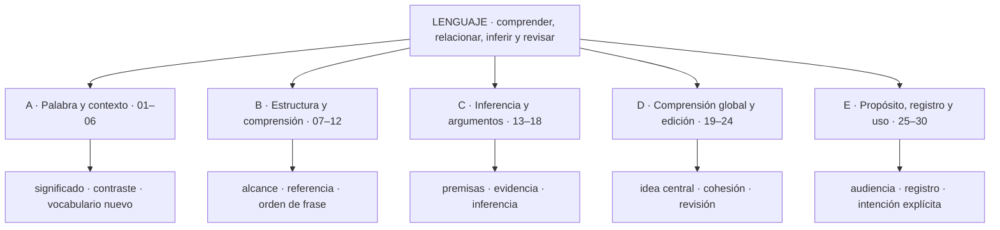
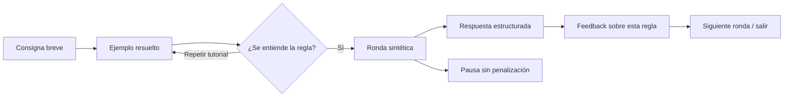

# Molvex · Lenguaje
## 30 modelos de práctica con filtro de calidad

| Versión | Fecha | Estado | Destino |
|---|---|---|---|
| 1.0 | 2026-10-04 | Propuesta conceptual · `DESIGN_ONLY / CONDITIONAL` | App móvil iOS + Android · estímulos sintéticos en español |

> Treinta modelos editoriales no son treinta ejercicios implementados ni treinta factores independientes. Cada propuesta exige una operación lingüística identificable y una respuesta comprobable; ninguna acredita efectos fuera de la tarea practicada. El documento no aprueba IDs, métricas oficiales, scoring, perfil, persistencia ni despliegue.

## Encargo y filtro de entrada

El objetivo razonable del bloque es ofrecer práctica variada de comprensión y razonamiento verbal: reconocer significado contextual, conservar alcance lógico, enlazar evidencia con afirmaciones y revisar mensajes breves. «Entrenar al máximo» significa practicar operaciones distintas con reglas transparentes, feedback útil y dificultad ajustable después de validación; no significa saturar de texto, premiar la velocidad ni inferir una capacidad global a partir de un minijuego.

Una propuesta solo entra si supera estas condiciones:

1. La jugada se puede explicar y resolver con un ejemplo completo.
2. Hay clave objetiva para el estímulo mostrado, con acierto, error, omisión y ensayo inválido distinguibles.
3. El único eje candidato cambia una dimensión de demanda, no el formato y el contenido a la vez.
4. Se identifica un atajo plausible y un resultado que obligaría a fusionar o retirar el modelo.
5. La tarea no depende de saber una palabra rara, una variedad regional concreta o una convención cultural no enseñada.
6. La respuesta libre, si se ofrece, no se atribuye al motor local actual como una medida formal.

### Evidencia y límites de interpretación

En adultos, la lectura de palabras nuevas en frases se ha estudiado manipulando diversidad contextual, espaciado y recuperación. Para este dossier, el hallazgo solo orienta cómo diseñar una práctica concreta de palabras en frases; no valida el producto ni sus resultados. [Pagán y Nation, 2019, estudio experimental](https://onlinelibrary.wiley.com/doi/full/10.1111/cogs.12705).

En un ensayo aleatorizado con adultos sanos, el entrenamiento adaptativo de memoria de trabajo verbal a nivel de frase no produjo evidencia estadísticamente significativa de transferencia cercana o lejana en los resultados estudiados. La población, el programa y las tareas no son los de Molvex; el resultado sirve como advertencia contra prometer transferencia automática, no como veredicto sobre estas propuestas. [Friedrich et al., 2017](https://www.frontiersin.org/journals/communication/articles/10.3389/fcomm.2017.00014/full).

Por tanto, los resultados candidatos de este catálogo se limitan a la tarea y al conjunto de estímulos. Una eventual sonda distinta, preregistrada y sin feedback, sería necesaria para estudiar retención o transferencia; un resultado de juego no basta para afirmar mejora cotidiana.

## Cartera editorial

| Zona | Modelos | Operación | Linaje |
|---|---:|---|---|
| A · Palabra y contexto | M01–M06 | Precisar significado, relaciones y aprendizaje de vocabulario ficticio | M01–M06 enlazan o amplían seis rutas ejecutables; varias propuestas son variantes que deben competir en piloto |
| B · Estructura y comprensión | M07–M12 | Resolver alcance, referencia, orden e implicaciones de frases | M07 enlaza una ruta ejecutable; restantes son contratos nuevos o variantes |
| C · Inferencia y argumentos | M13–M18 | Separar dato, conclusión, apoyo, contraejemplo y fuerza inferencial | M13–M14 enlazan rutas ejecutables; restantes son contratos nuevos |
| D · Comprensión global y edición | M19–M24 | Elegir resumen fiel, reparar cohesión y quitar ambigüedad | Contratos nuevos; cualquier redacción abierta se excluye del resultado formal |
| E · Propósito, registro y uso | M25–M30 | Adaptar interpretación a reglas explícitas de propósito y contexto | Contratos nuevos; variantes sociolingüísticas requieren validación local |

Los grupos son una organización práctica, no una estructura cerebral ni escalas separadas. Antes de publicar varias propuestas cercanas, se exige evidencia de que producen patrones de respuesta o predicciones distinguibles; si no, se fusionan. La selección de treinta no obliga a que treinta lleguen al producto.



### Linaje y significado de estados

`LIVE_LINEAGE` indica una ruta de tarea observada en el árbol inspeccionado; no indica calidad validada. `VARIANT` requiere demostrar una predicción distinguible de la familia base. `NEW_CONTRACT` necesita contrato, banco, revisión de claves y piloto. El catálogo en código actual tiene seis rutas de respuesta cerrada: EvidenceLock, SemanticSurgery, CompressionLadder, ArgumentXRay, ScopeNegation y SourceTriage. No se encontró evidencia en esa inspección de que cada una disponga de banco paramétrico amplio. La ruta evaluadora local devuelve confianza baja y no evidencia elegible; por eso ninguna respuesta abierta propuesta aquí obtiene puntuación formal por IA.

| Modelo | Linaje observado / propuesto |
|---|---|
| M01 | `LIVE_LINEAGE` · EvidenceLock |
| M02 | `LIVE_LINEAGE` · SemanticSurgery |
| M03 | `LIVE_LINEAGE` · CompressionLadder |
| M04 | `LIVE_LINEAGE` · ArgumentXRay |
| M05 | `LIVE_LINEAGE` · ScopeNegation |
| M06 | `LIVE_LINEAGE` · SourceTriage |
| M07 | `LIVE_LINEAGE` · ScopeNegation, otra regla de cuantificador |
| M08–M30 | `NEW_CONTRACT`, salvo la variante declarada en cada título |

Los nombres de rasgos internos existentes son linaje técnico, no nuevas métricas públicas autorizadas. No se reasignan identificadores taxonómicos en este documento.

## Experiencia móvil compartida



```text
┌──────────────────────────────┐
│ Lenguaje          04 / 10    │
│                              │
│ Lee el mensaje y elige       │
│ qué conclusión permite.     │
│                              │
│ «Todas las piezas verdes     │
│ tienen un punto. Esta ficha  │
│ tiene un punto.»             │
│                              │
│ ○ Es verde                   │
│ ○ Puede ser verde o de otro  │
│   color                      │
│                              │
│ [Responder]       [Pausar]   │
└──────────────────────────────┘
```

Wireframe conceptual, no captura ni interfaz aprobada. El texto debe poder ampliarse; foco y lectura deben seguir un orden lógico; las respuestas tienen botones con etiqueta, no solo color o gesto. El modo de acceso alternativo puede cambiar la demanda: si lo hace, se analiza como forma separada y no se comparan sus resultados sin estudio.

**Reglas comunes:** contenido breve, sintético, revisado por hablantes de España y de otras variedades; no usar modismos locales como clave salvo que se enseñen. Distinguir competencia en el formato, exposición léxica y lectura. Sin cronómetro como criterio central. No perfilar ortografía, dialecto, nivel educativo o familiaridad temática como capacidad lingüística general. En modelos de edición, ofrecer selección entre alternativas de respuesta con clave explícita; redacción libre solo como práctica/reflexión no puntuable. Guardar el mínimo de sesión necesario; estos modelos no necesitan diarios personales ni texto íntimo.

## Los 30 modelos

En todas las métricas siguientes, el denominador es el número de ensayos válidos efectivamente presentados y respondidos para esa regla; interrupciones, fallos de carga y omisiones se registran por separado y no se convierten en error. Cada eje es solo candidato: no hay umbrales ni adaptación aprobados.

### Zona A · Palabra y contexto

#### M01 · Bloquea la afirmación en el texto
**Linaje:** `LIVE_LINEAGE` · EvidenceLock. **Operación:** decidir si una frase está expresamente respaldada, contradicha o no determinada por un texto breve.

**Ronda resuelta:** texto: «El taller abre de martes a sábado. El jueves cierra a las 18:00». Afirmación: «El taller abre el lunes». Clave: **no determinado**; el texto no da el horario del lunes. Elegir “contradicho” también sería excesivo: podría abrir o no.

**Señal:** aciertos por categoría / ítems respondidos de cada categoría; no colapsar tres etiquetas si una clase escasea. **Eje candidato:** cantidad de cláusulas del texto. **Atajo/confusión:** elegir “no determinado” por descarte o por palabras raras. **Acceso/falsador:** texto ampliable y lectura en voz alta; retirar una forma si la carga lectora predice el resultado más que la distinción de evidencia, o si el texto admite dos claves razonables.

#### M02 · Cambia una pieza del significado
**Linaje:** `LIVE_LINEAGE` · SemanticSurgery. **Operación:** escoger la sustitución mínima que cambia una frase al significado indicado sin alterar lo demás.

**Ronda resuelta:** original: «La sala está abierta salvo los domingos». Objetivo: «La sala no abre ningún día». Opciones: cambiar “salvo” por “incluidos”; cambiar “abierta” por “cerrada”; borrar “los domingos”. Clave: ninguna opción logra el objetivo; la respuesta correcta es **ninguna de las anteriores**. El tutorial muestra que una reparación válida sería «La sala está cerrada todos los días».

**Señal:** selecciones de reparación exacta / frases válidas respondidas. **Eje:** número de cambios permitidos. **Atajo:** detectar una palabra con polaridad sin comprobar la frase entera. **Acceso/falsador:** texto y alternativas lineales, sin drag-and-drop; retirar si los distractores difieren en longitud o si una opción “mejor” depende del estilo preferido y no de la semántica.

#### M03 · Resume sin perder la regla
**Linaje:** `LIVE_LINEAGE` · CompressionLadder. **Operación:** elegir una paráfrasis breve que conserve condiciones y excepciones explícitas.

**Ronda resuelta:** original: «Se prestan paraguas de lunes a viernes; para llevártelo el fin de semana, debes reservarlo antes del jueves». Clave entre tres resúmenes: **«El préstamo entre semana es directo; para el fin de semana hace falta reservar antes del jueves»**. Un resumen que omita el plazo no conserva la regla.

**Señal:** resúmenes que conservan todas las proposiciones clave / textos respondidos. **Eje:** número de condiciones expresas. **Atajo:** elegir siempre la opción más larga. **Acceso/falsador:** las opciones se igualan en longitud y vocabulario; retirar o fusionar con M19 si la elección depende de extensión, memoria de trabajo no prevista o puntuación subjetiva de estilo.

#### M04 · Separa argumento y adorno
**Linaje:** `LIVE_LINEAGE` · ArgumentXRay. **Operación:** localizar conclusión, premisa y material que no aporta apoyo al argumento.

**Ronda resuelta:** «El huerto tiene suelo húmedo. Las plantas de esta variedad necesitan suelo húmedo. Por eso, el huerto cumple la condición de humedad que necesita esta variedad. El cartel del huerto es azul». Conclusión: **el huerto cumple la condición de humedad**; premisas: humedad del suelo y requisito de la variedad; el color del cartel es irrelevante. No se concluye que la planta vaya a crecer: podrían faltar otras condiciones.

**Señal:** componentes correctamente clasificados / componentes con clave inequívoca. **Eje:** número de frases irrelevantes. **Atajo:** escoger la oración final como conclusión sin leer conectores. **Acceso/falsador:** numerar las oraciones y permitir selección textual; retirar si el conector o posición revela la respuesta en todas las rondas o si las premisas no implican la conclusión propuesta.

#### M05 · Alcance de “no”
**Linaje:** `LIVE_LINEAGE` · ScopeNegation. **Operación:** distinguir qué parte de una proposición queda bajo una negación explícita.

**Ronda resuelta:** regla: «No todos los sobres contienen una tarjeta». Elige la equivalencia: **«Al menos un sobre no contiene tarjeta»**, no «Ningún sobre contiene tarjeta». El tutorial contrasta “no todos” con “ninguno”.

**Señal:** equivalencias correctas / expresiones respondidas por patrón de negación. **Eje:** número de cuantificadores en la oración. **Atajo:** asociar cualquier “no” con negación total. **Acceso/falsador:** apoyo con conjuntos de iconos además del texto; retirar si la notación gráfica impone conteo o la frase natural admite lecturas pragmáticas no previstas.

#### M06 · Elige la fuente pertinente
**Linaje:** `LIVE_LINEAGE` · SourceTriage. **Operación:** seleccionar qué fuente responde a una pregunta concreta y cuál no aporta información sobre ella.

**Ronda resuelta:** pregunta: «¿Qué día cierra el museo?». Fuentes: A) «Horario: martes-domingo; cierre a las 17:00»; B) «La entrada principal es azul»; C) «Abre de martes a domingo». Clave: A responde día y hora; C responde días, pero no hora; B es irrelevante. La pregunta separa “responde parcialmente” de “irrelevante”.

**Señal:** nivel de pertinencia correcto / fuentes evaluadas; reportar acuerdo por nivel. **Eje:** cantidad de fuentes irrelevantes. **Atajo:** elegir la tarjeta más larga. **Acceso/falsador:** rótulos accesibles y longitud igualada; retirar si la respuesta requiere conocimiento externo o si no se define si “parcial” cuenta como pertinente.

### Zona B · Estructura y comprensión

#### M07 · Cuantificador exacto
**Linaje:** `LIVE_LINEAGE` · variante de ScopeNegation. **Operación:** diferenciar “todos”, “alguno”, “ninguno” y “exactamente uno” en una población explícita.

**Ronda resuelta:** hay cuatro cajas; tres tienen etiqueta y una no. «Algunas cajas tienen etiqueta» es **verdadero**; «todas» es falso; «exactamente una no tiene etiqueta» es verdadero. Se responde una afirmación por ronda y se muestra el conjunto marcado.

**Señal:** juicios correctos / afirmaciones por cuantificador. **Eje:** tamaño del conjunto (manteniendo la proporción y la regla balanceadas). **Atajo:** contar iconos sin procesar el cuantificador. **Acceso/falsador:** cifras y lista textual como alternativa visual; fusionar con M05 si errores y curvas no se distinguen por negación frente a cuantificación.

#### M08 · ¿A quién se refiere “ella”?
**Linaje:** `NEW_CONTRACT`. **Operación:** resolver referencia pronominal usando restricciones explícitas de número y género gramatical, no estereotipos.

**Ronda resuelta:** «Nora llamó a Eva cuando ella llegó al estudio». El sistema presenta dos contextos: 1) «Nora llegó tarde; Eva ya esperaba»; 2) «Eva llegó tarde; Nora ya esperaba». Pregunta qué nombre sustituye “ella” en cada contexto revisado. Claves: Nora en 1, Eva en 2. Sin contexto suficiente, opción correcta: **no se puede determinar**.

**Señal:** referentes correctos / frases con contexto suficiente; medir aparte abstención adecuada. **Eje:** distancia en palabras al antecedente. **Atajo:** asumir que el pronombre apunta al nombre más cercano. **Acceso/falsador:** texto lineal, sin color de género; retirar si claves dependen de expectativas sociales o si persiste ambigüedad gramatical entre hablantes.

#### M09 · Orden que respeta la secuencia
**Linaje:** `NEW_CONTRACT`. **Operación:** reconstruir una secuencia temporal a partir de conectores y eventos explícitos.

**Ronda resuelta:** «Antes de sellar el paquete, Lía puso la tarjeta dentro. Después lo etiquetó». Orden correcto: **poner tarjeta → sellar paquete → etiquetar**. Las tres tarjetas se arrastran o se ordenan con botones accesibles; la regla de respuesta es la misma.

**Señal:** pares de eventos en orden correcto / pares comparables. **Eje:** número de eventos. **Atajo:** asumir el orden de lectura de las frases sin atender a conectores. **Acceso/falsador:** controles subir/bajar disponibles; retirar si la construcción permite secuencias paralelas o si el movimiento motor altera sistemáticamente la respuesta.

#### M10 · Condición suficiente y necesaria
**Linaje:** `NEW_CONTRACT`. **Operación:** interpretar una regla condicional sin invertir antecedente y consecuente.

**Ronda resuelta:** regla ficticia: «Si una pieza lleva sello, pasa al archivo». Se ve una pieza que pasó al archivo. ¿Se deduce que llevaba sello? Clave: **no**; la regla no dice que solo las piezas con sello pasen. Se ve después una pieza con sello: sí se deduce que pasa al archivo.

**Señal:** inferencias válidas seleccionadas / casos de afirmación y negación respondidos. **Eje:** forma lógica de la condición. **Atajo:** responder según conocimiento del mundo. **Acceso/falsador:** símbolos consistentes y ejemplos ficticios; retirar si el vocabulario “si” se interpreta como bicondicional por la pragmática del ítem.

#### M11 · Detecta una contradicción interna
**Linaje:** `NEW_CONTRACT`. **Operación:** comprobar compatibilidad de dos afirmaciones del mismo mensaje.

**Ronda resuelta:** «La biblioteca no abre ningún festivo. El lunes festivo abrirá a las 10:00». Clave: **contradicción**, bajo la lectura literal definida por el tutorial. Contraste: «No abre los festivos, excepto el lunes festivo» no es contradicción si la excepción se aplica a ese lunes.

**Señal:** tipo de relación correcto / pares con una relación definida por clave. **Eje:** presencia de excepción explícita. **Atajo:** detectar solo palabras incompatibles sin integrar cláusulas. **Acceso/falsador:** lectura pausada; retirar cuando una frase tiene alcance legal o institucional sujeto a convenciones no mostradas.

#### M12 · Sustituye sin cambiar el sentido
**Linaje:** `NEW_CONTRACT`. **Operación:** elegir una paráfrasis que mantiene condiciones de verdad en un contexto sintético.

**Ronda resuelta:** regla: «Solo los vehículos eléctricos entran en la zona»; es decir, si entra un vehículo, es eléctrico. La tarjeta pregunta si equivale a «Todos los eléctricos entran». Clave: **no**, esa segunda frase afirma lo contrario en dirección adicional. El sistema muestra conjuntos posibles como comprobación, no como pista para memorizar.

**Señal:** equivalencias acertadas / pares evaluables. **Eje:** número de cuantificadores y condiciones. **Atajo:** juzgar por semejanza léxica. **Acceso/falsador:** mostrar también una versión textual; fusionar con M10 si no hay una disociación clara entre equivalencia y condicional.

### Zona C · Inferencia y argumentos

#### M13 · Encuentra la evidencia que sí apoya
**Linaje:** `NEW_CONTRACT`. **Operación:** elegir un dato que aumenta el apoyo a una conclusión frente a alternativas dadas.

**Ronda resuelta:** conclusión: «La semilla A germina con menos luz que la B». Evidencias posibles: una comparación con luz igual y réplicas; una foto de A en un día soleado; el color del paquete. Clave: **comparación controlada**, porque diferencia luz manteniendo el resto igual.

**Señal:** evidencia discriminativa elegida / problemas con alternativas predefinidas. **Eje:** número de variables de confusión explícitas. **Atajo:** escoger la evidencia con números o más detalle. **Acceso/falsador:** igualar longitud y formato; retirar si la conclusión no sigue del diseño o la clave presupone experiencia científica no enseñada.

#### M14 · Qué conclusión permite la muestra
**Linaje:** `NEW_CONTRACT`. **Operación:** limitar una generalización al alcance de los casos observados.

**Ronda resuelta:** de 12 semillas de una variedad, 9 germinan bajo una condición. Clave permitida: **«En esta prueba germinaron 9 de 12»**. «El 75 % de todas las semillas germinará» no se deduce sin más datos. Se pide seleccionar la formulación que no excede la muestra.

**Señal:** conclusiones de alcance apropiado / conjuntos de resultados respondidos. **Eje:** tamaño de muestra indicado. **Atajo:** repetir la fracción como ley universal. **Acceso/falsador:** contar con iconos o tabla; retirar si el feedback confunde estimación descriptiva con predicción poblacional.

#### M15 · Detecta la premisa que falta
**Linaje:** `NEW_CONTRACT`. **Operación:** identificar cuál supuesto adicional haría válida una inferencia, sin afirmar que sea verdad fuera del juego.

**Ronda resuelta:** mundo ficticio: «El objeto Z pertenece al grupo L; por eso, su borde es azul». Pregunta qué regla general falta para que la conclusión se siga. Opciones: A) todos los objetos L tienen borde azul; B) todos los objetos con borde azul pertenecen a L; C) algunos objetos L tienen borde azul; D) los objetos del grupo Q tienen borde azul. Clave: **A**. La ronda declara que Z no pertenece a Q y que la única regla buscada debe conectar L con borde azul.

**Señal:** premisa estructural identificada / argumentos con clave de completitud. **Eje:** cantidad de premisas candidatas. **Atajo:** escoger la afirmación más rotunda. **Acceso/falsador:** opción «ninguna basta»; retirar si más de una premisa produce lógicamente el mismo puente.

#### M16 · Busca un contraejemplo mínimo
**Linaje:** `NEW_CONTRACT`. **Operación:** refutar una afirmación universal con un caso compatible con lo dado.

**Ronda resuelta:** afirmación: «Todos los mapas impresos muestran el norte arriba». Opciones: mapa A con norte arriba; mapa B con norte a la izquierda; mapa digital con rotación; foto de un mapa doblado. Clave: **mapa B**, un mapa válido que viola la afirmación universal.

**Señal:** contraejemplos válidos / afirmaciones universales evaluables. **Eje:** número de atributos que debe conservar el caso. **Atajo:** escoger la opción rara aunque no pertenezca a la clase afirmada. **Acceso/falsador:** texto descriptivo junto al dibujo; retirar si la pertenencia al conjunto requiere convención geográfica desconocida.

#### M17 · Causa o coincidencia
**Linaje:** `NEW_CONTRACT`. **Operación:** distinguir correlación observada de causalidad identificada por el diseño.

**Ronda resuelta:** «En días con más paraguas se venden más bebidas calientes». Datos observacionales no prueban que los paraguas causen ventas. Clave: **asociación compatible con varias causas**, incluida la lluvia. Una segunda tarjeta describe macetas idénticas asignadas al azar a dos cantidades de riego y compara su crecimiento; el usuario clasifica qué permite afirmar esa comparación sobre las macetas estudiadas, no sobre todas las plantas.

**Señal:** conclusión ajustada al diseño / estudios sintéticos respondidos. **Eje:** cantidad de variables alternativas nombradas. **Atajo:** memorizar «correlación no es causalidad» y rechazar toda conclusión causal. **Acceso/falsador:** feedback indica qué sí permite afirmar cada diseño; retirar si el ejemplo no identifica la causa propuesta.

#### M18 · Mide la fuerza del apoyo, no la verdad
**Linaje:** `NEW_CONTRACT`. **Operación:** clasificar si una evidencia apoya mucho, poco o nada una conclusión dentro de probabilidades dadas.

**Ronda resuelta:** dos cajas, A y B, generan una señal. La tabla del juego dice que la señal aparece en 8/10 casos A y 2/10 B. Pregunta: ¿la señal favorece A, favorece B o no discrimina? Clave: **favorece A, pero no lo prueba con certeza**.

**Señal:** dirección de actualización correcta / señales con distribución explícita; la magnitud se informa aparte solo si el control se valida. **Eje:** solapamiento entre distribuciones. **Atajo:** igualar «favorece» a certeza. **Acceso/falsador:** tabla y barras con cifras exactas; retirar si la inferencia requiere independencia o priors no dados.

### Zona D · Comprensión global y edición

#### M19 · Elige la idea central
**Linaje:** `NEW_CONTRACT` · forma distinta propuesta a CompressionLadder. **Operación:** escoger la frase que cubre todas las ideas principales y excluye un detalle accesorio.

**Ronda resuelta:** texto: «El club abrió dos turnos para repartir visitas. El primer turno se llenó rápido; el segundo permitió atender a más grupos sin alargar la jornada». Clave: **«Los dos turnos ampliaron la capacidad de visitas»**; el color del uniforme no aparece y no puede ser resumen.

**Señal:** idea central seleccionada / textos respondidos. **Eje:** número de ideas principales. **Atajo:** elegir la primera frase o la más abstracta. **Acceso/falsador:** marcar frases numeradas; fusionar con M03 si ambas dependen de compresión local sin patrón diferencial.

#### M20 · Repara una referencia confusa
**Linaje:** `NEW_CONTRACT`. **Operación:** elegir la edición mínima que hace inequívoco el referente.

**Ronda resuelta:** «Mara entregó a Inés el cuaderno cuando terminó la reunión». No se sabe quién terminó. Opciones incluyen «cuando Mara terminó» y «cuando Inés terminó». Clave: **no hay edición correcta sin contexto**; seleccionar «falta información». Variante resoluble: el contexto dice que Inés presidía la reunión, no quién terminó, por lo que la ambigüedad sigue.

**Señal:** identificación correcta de referencias resueltas o indeterminadas / frases evaluables. **Eje:** número de referentes compatibles. **Atajo:** aplicar proximidad del nombre. **Acceso/falsador:** ofrecer lectura y respuesta en botones; retirar si el contexto no elimina la ambigüedad de forma inequívoca.

#### M21 · Ordena conectores para conservar lógica
**Linaje:** `NEW_CONTRACT`. **Operación:** escoger el conector que expresa la relación entre dos cláusulas ya dadas.

**Ronda resuelta:** «La ruta era más corta; ___ estaba cerrada por obras». Opciones: por eso / sin embargo / por ejemplo. Clave: **sin embargo**, dada la relación adversativa explícita. El tutorial contrasta un caso causal en que “por eso” sí es correcto.

**Señal:** conector compatible / pares con clave acordada por revisores. **Eje:** número de relaciones discursivas candidatas. **Atajo:** asociar conectores con una palabra de la cláusula. **Acceso/falsador:** equilibrar frecuencia léxica; retirar si revisores nativos discrepan de la relación prevista.

#### M22 · Elimina una repetición sin borrar información
**Linaje:** `NEW_CONTRACT`. **Operación:** escoger la edición más breve que mantiene todos los datos relevantes declarados.

**Ronda resuelta:** «El tren salió a las ocho. La salida del tren fue a las ocho». Clave: borrar la segunda oración; ambas duplican el mismo dato. Contraste: «El tren salió a las ocho. Llegó a las diez», donde la segunda no es redundante.

**Señal:** ediciones que conservan la lista de proposiciones / textos editados. **Eje:** cantidad de proposiciones repetidas. **Atajo:** elegir siempre el texto más corto. **Acceso/falsador:** checklist visible de datos; retirar si se elimina una distinción temporal o pragmática necesaria.

#### M23 · Detecta una palabra que cambia el alcance
**Linaje:** `NEW_CONTRACT` · variante de M05/M07. **Operación:** localizar qué elemento modifica el conjunto cubierto por una afirmación.

**Ronda resuelta:** «Casi todos los paquetes llegaron» frente a «Todos los paquetes llegaron». Se muestran 10 paquetes; uno llegó tarde. Clave: **verdadera la primera, falsa la segunda**, siguiendo la convención cuantitativa del tutorial que define “casi todos” en ese ítem como 9/10. Esa definición debe aparecer en pantalla, no darse por universal.

**Señal:** juicios correctos por operador / enunciados con referencia explícita. **Eje:** distancia entre cantidad observada y umbral definido en el ítem. **Atajo:** adivinar el umbral usual. **Acceso/falsador:** umbral numérico visible; retirar si la respuesta depende de uso dialectal de “casi”.

#### M24 · Construye una cadena de referencias
**Linaje:** `NEW_CONTRACT`. **Operación:** seguir qué entidad nombran pronombres y descripciones definidas en un párrafo corto.

**Ronda resuelta:** «El robot A siguió al robot B. Este llevaba una luz roja». Si el contexto previo declara que solo B tiene luz roja, “este” refiere a B. Sin esa pista, la clave es **referencia ambigua**. El ejercicio alterna ambos tipos y pregunta por el estado de resolución.

**Señal:** entidades correctamente enlazadas / referencias evaluables, con ambigüedad reportada aparte. **Eje:** cantidad de entidades activas. **Atajo:** proximidad superficial. **Acceso/falsador:** tabla nombre→descripción además de lectura; retirar si la clave requiere pronombres cuyo uso varía entre variedades.

### Zona E · Propósito, registro y uso

#### M25 · Escoge la instrucción menos ambigua
**Linaje:** `NEW_CONTRACT`. **Operación:** elegir entre instrucciones cuál permite ejecutar una secuencia sin una decisión oculta.

**Ronda resuelta:** tarea: guardar un archivo con fecha. A) «Guárdalo pronto»; B) «Nombra el archivo AAAA-MM-DD y guárdalo en la carpeta Proyecto»; C) «Ponle un nombre claro». Clave: **B**, porque fija formato y destino.

**Señal:** instrucción con criterios explícitos / conjuntos de opciones respondidos. **Eje:** cantidad de parámetros omitidos. **Atajo:** elegir la opción más larga. **Acceso/falsador:** longitud igualada; retirar si B solo parece más formal y no mejora la reproducibilidad de ejecución.

#### M26 · Ajusta el mensaje a un propósito dado
**Linaje:** `NEW_CONTRACT`. **Operación:** seleccionar qué versión cumple un objetivo comunicativo explícito y neutral.

**Ronda resuelta:** propósito: avisar que una sala estará cerrada el martes y proponer el miércoles. Clave: el mensaje que contiene **cierre + día + alternativa**, sin añadir una explicación inventada. Se comparan tres mensajes similares en extensión y tono.

**Señal:** componentes informativos presentes / mensajes respondidos. **Eje:** cantidad de requisitos comunicativos. **Atajo:** preferir cortesía o estilo propio. **Acceso/falsador:** puntuar solo requisitos declarados; retirar si la respuesta correcta depende de jerarquías laborales o normas sociales no incluidas.

#### M27 · Distingue petición, oferta y afirmación
**Linaje:** `NEW_CONTRACT`. **Operación:** clasificar la función literal indicada por forma y contexto suficiente, evitando atribuir intención oculta.

**Ronda resuelta:** A) «¿Puedes cerrar la ventana?»; B) «Puedo cerrar la ventana si quieres»; C) «La ventana está abierta». Con contexto «A pregunta a la persona que está junto a la ventana», A se marca como **petición indirecta convencional**; B como oferta; C como afirmación. El feedback señala que clasifica el acto probable del texto, no la intención mental real.

**Señal:** función textual seleccionada / casos con contexto suficiente. **Eje:** cantidad de pistas contextuales explícitas. **Atajo:** etiquetar todo interrogativo como pregunta literal. **Acceso/falsador:** ofrecer “ambas lecturas posibles”; retirar si un panel de hablantes nativos detecta variación sistemática no cubierta.

#### M28 · Elige el registro que cumple la consigna
**Linaje:** `NEW_CONTRACT`. **Operación:** distinguir una propiedad de registro definida en la consigna, no juzgar qué forma de hablar es superior.

**Ronda resuelta:** consigna ficticia: «Para esta carta administrativa, usa el pronombre “usted” y evita abreviaturas». Entre tres mensajes, clave el que usa “usted” y escribe “información” completo. No se puntúan acento, dialecto, gramática regional ni nivel educativo.

**Señal:** requisitos de registro cumplidos / requisitos por mensaje. **Eje:** número de restricciones expresas. **Atajo:** asociar longitud con formalidad. **Acceso/falsador:** explicar cada restricción; retirar si el ítem penaliza una variedad legítima que no infringe la consigna.

#### M29 · Lee la metáfora según la clave local
**Linaje:** `NEW_CONTRACT`. **Operación:** resolver una expresión figurada cuando el contexto del propio ítem define su sentido.

**Ronda resuelta:** «Al revisar el plan, el equipo encontró un agujero: faltaba decidir quién abriría el local». Clave: **una parte importante sin resolver**, no un agujero físico. El siguiente ítem contrasta un uso literal acompañado de contexto físico inequívoco.

**Señal:** interpretación contextual / expresiones con contexto suficiente. **Eje:** grado de apoyo contextual. **Atajo:** familiaridad previa con modismos. **Acceso/falsador:** permitir “no conozco la expresión” sin penalización y validar regionalmente; retirar cualquier frase cuyo sentido no sea recuperable por la pista.

#### M30 · Revisa una explicación con una fuente nueva
**Linaje:** `NEW_CONTRACT` · síntesis de comprensión y evidencia. **Operación:** actualizar qué conclusión está apoyada al recibir una nota que aclara una frase ambigua.

**Ronda resuelta:** nota inicial: «El paquete llegó después del aviso». Se presentan dos lecturas temporales posibles. La aclaración dice: «El aviso se envió el lunes y la entrega ocurrió el martes». Clave: revisar la conclusión a **entrega posterior al envío** y retirar la lectura inversa. La ronda siguiente usa una aclaración insuficiente para que “no se puede decidir” sea la clave.

**Señal:** interpretación final compatible con todas las notas / secuencias con aclaración válida. **Eje:** número de aclaraciones necesarias. **Atajo:** aceptar siempre la última frase como corrección total. **Acceso/falsador:** conservar visible el historial; retirar si una misma secuencia acepta dos cronologías coherentes.

## Revisión adversarial · Red team secuencial

**Alcance:** revisión del documento de Lenguaje como propuesta. No es revisión independiente; la realiza el mismo autor del catálogo, por lo que no certifica ausencia de sesgos ni sustituye revisión externa, lingüística o de QA.

| Perspectiva | Ataque concreto | Defensa incorporada | Riesgo residual / decisión |
|---|---|---|---|
| Atacante de métrica | Repetir un banco pequeño hasta memorizar claves o explotar la posición de la respuesta | Distinguir bancos observados de nuevos; balancear posición y forma; medir por categoría; no autorizar perfiles con estos resultados | Cobertura real y filtración requieren auditoría de banco y piloto; bloquea publicación, no el dossier conceptual |
| Usuario caótico | Responder rápido al azar, pausar, reintentar o usar lector de pantalla y obtener una señal artificialmente alta/baja | Sin premio por velocidad; pausa y omisión no son error; alternativa de acceso explícita; conservar por separado cada modalidad | Comparabilidad por modalidad pendiente de datos de accesibilidad |
| Lógico escéptico | Impugnar claves, generalizaciones o que treinta títulos sean en realidad pocas tareas repetidas (por ejemplo, M05/M07/M23; M03/M19; M08/M20/M24) | Se limita cada regla, se ofrece alternativa “no se puede determinar” cuando procede y se exige comparar predicciones y errores entre pares | Revisión doble por hablantes y prueba de discriminación antes de activar; fusionar pares sin evidencia de separación, aunque el catálogo deje de contar treinta familias |
| Realidad operativa | Intentar puntuar prosa abierta con el evaluador local o afirmar transferencia desde aciertos dentro de la app | Solo respuestas cerradas/estructuradas puntúan en la propuesta; texto libre sería formativo; estados de implementación y eficacia separados | Integración iOS/Android, calibración, privacidad de eventos y validez no verificados |

### Criterio de puerta

Resultado del red team: **PASA COMO DOCUMENTO DE DISEÑO `DESIGN_ONLY / CONDITIONAL`**. No se identificó un defecto P0/P1 sin mitigación dentro del alcance editorial tras aplicar las defensas anteriores. No pasa como aprobación de producto: queda condicionado a revisión lingüística independiente, cobertura/versionado de bancos, pruebas de accesibilidad por plataforma, piloto de fiabilidad/validez y análisis de privacidad antes de cualquier implementación o afirmación de eficacia. Este pase solo autoriza continuar con la secuencia de diseño solicitada.

## Cierre y siguiente puerta

**Decisión editorial:** conservar 30 propuestas como cartera para evaluación comparativa; no publicarlas como 30 familias ni incorporar todas por alcanzar la cifra. Mayor prioridad conceptual: formas cerradas de evidencia, alcance e inferencia, siempre que se demuestre que sus errores no son meras diferencias de lectura o escolarización. Variantes que no separen predicciones se fusionan.

**Fuera de alcance:** generación o scoring abierto por IA; puntuación verbal global; ranking por dialecto, vocabulario cultural o tiempo; evaluación clínica; afirmaciones de transferencia; cambios de código, taxonomía, datos, perfil o release.

**Criterio para reabrir:** cada candidata necesita especificación versionada, validación de contenido por hablantes/revisores, banco sin claves filtradas, protocolo de acceso, definición de exclusiones, análisis por idioma/variedad, piloto y, por separado, estudio de retención/transferencia. Ningún umbral de éxito se inventa en este documento.

**Fuentes de linaje actual:** [catálogo de seis rutas](../../../shared/src/commonMain/kotlin/com/mindos/app/features/mindboost/language/presentation/exercises/LanguageExerciseCatalog.kt), [banco EvidenceLock](../../../shared/src/commonMain/kotlin/com/mindos/app/features/mindboost/language/presentation/exercises/EvidenceLockBank.kt), [taxonomía del bloque](../../../shared/src/commonMain/kotlin/com/mindos/app/features/mindboost/language/domain/model/LanguageTaxonomy.kt), [evaluador local](../../../shared/src/commonMain/kotlin/com/mindos/app/features/mindboost/language/domain/evaluator/LocalStubEvaluatorClient.kt). Inspección estática del working tree; no se ejecutaron pruebas ni builds para este dossier.
