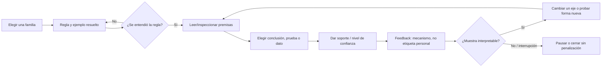

# Molvex · Lógica
## 30 modelos de práctica con filtro de calidad

| Versión | Fecha | Estado | Destino / uso |
|---|---|---|---|
| 1.0 | 2026-10-03 | Propuesta conceptual completa · `DESIGN_ONLY / CONDITIONAL` | App móvil iOS + Android · entrenamiento no clínico |

> Este documento selecciona treinta modelos de práctica de operaciones de razonamiento observables. No afirma que existan treinta capacidades independientes, que estén implementados los treinta ejercicios, que su score mida una «inteligencia lógica» general ni que su uso aumente el CI. El filtro editorial acredita especificación conceptual, no eficacia, validez psicométrica, dosis óptima, equivalencia iOS/Android o transferencia cotidiana.

## Brief y estándar de admisión

El bloque Lógica debe permitir practicar cómo derivar conclusiones necesarias, representar relaciones, buscar contraejemplos, evaluar evidencia y corregir una inferencia. El reto no es fabricar treinta pantallas: cada ficha debe pedir una operación que pueda distinguirse de sus vecinas y sobrevivir a un cambio de forma superficial. Se usan problemas autocontenidos, reglas explícitas y material sintético; no se puntúa conocimiento profesional, ideología, experiencia laboral ni familiaridad con un dominio.

«Entrenar al máximo» se traduce aquí en maximizar oportunidades de razonamiento deliberado, feedback específico y variedad de estrategias que pueda probarse. No equivale a maximizar velocidad, carga de texto, longitud por sí sola o un score agregado. Una mejora en los mismos ítems puede ser aprendizaje del formato. Una generalización a reglas nuevas es una hipótesis de transferencia cercana; el beneficio funcional necesita outcomes externos independientes.

### Puerta editorial

Un modelo entra solo si declara: operación primaria; paso a paso prototipable; ejemplo con respuesta justificable; clase de error interpretable; un eje gobernante de dificultad; atajo plausible y defensa; barrera de acceso/confusor; condición que lo refutaría; estado y linaje. Si solo cambia tema, paleta o redacción, se agrupa como forma de otro modelo. Las pruebas de evaluación reservadas se separan del entrenamiento y no se usan para adaptar dificultad.

### Qué significa «30» en esta cartera

| Clase | Fichas | Interpretación |
|---|---:|---|
| Familias propuestas | M01–M24, M26–M28 | 27 candidatos de mecanismo, aún sujetos a fusión si no muestran predicciones distintas. |
| Overlay transversal | M29 | Confianza/metacognición sobre ensayos existentes; no juego ni capacidad independiente. |
| Protocolo de práctica | M30 | Secuencia de decisión y reintento; no suma un constructo al catálogo. |

El recuento de fichas satisface el encargo editorial, no una cuota de capacidades independientes ni un requisito para lanzar las treinta. La cartera inicial debería elegir pocas familias complementarias y validar su señal antes de ampliar.

## Mapa gráfico de cobertura

```mermaid
flowchart TB
  LOG["LÓGICA · derivar, comprobar, revisar y decidir con reglas explícitas"]
  LOG --> D["01–05 · Deducción y formalización"]
  LOG --> R["06–10 · Prueba, refutación y reparación"]
  LOG --> U["11–15 · Inducción, causalidad e incertidumbre"]
  LOG --> A["16–20 · Relaciones y argumentos"]
  LOG --> I["21–25 · Información, restricciones y estrategias"]
  LOG --> X["26–30 · Transferencia y metacognición"]
  D --> M01["01 Conclusión necesaria"]
  D --> M02["02 Cadenas de inferencia"]
  D --> M03["03 Necesaria / suficiente"]
  D --> M04["04 Cuantificadores y conjuntos"]
  D --> M05["05 Subdeterminación"]
  R --> M06["06 Selección condicional"]
  R --> M07["07 Contraejemplo mínimo"]
  R --> M08["08 Consistencia"]
  R --> M09["09 Orden de prueba"]
  R --> M10["10 Reparar inferencia"]
  U --> M11["11 Inducir una regla"]
  U --> M12["12 Abducción competitiva"]
  U --> M13["13 Causalidad e intervención"]
  U --> M14["14 Tasas base y frecuencias"]
  U --> M15["15 Revisión de creencias"]
  A --> M16["16 Analogía relacional"]
  A --> M17["17 Anatomía del argumento"]
  A --> M18["18 Supuesto oculto"]
  A --> M19["19 Falacia precisa"]
  A --> M20["20 Validez vs fuerza"]
  I --> M21["21 Valor de información"]
  I --> M22["22 Restricciones múltiples"]
  I --> M23["23 Representación externa"]
  I --> M24["24 Flexibilidad estratégica"]
  I --> M25["25 Resistencia adversarial"]
  X --> M26["26 Inferencia suprimida explícita"]
  X --> M27["27 Formalización verbal"]
  X --> M28["28 Probe de transferencia funcional"]
  X --> M29["29 Confianza · overlay"]
  X --> M30["30 Elegir, comprobar y revisar · protocolo"]
```

Los seis grupos son una organización editorial. No equivalen a seis factores latentes ni garantizan que dos tareas de un mismo grupo sean intercambiables. La tabla siguiente indica el mecanismo diferencial y dónde la cartera puede estar contando variantes cercanas.

| Zona | Núcleo que debe observarse | Solapamiento a controlar |
|---|---|---|
| Deducción | Si la conclusión está implicada por las premisas, aunque resulte rara. | M01/M02 comparten derivación; M03 es lectura condicional si no obliga a evaluar contracasos. |
| Prueba y reparación | Qué observación o premisa refuta, contradice o repara una estructura. | M06/M07/M08 son falsación bajo formatos distintos; M09/M10 solo aportan si la estructura de prueba cambia. |
| Inducción/uncertainty | Elegir regla o explicación mejor apoyada sin convertir apoyo en certeza. | M11/M12/M15 pueden degenerar en elección de opción plausibilista; se necesitan predicciones discriminantes. |
| Argumentos | Separar forma, premisas, supuestos, evidencia y plausibilidad. | M17–M20 dependen de texto; neutralizar vocabulario, conocimiento y lectura. |
| Decisión/representación | Elegir qué dato obtener o qué estrategia/representación hace el problema comprobable. | M21/M24/M30 son decision protocols, no tres scores cognitivos. |
| Transferencia/meta | Mantener forma frente a nuevo contexto y reportar incertidumbre. | M28 es evaluación reservada; M29 overlay; ninguno debe inflar el catálogo entrenable. |

## Estado observado y linaje

En el snapshot local observado para este dossier, `LogicModels.kt` declara 28 valores de `LogicSkill`, cinco `LogicExerciseType` y contratos de respuesta con opción seleccionada, premisas marcadas, regla, claim de justificación, confianza, pistas y tiempo software. `DefaultLogicContentProvider` contiene seis ítems autorados: deducción, prueba de condicional, necesario/suficiente, control de consistencia, contraejemplo y un segundo ítem isomorfo de prueba condicional. Es un paquete pequeño y fijo; que una habilidad figure en un enum no prueba que tenga banco, pantalla, ruta de sesión o métrica validada.

La sesión observada toma ítems del proveedor y limita la lista a la configuración, y la recomendación adaptativa se produce después de la sesión. No se observó generador paramétrico ni selección efectiva de dificultad de contenido. Por tanto, la escala de cinco niveles no debe presentarse como progresión ya expresada por ítems. El contrato actual es mayor que los seis contenidos: opciones, premisas, regla y justificación permiten describir respuestas estructuradas; no se infiere soporte para texto libre, diagramas editables, tablas, árboles de prueba, entradas numéricas o selección de experimentos. M29 puede describirse como principio de diseño, no como calibración ya probada.

El árbol tenía cambios de trabajo previos en archivos de Lógica. La observación de código queda anclada al working tree visto el 2026-10-03, no a un baseline limpio o una auditoría independiente. No se ejecutaron pruebas. El código observado sirve para delimitar contratos, no para revalidar scoring, calidad de contenido, comparabilidad o elegibilidad. La versión `CURRENT=2` de scoring y la regla que evita comparar versiones distintas quedan fuera de este rediseño; ninguna ficha propone recomputar sesiones históricas.

| Estado en ficha | Significado |
|---|---|
| `LIVE_TYPE` | Existe un tipo actual cercano y ejemplo dentro del pack fijo; solo demuestra expresabilidad de una forma, no una familia lista ni compatibilidad completa. |
| `SKILL_ONLY` | Hay habilidad/taxonomía relacionada, pero no contenido/generador observado que exprese este modelo. |
| `VARIANT / REDESIGN` | Extiende una familia/tipo existente; no merece identidad adicional hasta probar diferencia sustantiva. |
| `REQUIRES_NEW_RESPONSE` | La mecánica pide construcción, selección múltiple, gráfico, tabla o decisión que no se deduce del contrato/render actual. |
| `PROBE_ONLY` | Material no entrenado, fijo y protegido; no alimenta adaptación ni perfil como si fuera entrenamiento. |
| `OVERLAY / PROTOCOL` | Acompaña a otras familias y no cuenta como juego independiente. |

### Diseños previos de Lógica

El documento histórico `docs/mindboost_exercise_design/03_3_Logica.md` plantea diez modelos: Cadena Deductiva Progresiva, Detector de Contradicción Latente, Necesario vs Suficiente, Caza-Contraejemplo, Silogismo Categórico con Diagrama Mental, Inferencia Bayesiana Cualitativa, Transferencia Espejo, Ordenar la Derivación, Inferencia Suprimida y Puente de Analogía Estructural. Se reutiliza su intención como linaje para M02, M08, M03, M07, M04, M14, M28/sonda, M09, M26 y M16, respectivamente. Son propuestas históricas, no diez aprobaciones, diez implementaciones o evidencia de calidad. Se corrigen aquí dos riesgos recurrentes: no puntuar velocidad como razonamiento sin contrato temporal validado y no asumir contexto cultural para completar premisas ausentes.

## Contrato común de experiencia

### Bucle móvil propuesto

- Estados de una futura implementación: preparación, demostración, práctica guiada, verificación de comprensión, ensayo, respuesta, confianza opcional, feedback, pausa, reanudación, cierre y fallo técnico. Un timeout por background no es una respuesta lógica incorrecta.
- Instrucción y contenido deben hacer explícito si se evalúa necesidad deductiva, probabilidad, plausibilidad o regla práctica. «Parece cierto» no significa «se sigue necesariamente».
- El sistema debe aceptar «no se puede determinar» cuando sea una respuesta válida; no usarla como comodín penalizable ni premiar decirla siempre.
- Formación y probe difieren: feedback de estrategia permitido en entrenamiento; probe de progreso fija regla, forma y criterio, reserva ítems, no muestra solución antes del final y no adapta durante la administración.
- Un ensayo completo puede necesitar más de una acción: respuesta, premisas usadas, regla y justificación. Si la interfaz recoge solo una alternativa, se etiqueta como reconocimiento, no como prueba de derivación.

### Métricas, errores y dificultad

Guardar/derivar por ensayo únicamente lo necesario para el uso aprobado: identidad/versiones del ítem y estructura, respuesta, clase de distractor, soporte seleccionado cuando aplique, comprensión de regla, confianza opcional, pista, finalización e integridad. Respuesta no válida, omisión, interrupción técnica, abandono y error de lógica son estados distintos. No equiparar una latencia de software con tiempo mental: mínimo temporal de contrato no es una medida cognitiva validada.

Reportar métricas específicas: conclusión necesaria correcta sobre oportunidades resolubles; falsos positivos de consecuencia; falsos negativos; premisas relevantes omitidas/extras cuando la rúbrica permite interpretarlo; refutación válida; falsa contradicción; selección de evidencia; discriminación entre casos; confianza y calibración con denominador suficiente. No sumar todo en un «IQ lógico» ni usar precisión global si clases de respuesta están desbalanceadas. Métricas ausentes o inestables se dejan no disponibles, no cero.

Cada ficha asigna un solo eje gobernante candidato. Cadena más larga, texto más denso, más premisas irrelevantes y más distractores simultáneos no son una progresión interpretable. Los parámetros restantes se mantienen constantes o se investigan en experimento separado. Sin suficientes ensayos, el nivel se retiene; no se adapta en respuesta a un patrón único ni se declara fatiga a partir de una sola respuesta rápida.

### Acceso, plataforma y privacidad

- Tareas sin permisos sensibles; todos los dominios, reglas, entidades, diagramas y datos son sintéticos. No acceder a email, calendario, contactos, archivos, actividad académica o laboral.
- iOS y Android deben compartir lógica determinista, reglas, casos válidos, versión de estímulos y rúbrica. Renderizado, safe areas, tamaños, TalkBack/VoiceOver, teclado, rotación, interrupciones y offline requieren verificación independiente en dispositivo; no se certifican aquí.
- Texto ampliable, contraste, marcadores no basados solo en color, objetivos táctiles claros y reducción de animación. Diagramas llevan descripción estructurada y alternativa textual; si cambia la representación y con ella la demanda, se etiqueta condición distinta, no se llama equivalente sin evidencia.
- Limitar lectura irrelevante: instrucciones cortas, términos ficticios definidos, sintaxis simple y control de comprensión. Evitar cuentas aritméticas, conocimientos de software/negocio y vocabulario avanzado, salvo que sean variable explícita y validada.
- Sin presión de tiempo como eje por defecto. Sin animaciones durante el intervalo de razonamiento. Pausa y recuperación tras interrupción deben preservar estado o invalidar el ensayo con motivo explícito.
- Entrenamiento offline y determinista; no usar IA generativa para crear en vivo una premisa, respuesta correcta o puntuación. Un futuro generador necesita seed reproducible, validador/oráculo y revisión de sesgo.
- No transmitir texto libre (si se llegara a permitir), respuesta detallada o perfiles inferidos por defecto. Todo dato propuesto necesita finalidad, minimización, retención y límite de acceso aprobados.

## Los 30 modelos

### Zona 1 · Deducción y formalización

#### M01 · ¿Qué se sigue necesariamente?
**Estado/linaje:** `LIVE_TYPE` · `DEDUCTION_FROM_PREMISES`; relación con diseño histórico de cadena deductiva. **Operación:** distinguir consecuencia lógica de inferencia plausible.

**Pantalla y jugada:** tres tarjetas: «Todo neral marcado tiene una ficha», «La pieza A está marcada», «A tiene ficha». Pregunta: ¿qué conclusión se sigue necesariamente? Distractores: «toda pieza con ficha está marcada» y «A está dañada». Respuesta correcta: la pieza A tiene ficha; el resto no se deriva.

**Lectura de respuesta:** elegir conclusión y, si la interfaz lo permite, premisas exactas y regla. Opción acertada sin soporte no demuestra que la persona haya usado la regla. Feedback muestra la implicación y nombra la sobre-generalización sin etiquetar al usuario.

**Medida y eje:** aciertos / ítems válidos; soporte preciso / casos que exigen soporte. Eje candidato: cantidad de premisas distractoras, con longitud de derivación fija.

**Atajo y defensa:** coincidencia de palabras; balancear términos y opciones, exigir transferencia a estructura nueva. **Acceso/falsador:** vocabulario corto y modo simbólico definido; refutar si éxito depende de recordar opciones o conocimiento léxico.

#### M02 · Cadena de dos o más inferencias
**Estado/linaje:** `VARIANT / REDESIGN` del tipo de deducción; propuesta previa 01. **Operación:** mantener una derivación intermedia y enlazar reglas válidas.

**Pantalla y jugada:** premisas `P→Q`, `Q→R`, `P`; se pide qué queda forzado. Respuesta: `R`, con `Q` como paso intermedio. Un distractor ofrece `P→R` como si fuese una premisa recibida; otro infiere `¬P` desde `¬Q` sin regla suficiente.

**Lectura de respuesta:** conclusión más ruta de pasos verificable por oráculo formal; no se corrige comparando con una sola secuencia si varias pruebas son válidas. Feedback identifica el primer paso no justificado.

**Medida y eje:** conclusiones válidas y pasos válidos / oportunidades; eje: profundidad de derivación (una transición cada vez). Mantener cantidad de premisas constantes.

**Atajo y defensa:** adivinar una cadena por la letra final; usar formas y reglas nuevas, distractores con error diagnóstico. **Acceso/falsador:** opción de selección paso a paso, sin drag obligatorio; refutar si solo sube recuerdo de plantillas o si el paso intermedio se resuelve por memoria de trabajo incidental.

#### M03 · Condición necesaria, suficiente o ambas
**Estado/linaje:** `LIVE_TYPE` · `NECESSARY_SUFFICIENT`; diseño previo 03. **Operación:** preservar dirección e implicación al clasificar condiciones.

**Pantalla y jugada:** «Para entrar al archivo se requiere una clave válida. Tener la clave no garantiza autorización». Clasificar clave como necesaria/suficiente/ambas/ninguna. Correcta: necesaria, no suficiente. Control: otra forma que declara equivalencia explícita.

**Lectura de respuesta:** pregunta auxiliar con contracaso: ¿puede entrar sin la condición? ¿Puede cumplirse la condición sin alcanzar el resultado? Esto diferencia comprensión de selección memorizada de etiquetas.

**Medida y eje:** clasificación correcta por condición y errores de inversión; eje: presencia de condiciones concurrentes, dejando sintaxis fija.

**Atajo y defensa:** memorizar el orden de palabras; alternar dirección sujeto/resultado y exigir escoger contraejemplo. **Acceso/falsador:** diagramas `A→B` con descripción; refutar si estudiantes contestan por pistas gramaticales y fallan con la misma forma abstracta.

#### M04 · Cuantificadores y conjuntos
**Estado/linaje:** `SKILL_ONLY` (`QUANTIFIERS`, `CONSISTENCY`); incluye silogismo categórico del diseño previo 05. **Operación:** verificar «todos/algunos/ninguno» sin convertir existencia o inclusión en equivalencia.

**Pantalla y jugada:** «Todos los lumas son verdes. Algunos verdes son circulares». Pregunta si se concluye que algunos lumas son circulares. Correcta: no se puede determinar. El diagrama de conjuntos admite que los circulares verdes estén fuera de lumas.

**Lectura de respuesta:** conclusión + región/caso posible que valida o refuta la necesidad. Una imagen no debe insinuar escala o solapamiento no declarado.

**Medida y eje:** validez de conclusión y contramodelo seleccionado / casos cuantificados; eje: tipo de cuantificador, con número de conjuntos fijo.

**Atajo y defensa:** aceptar intersección dibujada como hecho; variar diagramas posibles y exigir evaluar todos los modelos compatibles. **Acceso/falsador:** formas y etiquetas redundantes, alternativa textual; refutar si la demanda principal observada es leer el diagrama en lugar de razonar con cuantificadores.

#### M05 · Indeterminación: lo que no permiten concluir
**Estado/linaje:** `LIVE_TYPE` como forma de conclusión de premisas; rediseño del distractor «no se determina». **Operación:** detectar subdeterminación y abstenerse de completar huecos.

**Pantalla y jugada:** «Si la alarma está activa, la luz se enciende. La luz está encendida». Pregunta si la alarma está activa. Respuesta: no se puede concluir; otra causa puede encender la luz. Pares de control sí permiten inferir con `alarma activa` como premisa.

**Lectura de respuesta:** elección triádica: se sigue / se contradice / no determinado. Añadir un caso compatible donde el antecedente sea falso para probar que la regla y el hecho no fijan una única respuesta.

**Medida y eje:** aciertos por clase lógica; eje: número de modelos compatibles que el participante debe considerar, empezando por un par mínimo.

**Atajo y defensa:** seleccionar siempre «no determinado»; balancear condiciones que fuerzan, contradicen y dejan abierto. **Acceso/falsador:** etiquetas consistentes; refutar si la opción correcta es identificable por longitud, posición o vaguedad del lenguaje.

### Zona 2 · Prueba, refutación y reparación

#### M06 · Selección de caso crítico para una regla condicional
**Estado/linaje:** `LIVE_TYPE` · `CONDITIONAL_TEST`; propuesta previa 02. **Operación:** seleccionar el caso que puede falsar `si P, entonces Q`.

**Pantalla y jugada:** regla «si una tarjeta lleva sello P, debe mostrar marca Q». Se muestran cuatro tarjetas: `P+Q`, `P+¬Q`, `¬P+Q`, `¬P+¬Q`. Para probar la regla, hay que voltear `P` y `¬Q`; la tarea dice si se busca probar o falsar.

**Lectura de respuesta:** selección del conjunto mínimo pertinente, no solo acierto en una tarjeta. El feedback separa confirmación (`P,Q`) de posible refutación (`P,¬Q`).

**Medida y eje:** casos críticos elegidos / decisiones; selección de confirmatorios como error de búsqueda. Eje: una regla a dos reglas concurrentes, no velocidad.

**Atajo y defensa:** elegir todas o solo las que «parecen importantes»; pedir conjunto mínimo y comparar casos balanceados. **Acceso/falsador:** cartas con símbolos y texto accesible; refutar si selección total puntúa igual que test informativo.

#### M07 · Construir un contraejemplo mínimo
**Estado/linaje:** `LIVE_TYPE` · `COUNTEREXAMPLE`; diseño previo 04. **Operación:** mantener premisas verdaderas y hacer falsa la conclusión.

**Pantalla y jugada:** argumento «Todo objeto cuadrado es azul; esta pieza es azul; luego es cuadrada». Elegir entre casos. Correcto: una pieza azul redonda, pues deja posibles las premisas y falsifica la conclusión. No sirve un caso que diga que ninguna pieza cuadrada es azul porque contradice la premisa.

**Lectura de respuesta:** validar por dos condiciones lógicas separadas; feedback muestra cuál falló: premisa rota o conclusión aún posible. Los generadores futuros requieren oráculo que compruebe satisfacibilidad.

**Medida y eje:** contraejemplos válidos / oportunidades; errores de premisa falsa o conclusión no refutada. Eje: número de condiciones a preservar.

**Atajo y defensa:** elegir cualquier historia rara; todas las opciones deben verificarse mecánicamente. **Acceso/falsador:** respuesta por selección, sin exigir redacción; refutar si las opciones no están inequívocamente diferenciadas.

#### M08 · Detector de consistencia y núcleo mínimo
**Estado/linaje:** `LIVE_TYPE` · `CONTRADICTION_DETECTION`; diseño previo 02. **Operación:** distinguir incompatibilidad real de estados que pueden coexistir.

**Pantalla y jugada:** «El sensor está activo solo si recibió energía. Sensor A no recibió energía. Sensor A está en modo de espera». Esto es consistente. En un ensayo contradictorio: «A está activo» y «A no está activo». Pregunta binaria y luego identificar núcleo mínimo solo cuando exista.

**Lectura de respuesta:** separar falsa alarma (declarar inconsistente un conjunto posible) de contradicción no detectada. Un futuro núcleo puede tener dos o más premisas; no premiar marcar la lista entera.

**Medida y eje:** aciertos por clase; falsa alarma / conjuntos consistentes, misses / inconsistentes; eje: profundidad de contradicción derivada, con tamaño del set estable.

**Atajo y defensa:** marcar siempre contradicción por tono adversarial; incluir controles consistentes y contramodelos. **Acceso/falsador:** no depender de pragmática del mundo; refutar si «modo espera» exige conocimiento técnico no definido.

#### M09 · Ordenar la prueba, no memorizar una ruta
**Estado/linaje:** `SKILL_ONLY` (`PROOF_REFUTATION`, `MULTISTEP_CONSTRAINTS`); diseño previo 08. `REQUIRES_NEW_RESPONSE` si se construye/ordena. **Operación:** distinguir premisas, pasos y conclusión válidos.

**Pantalla y jugada:** se dan `P→Q`, `Q→R`, `P` y tres pasos candidatos. El usuario ordena o elige el siguiente paso justificable: de `P` y `P→Q`, obtener `Q`; después `R`. Si hay varias pruebas válidas, todas se aceptan por relación de precedencia.

**Lectura de respuesta:** validador de grafo de prueba, no comparación de secuencia literal. No usar drag como componente obligatorio; una selección accesible puede mantener el mismo objetivo.

**Medida y eje:** transiciones válidas / transiciones intentadas; eje: número de pasos en DAG pequeño, sin aumentar conectivos a la vez.

**Atajo y defensa:** ordenar por longitud/posición de pantalla; aleatorizar candidatos y proporcionar ítems con más de un orden válido. **Acceso/falsador:** entrada de un tap por paso; refutar si precisión cae por interacción motora y no por inferencia.

#### M10 · Reparación lógica con cambio mínimo
**Estado/linaje:** `SKILL_ONLY` (`LOGICAL_REPAIR`). **Operación:** encontrar el menor cambio de premisa que vuelve válida una inferencia antes inválida.

**Pantalla y jugada:** «Si se aprueba el plano, se emite permiso. Se emitió permiso. Luego se aprobó el plano». Se pregunta qué premisa adicional bastaría para la conclusión. Una opción: «El permiso solo se emite si se aprueba el plano» (`permiso→aprobación`); las otras no cierran la brecha o alteran el argumento.

**Lectura de respuesta:** el cambio debe resolver la inferencia sin contradecir premisas. Mostrar la dirección de la flecha y exigir seleccionar si la reparación es suficiente y consistente.

**Medida y eje:** reparaciones suficientes y consistentes / ensayos; eje: número de huecos inferenciales, uno por uno.

**Atajo y defensa:** seleccionar el añadido más fuerte; incluir añadidos incompatibles o irrelevantes. **Acceso/falsador:** plantillas simbólicas definidas; refutar si «mínimo» depende de intuición lingüística en vez de regla explícita.

### Zona 3 · Inducción, causalidad e incertidumbre

#### M11 · Generar y probar una regla
**Estado/linaje:** `SKILL_ONLY` (`GENERATIVE_RULE`, `FALSIFYING_INDUCTION`). **Operación:** proponer hipótesis a partir de ejemplos y elegir un ensayo discriminante, no solo confirmar la regla favorita.

**Pantalla y jugada:** el sistema acepta `2,4,6` y rechaza `1,2,3`. Usuario propone una regla candidata seleccionando entre patrones codificados; puede probar una secuencia nueva. Una regla como «números pares crecientes» encaja, pero `8,10,12` solo confirma; una secuencia impar creciente puede discriminar alternativas según la regla objetivo.

**Lectura de respuesta:** registrar hipótesis, prueba elegida y resultado, no solo respuesta final. El espacio de hipótesis debe limitarse y exponerse; no penalizar una regla válida distinta de la del autor.

**Medida y eje:** pruebas que distinguen hipótesis / pruebas elegidas; eje: número de hipótesis candidatas compatibles.

**Atajo y defensa:** inferir patrón conocido por valores memorizados; cambiar formas y aceptar reglas equivalentes demostrables. **Acceso/falsador:** entrada por botones, sin aritmética rápida; refutar si éxito depende de conocer secuencias de acertijos populares.

#### M12 · Abducción entre explicaciones competidoras
**Estado/linaje:** `SKILL_ONLY` (`ABDUCTION`). **Operación:** escoger explicación provisional que cubre observaciones sin presentarla como deducción cierta.

**Pantalla y jugada:** observación: «el suelo junto a la puerta está mojado». Hipótesis ficticias: condensación en esa zona; alguien limpió; una botella se derramó. Se muestran datos adicionales neutrales y se pregunta cuál explicación gana apoyo y cuál dato nuevo la distinguiría.

**Lectura de respuesta:** claves de evidencia y predicciones diferenciadoras; «más probable» exige probabilidades o supuestos declarados. Sin ellos, preguntar qué explicación es compatible o qué dato discrimina, no adivinar ranking.

**Medida y eje:** selección de dato discriminante / oportunidades; eje: cantidad de hipótesis activas, no complejidad verbal.

**Atajo y defensa:** elegir hipótesis más familiar; igualar plausibilidad, explicitar exhaustividad si se usa y permitir «no hay base suficiente». **Acceso/falsador:** vocabulario llano; refutar si comprensión lectora o conocimiento cotidiano domina las elecciones.

#### M13 · Diagrama causal: observar vs intervenir
**Estado/linaje:** `SKILL_ONLY` (`GRAPHICAL_CAUSALITY`, `EXTERNAL_REPRESENTATION`); `REQUIRES_NEW_RESPONSE`. **Operación:** distinguir asociación observada de efecto de intervención en un DAG explícito.

**Pantalla y jugada:** se presenta diagrama `D→A`, `D→B`, sin flecha `A→B`. Pregunta qué permite concluir de subir A. Correcta: el diagrama no permite afirmar que intervenir A cambie B; D puede explicar asociación. Si se añade `A→B`, la respuesta se recalcula desde ese modelo.

**Lectura de respuesta:** señalar ruta o elegir predicción bajo `do(A)`. El diagrama declara que es supuesto del problema, no verdad empírica del mundo.

**Medida y eje:** predicción válida por intervención / ensayos; eje: cantidad de rutas causales relevantes, empezando con DAG pequeño.

**Atajo y defensa:** leer correlación como causalidad; contrastar pares de grafos con mismos nodos. **Acceso/falsador:** descripción textual equivalente, alto contraste y sin color como único código; refutar si la lectura de flechas causa fallos ajenos a la lógica.

#### M14 · Frecuencias naturales y tasa base
**Estado/linaje:** `SKILL_ONLY` (`BASE_RATES`), vínculo con diseño previo 06. **Operación:** combinar tasa base y evidencia condicional sin confundir `P(evidencia|caso)` con `P(caso|evidencia)`.

**Pantalla y jugada:** problema ficticio: de 100 tarjetas, 10 pertenecen al tipo X. Una señal aparece en 8 de las 10 X y en 18 de las 90 no-X. Pregunta: entre las 26 señales, cuántas son X? Correcta: 8; elegir entre frecuencias concretas con denominador visible.

**Lectura de respuesta:** mostrar cohortes y conteos, permitir reconstruir numerador/denominador. No convertir acierto en consejo médico, riesgo personal o decisión real.

**Medida y eje:** selección de frecuencia posterior correcta / ítems resolubles; eje: separación de base rate entre cohortes, con conteos simples constantes.

**Atajo y defensa:** ignorar tasa base y usar sensibilidad; variar valores, hacer ítems espejo y pedir grupo de referencia. **Acceso/falsador:** números legibles y lectura redundante; refutar si carga aritmética domina, pese a que se busque razonamiento condicional.

#### M15 · Revisar una creencia cuando llega evidencia
**Estado/linaje:** `SKILL_ONLY` (`BELIEF_REVISION`). **Operación:** actualizar conclusión provisional sin aferrarse a la primera respuesta ni sobrerreaccionar a una pista.

**Pantalla y jugada:** al inicio dos hipótesis explican igualmente una señal; el jugador registra una opción provisional. Luego llega un dato con razón de verosimilitud definida en el propio problema. Debe actualizar cuál encaja mejor y seleccionar qué evidencia produjo el cambio.

**Lectura de respuesta:** scoring de actualización se especifica por modelo probabilístico o por orden cualitativo predefinido. No juzgar personalidad, ideología ni rasgo de «apertura».

**Medida y eje:** cambios de juicio en dirección/peso esperado / oportunidades; eje: fuerza informativa del dato entrante.

**Atajo y defensa:** cambiar siempre a la opción nueva; incluir evidencia redundante/no informativa y casos confirmatorios. **Acceso/falsador:** no usar información política, de salud ni autobiográfica; refutar si la regla de actualización no está explicitada o no tiene respuesta determinable.

### Zona 4 · Relaciones y argumentos

#### M16 · Analogía por estructura relacional
**Estado/linaje:** `SKILL_ONLY` (`RELATIONAL_ANALOGY`); diseño previo 10. **Operación:** preservar relación, no parecido superficial.

**Pantalla y jugada:** diagrama abstracto: `A contiene B`; `C contiene ?`. Opciones muestran un nodo dentro de otro, una flecha invertida y una forma con color coincidente. Correcta: candidato cuya relación de inclusión coincide, aunque su aspecto difiera.

**Lectura de respuesta:** el usuario elige relación formal y objetivo; distractores codifican inversión, relación distinta o similitud visual. Más de una relación válida necesita rúbrica explícita.

**Medida y eje:** mapeos estructurales correctos / ensayos; eje: número de relaciones encadenadas (mantener una inicialmente).

**Atajo y defensa:** copiar color/tamaño; desacoplar atributos de relación y usar formas no lingüísticas. **Acceso/falsador:** alt-text de nodos/aristas; refutar si la tarea se vuelve test de vocabulario o agudeza visual fina.

#### M17 · Anatomía: premisa, evidencia y conclusión
**Estado/linaje:** `SKILL_ONLY` (`ARGUMENT_ANATOMY`). **Operación:** identificar función de cada enunciado, no decidir por acuerdo con la conclusión.

**Pantalla y jugada:** microargumento neutral: «Todos los paquetes con sello se revisan. El paquete M tiene sello. Por eso M se revisó». Tocar conclusión, premisas y dato contextual irrelevante. Luego preguntar si la inferencia se sostiene.

**Lectura de respuesta:** función del enunciado y validez son subrespuestas diferentes. Un argumento con conclusión verdadera pero soporte inválido evita confundir corrección factual con estructura.

**Medida y eje:** clasificación por rol / enunciados; eje: cantidad de oraciones distractoras, manteniendo sintaxis clara.

**Atajo y defensa:** marcar frase final como conclusión sin analizar; variar ubicación y forma del argumento. **Acceso/falsador:** frases cortas; refutar si el etiquetado de rol explica casi toda la varianza y la validez queda sin señal.

#### M18 · Encontrar la premisa oculta necesaria
**Estado/linaje:** `SKILL_ONLY` (`HIDDEN_ASSUMPTION`). **Operación:** detectar el supuesto mínimo que hace falta para que la conclusión se siga.

**Pantalla y jugada:** «El informe usa datos recientes; por tanto, sus recomendaciones son precisas». Opciones: datos recientes son completos y pertinentes; informes recientes siempre son correctos; la recomendación es popular. Correcta según el problema: hace falta que actualidad se acompañe de pertinencia/fiabilidad, no basta por sí sola.

**Lectura de respuesta:** la ficha solo vale si el supuesto se define como necesario en el modelo, no como conocimiento del autor. Mostrar qué contramodelo deja premisas ciertas y conclusión falsa.

**Medida y eje:** supuesto que cierra el argumento / oportunidades; eje: cantidad de supuestos candidatos que son realmente necesarios.

**Atajo y defensa:** escoger opción más larga o moralizante; igualar longitud, comprobar con contramodelo y admitir pluralidad de supuestos si lógica la permite.

**Acceso/falsador:** contexto ficticio y explícito; refutar si un grupo con experiencia de dominio lo resuelve por conocimientos no enseñados.

#### M19 · Diagnóstico preciso de falacia
**Estado/linaje:** `SKILL_ONLY` (`PRECISE_FALLACY`). **Operación:** localizar la transición inválida exacta en lugar de reconocer etiquetas de memoria.

**Pantalla y jugada:** «Si hay señal, el panel se ilumina; panel iluminado; luego hubo señal». Elegir diagnóstico: afirmar consecuente, modus ponens válido, negación del antecedente o falta información. Explicar brevemente con caso alternativo: panel puede iluminarse por prueba manual.

**Lectura de respuesta:** clasificar patrón y seleccionar el paso inválido. Un vocabulario de falacias no es requisito; se ofrece opción de patrón en forma simbólica.

**Medida y eje:** identificación correcta por estructura y distractor; eje: mezcla de formas inválidas, con exposición equilibrada.

**Atajo y defensa:** aprender nombre asociado al relato; variar superficie y pedir contraejemplo. **Acceso/falsador:** lenguaje sin ironía/sarcasmo; refutar si los nombres técnicos, lectura o escolaridad explican resultado más que reconocer forma.

#### M20 · Validez formal vs fuerza de las premisas
**Estado/linaje:** `SKILL_ONLY` (`ARGUMENT_STRENGTH`, `ARGUMENT_ANATOMY`). **Operación:** separar «la conclusión se sigue» de «las premisas son verdaderas/plausibles».

**Pantalla y jugada:** comparar dos argumentos sobre entidades ficticias. A: forma válida con premisa falsa declarada en el ítem. B: premisas plausibles, pero conclusión que no está implicada. Preguntar cuál es formalmente válido y cuál tiene premisas respaldadas por la tarjeta de evidencia.

**Lectura de respuesta:** dos ejes independientes; no fundirlos en una nota. El contenido indica la verdad/estatus de premisas para que el usuario no dependa de conocimiento externo.

**Medida y eje:** clasificación formal y evaluación de soporte por separado; eje: distancia entre plausibilidad intuitiva y validez en pares construidos.

**Atajo y defensa:** favorecer conclusión convincente; contrabalancear posiciones y creencias compatibles con respuesta contraria. **Acceso/falsador:** escenarios inventados y breves; refutar si cambia la respuesta cuando se conserva forma y solo cambia opinión del usuario.

### Zona 5 · Información, restricciones y estrategias

#### M21 · Valor de la información: elegir el test que discrimina
**Estado/linaje:** `SKILL_ONLY` (`VALUE_OF_INFORMATION`). **Operación:** elegir qué observación reduce incertidumbre entre hipótesis, no la que solo confirma una.

**Pantalla y jugada:** hipótesis H1 predice `A y B`; H2 predice `A y no-B`. La opción «observar A» coincide con ambas; «observar B» separa las dos. Se pide el próximo test y qué resultado favorecería cada hipótesis.

**Lectura de respuesta:** matriz de predicciones visible y pregunta sobre dato discriminante. Si se usa valor esperado, priors y costes se explicitan; no simular precisión con supuestos ocultos.

**Medida y eje:** test elegido que separa hipótesis / decisiones; eje: grado de solapamiento de predicciones.

**Atajo y defensa:** elegir test con más variables; variar saliencia y mostrar predicción informativa. **Acceso/falsador:** tabla con texto y símbolos; refutar si las reglas de cada hipótesis no son comprensibles o única respuesta.

#### M22 · Satisfacer restricciones múltiples
**Estado/linaje:** `SKILL_ONLY` (`MULTISTEP_CONSTRAINTS`). **Operación:** combinar restricciones declaradas para hallar soluciones permitidas, no optimizar criterio implícito.

**Pantalla y jugada:** asignar tres símbolos a tres ranuras: A no va en 1; B debe estar antes que C; C no va en 3. El jugador elige orden válido. `B-C-A` satisface las tres; distractores violan una restricción identificable.

**Lectura de respuesta:** cada ensayo conserva restricciones, candidatos y validador exhaustivo. Si existen varias soluciones, preguntar «¿cuál es válida?» en vez de exigir la única.

**Medida y eje:** restricciones satisfechas / total y elección válida / casos; eje: número de restricciones activas.

**Atajo y defensa:** probar opciones una por una sin representar relaciones; ofrecer solución construida además de opción múltiple en entrenamiento. **Acceso/falsador:** no exigir arrastre; refutar si motor/resolución espacial determina error más que restricciones.

#### M23 · Representación externa elegida por su utilidad
**Estado/linaje:** `SKILL_ONLY` (`EXTERNAL_REPRESENTATION`). `REQUIRES_NEW_RESPONSE` para construir tabla/diagrama. **Operación:** seleccionar una representación que haga verificable la relación lógica.

**Pantalla y jugada:** se presentan dos condiciones y una pregunta de casos. Opciones: tabla de verdad pequeña, lista de reglas, diagrama con flechas o texto repetido. Seleccionar representación que permita comprobar todas las combinaciones; luego leer fila `P=1,Q=0` como contraejemplo.

**Lectura de respuesta:** la opción «bonita» no es correcta sin ejecutar la comprobación. En versión avanzada el usuario completa una celda, no diseña desde cero.

**Medida y eje:** representación suficiente seleccionada y conclusión correcta; eje: número de variables proposicionales (mantener notación fija).

**Atajo y defensa:** memorizar que tabla siempre gana; variar si el objetivo es secuencia, conjunto o causalidad. **Acceso/falsador:** equivalente textual/sonoro donde sea viable; refutar si tabla crea carga visual adicional no separable.

#### M24 · Flexibilidad estratégica entre rutas válidas
**Estado/linaje:** `SKILL_ONLY` (`STRATEGIC_FLEXIBILITY`). **Operación:** cambiar de estrategia ante callejón sin salida y reconocer rutas equivalentes.

**Pantalla y jugada:** una conclusión puede probarse por cadena directa o por contradicción. Primero se muestra ruta A con bloqueo; usuario elige continuar, volver a premisas o intentar ruta B. En problema formal pequeño se verifica que ambas rutas llegan al mismo resultado.

**Lectura de respuesta:** registrar cambio de estrategia y éxito, no premiar cambio por sí solo. La comparación debe controlar práctica, dificultad y orden.

**Medida y eje:** ruta válida tras bloqueo / oportunidades; eje: disponibilidad de ruta alternativa (0/1 y luego dos alternativas).

**Atajo y defensa:** alternar al azar para parecer flexible; incluir controles donde perseverar sea correcto y donde cambiar resuelva el bloqueo. **Acceso/falsador:** botones con nombres claros, no penalizar pausas; refutar si cambio incrementa errores o solo mide preferencia de UI.

#### M25 · Prueba adversarial de una regla / loophole
**Estado/linaje:** `SKILL_ONLY` (`ADVERSARIAL_RESISTANCE`, `FALSIFYING_INDUCTION`). **Operación:** buscar caso límite que satisface literalmente premisas pero expone ambigüedad o fallo de regla.

**Pantalla y jugada:** regla formal: «se acepta si edad de archivo < 10 días y estado = pendiente». El jugador revisa cuatro casos, incluyendo uno con fecha exactamente 10 días, uno pendiente y uno con campo ausente. La primera pregunta es lógica bajo la regla escrita; no es una tarea de ciberataque ni consejo operativo.

**Lectura de respuesta:** probar frontera definida (`<` vs `≤`), completar valor faltante solo si la política se declara y separar contradicción de ambigüedad. No premiar explotar sistemas reales.

**Medida y eje:** límites identificados válidos / casos frontera; eje: ambigüedad de un solo operador o excepción.

**Atajo y defensa:** marcar todo como loophole; balancear casos válidos, inválidos y no especificados. **Acceso/falsador:** datos sintéticos simples; refutar si resuelve quien conoce el dominio por jerga no declarada.

### Zona 6 · Transferencia, calibración y protocolos

#### M26 · Inferencia suprimida bajo excepción explícita
**Estado/linaje:** `SKILL_ONLY` (`BELIEF_REVISION`, `CONDITIONAL_REASONING`); propuesta previa 09. **Operación:** distinguir condicional estricto de regla plausible con condición habilitadora declarada.

**Pantalla y jugada:** se define «normalmente, si el interruptor está activado, la luz está encendida; salvo que el modo de mantenimiento esté activo». Se muestra interruptor activado y luego aparece modo mantenimiento. Pregunta si la luz está necesariamente encendida. Control estricto: `P→Q` formal sin excepción; una premisa extra no anula una consecuencia ya válida.

**Lectura de respuesta:** solo usar excepciones escritas en el problema, no inferirlas del sentido común. Tres respuestas: sigue, no sigue, información insuficiente; cada una tiene criterio formal.

**Medida y eje:** juicios correctos en casos estrictos y defeasibles por separado; eje: tipo de excepción explícita.

**Atajo y defensa:** responder «depende» a todo; controles estrictos y pregunta de qué premisa concreta cambia. **Acceso/falsador:** mini-glosario y ejemplos; refutar si efecto depende de conocimiento cultural no declarado.

#### M27 · Formalizar lenguaje a estructura
**Estado/linaje:** `LIVE_TYPE` en forma de clasificación de necesario/suficiente; `REQUIRES_NEW_RESPONSE` para simbolización libre. **Habilidad:** `VERBAL_FORMALIZATION`. **Operación:** traducir frase condicional y negación a una estructura explícita.

**Pantalla y jugada:** «Solo si P, ocurre Q» se empareja con `Q→P`, no `P→Q`; luego se da un caso `Q∧¬P` para decidir consistencia. Se evita usar expresiones idiomáticas ambiguas sin mini-lección.

**Lectura de respuesta:** emparejar y verificar con un caso, no medir memorización de símbolo. Si el idioma tiene construcciones ambiguas, enunciado marca la lectura pretendida.

**Medida y eje:** traducción y evaluación del caso por separado; eje: conectivo/estructura lingüística, no largo del texto.

**Atajo y defensa:** memorizar palabra-clave «solo»; alternar paráfrasis y solicitar caso testigo. **Acceso/falsador:** frases cortas, TTS opcional; refutar si lectura o traducción idiomática explica la mayor parte del error.

#### M28 · Transferencia funcional a forma nueva (probe protegido)
**Estado/linaje:** `PROBE_ONLY` relacionado con `FUNCTIONAL_TRANSFER` y diseño previo 07. No es drill adaptativo ni se debe entrenar sobre los mismos ítems. **Operación:** comprobar si una regla practicada se usa con una superficie nueva y un procedimiento distinto.

**Pantalla y jugada:** tras practicar `P→Q` con formas abstractas, probe separado usa un sistema ficticio de etiquetas sin términos repetidos: «si el sello △ está presente, la luz ○ permanece apagada». Se pregunta qué caso refuta. Estructura, consigna, superficie y respuesta quedan selladas por forma.

**Lectura de respuesta:** medir diferencia entre ítems entrenados, isomorfos cercanos y nueva superficie; un cambio funcional real necesitaría además outcome independiente y protocolo causal, fuera de esta ficha.

**Medida/eje:** precisión por distancia de transferencia; sin adaptación. Eje experimental: distancia superficial/representacional, fijada en cada forma.

**Atajo y defensa:** repetir palabras/estructura de entrenamiento; banco reservado, sin feedback por ítem. **Acceso/falsador:** no declarar transferencia por un único acierto; refutar si efecto desaparece en formas nuevas o queda en el formato idéntico.

#### M29 · Confianza calibrada (overlay, nunca score autónomo)
**Estado/linaje:** `OVERLAY`; `CONFIDENCE_CALIBRATION` está en el contrato. **Operación:** expresar incertidumbre sobre respuestas M01–M28, sin inferir rasgo estable.

**Pantalla y jugada:** después de una respuesta, usuario marca baja/media/alta confianza. Ejemplo: una conclusión correcta con confianza baja cuenta distinto de error con confianza alta; feedback al final del bloque compara confianza con resultados y explica que pocos ensayos no bastan para una estimación personal.

**Lectura de respuesta:** solo calcular calibración con número y variedad suficiente de casos y por condiciones comparables. No transformar etiquetas categóricas en probabilidades exactas si la escala no fue validada.

**Medida y eje:** acuerdo confianza-resultado y sobre/subconfianza descriptivas; eje de práctica: oportunidad de revisar confianza tras feedback, no dificultad del razonamiento.

**Atajo y defensa:** elegir siempre media; mostrar resolución de aciertos y errores y no premiar seguridad. **Acceso/falsador:** opción «no sé»; refutar si feedback induce sobreconfianza, si no hay denominador suficiente o si usuario interpreta resultado como test clínico.

#### M30 · Elegir una estrategia, comprobar y revisar (protocolo)
**Estado/linaje:** `OVERLAY / PROTOCOL`; vínculo de diseño con M21 y M24, no familia independiente. **Operación:** seleccionar herramienta según estructura y comprobar después si resolvió el problema.

**Pantalla y jugada:** problema de tres reglas. Antes de responder, elegir entre cadena directa, contraejemplo, tabla de casos o «falta información». Luego resolver y, si falla, identificar qué paso revisar. La app ofrece un ejemplo donde cada estrategia es útil en una condición distinta.

**Lectura de respuesta:** separa elección de estrategia, validez de solución y revisión posterior. No atribuye mejora a flexibilidad si el mapa estrategia-problema no está especificado.

**Medida y eje:** estrategia adecuada y resultado válido / oportunidades; eje: disponibilidad de estrategia alternativa tras respuesta fallida.

**Atajo y defensa:** memorizar una estrategia preferida; incluir casos en que cada herramienta sea realmente útil. **Acceso/falsador:** misma demanda sin drag/texto libre; refutar si elección se explica por preferencia, familiaridad o recompensa de UI y no por adecuación.

## Matriz de las 28 subhabilidades declaradas

Esta matriz mapea candidatos a la taxonomía observada sin cambiarla ni alegar que cada habilidad sea un factor independiente. `Primaria` significa foco de una ficha propuesta, no cobertura validada.

| `LogicSkill` observado | Modelo(s) candidato(s) | Estado de cobertura en este dossier |
|---|---|---|
| `NECESSARY_DEDUCTION` | M01, M02 | Operacionalizado como conclusión implicada; M02 añade profundidad. |
| `INDETERMINACY` | M05, M12 | Conclusión no identificable o explicación insuficientemente determinada. |
| `CONDITIONAL_REASONING` | M05–M07, M19, M26 | Varias formas; controlar transferencia de plantilla. |
| `NECESSARY_SUFFICIENT` | M03, M27 | Dirección de implicación y formalización lingüística. |
| `QUANTIFIERS` | M04 | Silogismo/modelos posibles; requiere prueba de lectura de diagramas. |
| `CONSISTENCY` | M04, M08, M10 | Consistencia de conjunto y reparación sin contradicción. |
| `FALSIFYING_INDUCTION` | M06, M07, M11, M21, M25 | Buscar casos que discriminen o refuten, no confirmar. |
| `GENERATIVE_RULE` | M11 | Generar hipótesis y ponerlas a prueba; requiere forma de respuesta nueva. |
| `RELATIONAL_ANALOGY` | M16 | Mapeo abstracto de relaciones; no vocabulario. |
| `ABDUCTION` | M12, M21 | Mejor explicación provisional vs dato que discrimina. |
| `COUNTEREXAMPLE` | M05, M07, M19 | Mantener premisas verdaderas, hacer falsa la conclusión. |
| `PROOF_REFUTATION` | M06–M09, M19 | Refutación, consistencia y validez de pasos; medir solapamiento. |
| `LOGICAL_REPAIR` | M10 | Añadido mínimo, suficiente y consistente. |
| `VERBAL_FORMALIZATION` | M03, M27 | Traducción de necesario/suficiente y condicional. |
| `EXTERNAL_REPRESENTATION` | M04, M13, M23 | Diagramas/tablas candidatas; render y respuesta aún no comprobados. |
| `GRAPHICAL_CAUSALITY` | M13 | Efecto de intervención bajo DAG explícito; modelo nuevo. |
| `BASE_RATES` | M14 | Frecuencias naturales con cohortes inventadas. |
| `VALUE_OF_INFORMATION` | M12, M21 | Preferir evidencia discriminante bajo hipótesis declaradas. |
| `CONFIDENCE_CALIBRATION` | M29 | Overlay; no estimador autónomo validado. |
| `BELIEF_REVISION` | M15, M26 | Actualización según nueva evidencia/condición explícita. |
| `ARGUMENT_ANATOMY` | M17, M18, M20 | Componentes del argumento y soporte. |
| `HIDDEN_ASSUMPTION` | M18 | Supuesto probado por contramodelo. |
| `PRECISE_FALLACY` | M19, M20 | Forma inferencial inválida vs argumento válido/plausible. |
| `ARGUMENT_STRENGTH` | M12, M20 | Soporte, plausibilidad y consecuencia separados. |
| `MULTISTEP_CONSTRAINTS` | M02, M09, M22 | Cadena, orden de prueba y restricciones. |
| `STRATEGIC_FLEXIBILITY` | M24, M30 | Cambio de ruta solo si resuelve bloqueo y conserva validez. |
| `FUNCTIONAL_TRANSFER` | M28 | Probe reservada; no capacidad declarada por completar esta ficha. |
| `ADVERSARIAL_RESISTANCE` | M07, M25 | Casos límite formales sintéticos; sin ataque a sistemas reales. |

## Compatibilidad actual y brechas para una versión futura

| Requisito del modelo | Estado observado | Lectura prudente |
|---|---|---|
| Identidades/subhabilidades | 28 `LogicSkill`; cinco `LogicExerciseType` | Catálogo de tipos reducido; no equivale a 28 familias de contenido. |
| Contenido disponible | Seis ítems en `DefaultLogicContentProvider` | Pack fijo; no soporta treinta modelos ni una progresión demostrada. |
| Respuesta estructurada | Contrato con opción, premisas, regla, justificación, confianza y pistas | Expresabilidad parcial; cada control visible debe verificarse en renderer y flujo antes de prometerlo. |
| Generación/dificultad | No se observó generador paramétrico; la sesión consume la lista del proveedor | Los ejes de ficha requieren generación validada; enum/adaptador no crea ítems. |
| M03/M06/M07/M08 y parte M01 | Tipos actuales cercanos y ejemplos fijos | `CONDITIONAL` para una forma de reconocimiento; bancos nuevos y robustez pendientes. |
| M02/M04/M09–M28 | Mayoritariamente sin tipo/banco equivalente suficiente | `REQUIRES_PROPOSED_CHANGE`; no convertir nombres de `LogicSkill` en evidencia de capacidad implementada. |
| Diagramas, árbol de prueba, edición causal, números/contingencias | No inferidos del contrato de opción y premisas | Nueva interacción/renderer y rúbricas específicas; alternativa accesible por evaluar. |
| iOS, accesibilidad, interrupciones, equivalencia temporal | Sin verificación en este trabajo | `NOT_VERIFIED`; no usar compilación ni test desktop como sustituto. |
| Scoring/versiones históricas | Se observó marcador `CURRENT=2` y versionado en el working tree | No cambiar ni recomputar; comparar solo versiones compatibles y confirmar revisión técnica en tarea de motor aparte. |

La ruta más viable con lo observado es mejorar formas de selección estructurada en los cinco tipos existentes, en training-only, y probar comprensión antes de asumir que premisas/reglas justificadas se capturan con equivalencia en pantalla. La ruta de referencia requiere banco procedural verificable, validador lógico por familia, construcción de respuesta para modelos no-option, dificultad vinculada a un eje, diversidad y exposición, y evidencia específica de scoring antes de un score común. No hay base documental aquí para escoger implementación, cambiar taxonomía o ampliar el scoring.

## Cartera y criterios de fusión

1. **Prototipo corto:** M01, M03, M06, M07 y M08 cubren formas cercanas a los cinco tipos, con ítems nuevos solo después de validador y revisión. No asumir que son cinco módulos de producto.
2. **Segunda comparación:** M02 vs M09; M06 vs M07; M11 vs M21; M17 vs M20; M24 vs M30. Mantener ambos solo si conducta y predicciones difieren bajo formas controladas.
3. **Nuevos formatos de alto coste:** M04/M13/M16/M22/M23 necesitan trabajo de representación y accesibilidad; empezar con test de comprensión, no con el score final.
4. **Evaluación protegida:** M28 no recibe feedback adaptativo ni modifica dificultad. Sus materiales se reservan y el outcome funcional queda para estudio aparte.
5. **Transversales:** M29 acompaña muestras suficientes; M30 es protocolo didáctico. Ni el recuento de ejercicios ni el perfil deben sumarlos como dos capacidades nuevas.

Fusionar o retirar una ficha si: otro modelo la resuelve con la misma estrategia; el error no identifica mecanismo; el éxito depende de memorizar banco, leer más rápido, conocer el dominio o adivinar distractores; el formato accesible cambia la demanda sin etiqueta; el validador acepta más de una respuesta pero el scorer solo una; un eje de dificultad mezcla procesos; o un probe no entrenado recibe feedback que contamina futuras mediciones.

## Programa de validación pendiente

| Gate | Pregunta | Evidencia futura necesaria | Resultado que detiene o rediseña |
|---|---|---|---|
| Lógica sintética | ¿Cada ítem tiene respuestas válidas/exhaustivas y un oráculo estable? | Casos límite, generación reproducible, solución y mutaciones de distractor por estructura. | Ambigüedad, contraejemplo no válido o segunda respuesta correcta rechazada. |
| Comprensión/proceso | ¿La persona usa la operación prevista y entiende los cuantificadores/reglas? | Think-aloud/moderación fuera de la administración de medición, errores de comprensión y carga. | Confunde «posible» con «necesario», o demanda lectora domina. |
| Móvil y acceso | ¿Misma estructura llega/recibe respuesta en Android/iOS y modalidades relevantes? | Dispositivos físicos, lector, tamaño, interrupción, offline, reinicio y foco. | Diferencias de presentación o input alteran la respuesta más que la regla. |
| Medición | ¿La tarea es suficientemente precisa y comparable para el uso propuesto? | Formas, test-retest, error, exposición, sesgo, techo/suelo, invariancia pertinente. | Inestabilidad o aprendizaje de ítems impide interpretación. |
| Aprendizaje | ¿La práctica cambia la operación entrenada frente a control activo? | Comparador, expectativa/dosis equiparadas, protocolo preregistrado y outcome de tarea independiente. | Cambio solo en contenido practicado, contaminación o abandono diferencial no interpretado. |
| Transferencia y retención | ¿Se generaliza y persiste? | Probe reservada a forma nueva, seguimiento y outcome funcional definido antes. | Mejora solo en misma forma, ausencia de retención o nulo en outcome predefinido. |

La validación de factibilidad, comprensión, entrenamiento, medición y transferencia responde preguntas distintas. No se han probado participantes ni potencia estadística en esta tarea. No se fijan puntos de corte, duración de sesión o frecuencia óptima sin datos de constructo/población y decisión aprobada.

## Referencias científicas y alcance

- Grimm, H. & Richter, T. (2026). [Training rational thinking: Improvements without transfer to argument evaluation](https://doi.org/10.1016/j.learninstruc.2026.102359). *Learning and Instruction, 104*, 102359. Dos experimentos preregistrados con estudiantes universitarios: mejoras en razonamiento racional entrenado sin transferencia a evaluación de argumentos en esos protocolos. Sustenta medir transferencia por separado, no concluir que toda práctica lógica sea inútil ni que Molvex vaya a replicarlo.
- Sala et al. (2019). [Near and Far Transfer in Cognitive Training: A Second-Order Meta-Analysis](https://doi.org/10.1525/collabra.203). *Collabra: Psychology, 5*(1), 18. Reanálisis de programas heterogéneos; destaca límites del transfer lejano una vez considerados sesgos. No predice el resultado de una intervención de Lógica específica.
- Gigerenzer, G. & Hoffrage, U. (1995). [How to improve Bayesian reasoning without instruction: Frequency formats](https://doi.org/10.1037/0033-295X.102.4.684). *Psychological Review, 102*(4), 684–704. Apoya probar representación de frecuencias naturales para ciertos problemas bayesianos, no generalizar a una capacidad global.
- Hoffrage, U., Lindsey, S., Hertwig, R. & Gigerenzer, G. (2002). [Representation facilitates reasoning: What natural frequencies are and what they are not](https://pubmed.ncbi.nlm.nih.gov/12044739/). *Cognition, 84*(3), 343–352. Precisa el papel representacional de frecuencias; la ficha M14 no constituye consejo ni medición clínica.

La evidencia del efecto de una tarea, de su entrenamiento y de la transferencia es diferente. Toda descripción comercial debe usar verbos modestos («practicas», «resolviste») y outcomes observados, sin afirmar que se «entrena todo el cerebro», aumenta CI o previene trastornos.

## Cierre

- **document_completion:** `COMPLETE` para el catálogo conceptual de 30 fichas.
- **design_disposition:** `CONDITIONAL`; hace falta priorizar familias, fusionar candidatas redundantes y revisar cada contrato antes de desarrollo.
- **readiness:** `DESIGN_ONLY`; no aprobado para implementación, medición oficial ni publicación; no cambia los 28 valores de taxonomía ni los cinco tipos actuales.
- **Revisión:** auto-revisión secuencial del autor. No independiente.
- **No realizado:** cambios de código, motor, scoring, taxonomía, datos, flags, despliegues, prototipos, builds/tests de app o estudio con participantes. Graphify no se refrescó.
- **NOT_VERIFIED:** fidelidad real de UI/captura estructurada, iOS, equivalencia Android/iOS, contenido/exposición, propiedades de scoring, dosis, eficacia, retención y transferencia.

### Fuentes internas contrastadas

- Taxonomía/contratos: `shared/src/commonMain/kotlin/com/mindos/app/features/mindboost/logic/domain/model/LogicModels.kt`.
- Pack de contenido y sus seis ítems: `shared/src/commonMain/kotlin/com/mindos/app/features/mindboost/logic/domain/content/LogicContentProvider.kt`.
- Sesión/adaptación observadas: `shared/src/commonMain/kotlin/com/mindos/app/features/mindboost/logic/presentation/LogicStateHolder.kt`; adaptar recomendaciones no genera por sí mismo niveles más difíciles.
- Linaje de diez ideas: `docs/mindboost_exercise_design/03_3_Logica.md` (documento histórico, no estado de implementación).
- Límites y gobernanza: `docs/exer/contexto/00_CONTEXTO_VIGENTE.md`, `docs/exer/sistema/06_CONSTRUCTOS_Y_COBERTURA.md`, `07_DISENO_DEL_ENTRENAMIENTO.md`, `09_MEDICION_Y_TRANSFERENCIA.md`, `10_MOTOR_ACTUAL_Y_VNEXT.md`, `11_MOVIL_ACCESIBILIDAD_DATOS.md`, `12_REVISIONES_Y_CIERRE.md`, `13_VALIDACION_EMPIRICA.md`.
