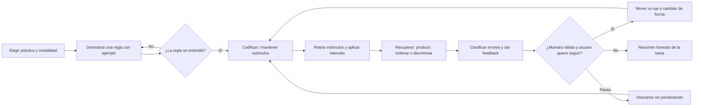

# Molvex · Memoria
## 30 modelos de ejercicio con filtro de calidad

| Versión | Fecha | Estado | Destino / uso |
|---|---|---|---|
| 1.0 | 2026-10-03 | Propuesta conceptual completa · `DESIGN_ONLY / CONDITIONAL` | App móvil iOS + Android · entrenamiento cognitivo no clínico |

> Este catálogo especifica treinta modelos de práctica para operaciones de memoria que se pueden observar en una tarea. No afirma que existan treinta capacidades independientes, que las treinta fichas estén implementadas, que una puntuación de práctica mida la memoria general ni que entrenarlas eleve la inteligencia. Los modelos pasan un filtro editorial de especificación; eficacia, validez, dosis, equivalencia entre plataformas y transferencia siguen pendientes de evaluación.

## Brief y criterio rector

El objetivo es ofrecer práctica móvil deliberada para codificar, mantener, actualizar, asociar, recuperar y discriminar información, además de recordar intenciones futuras y juzgar la propia confianza. La población de diseño es adulta y heterogénea, con personas principiantes; los ejemplos usan material ficticio, breve y culturalmente revisable. La personalización individual no debe convertir una sesión ruidosa en un diagnóstico ni imponerse sobre la robustez poblacional.

«Entrenar al máximo la capacidad cerebral» se operacionaliza como maximizar la calidad y variedad de oportunidades de recuperación sobre demandas concretas, con progresión comprensible, descanso y probes independientes. Se evita prometer aumento de capacidad general, prevención del deterioro, ventaja académica/laboral o mejora cotidiana no demostrada. Un resultado superior en el mismo formato puede ser aprendizaje de la tarea, estrategia o contenido.

### Regla maestra de admisión

Cada ficha debe declarar: (1) operación principal; (2) secuencia que cualquier equipo puede prototipar; (3) estímulo, regla, respuesta y ejemplo resoluble; (4) aciertos, errores y denominadores; (5) un eje gobernante de dificultad; (6) atajo probable y defensa; (7) alternativa de acceso o límite de validez; (8) falsador; (9) linaje respecto a EX1–EX16 y a las propuestas anteriores. Una nueva historia visual no cuenta como familia nueva. Si no se distingue un mecanismo, se presenta como modo/variante y no como capacidad adicional.

## Mapa gráfico

```mermaid
flowchart TB
  MEM["MEMORIA · codificar, mantener, recuperar y usar información"]
  MEM --> WM["01–05 · Mantener y actualizar"]
  MEM --> ENC["06–10 · Codificar y recuperar episodios"]
  MEM --> BIN["11–15 · Asociaciones, fuente y binding"]
  MEM --> VIS["16–20 · Espacio, detalle y orden"]
  MEM --> INT["21–25 · Interferencia y demora"]
  MEM --> PM["26–30 · Prospectiva, semántica y metamemoria"]
  WM --> M01["01 Span complejo"]
  WM --> M02["02 Actualización por ranuras"]
  WM --> M03["03 N-back relacional"]
  WM --> M04["04 Orden inverso"]
  WM --> M05["05 Instrucciones con demora"]
  ENC --> M06["06 Recuerdo libre"]
  ENC --> M07["07 Agrupación semántica"]
  ENC --> M08["08 Elaboración guiada"]
  ENC --> M09["09 Ruta de loci"]
  ENC --> M10["10 Relato episódico"]
  BIN --> M11["11 Pares asociados"]
  BIN --> M12["12 Rostro ficticio–nombre"]
  BIN --> M13["13 Memoria de fuente"]
  BIN --> M14["14 Objeto–lugar"]
  BIN --> M15["15 Conjunción de rasgos"]
  VIS --> M16["16 Ruta espacial"]
  VIS --> M17["17 Detección de cambio"]
  VIS --> M18["18 Reconstrucción de escena"]
  VIS --> M19["19 Orden temporal"]
  VIS --> M20["20 Completar episodio"]
  INT --> M21["21 Interferencia A–B / A–C"]
  INT --> M22["22 Liberación proactiva"]
  INT --> M23["23 Señuelos similares"]
  INT --> M24["24 Recuerdo episódico diferido"]
  INT --> M25["25 Pares diferidos"]
  PM --> M26["26 Intención por evento"]
  PM --> M27["27 Intención por tiempo simulado"]
  PM --> M28["28 Aprendizaje semántico de mundo nuevo"]
  PM --> M29["29 Calibración de confianza · overlay"]
  PM --> M30["30 Elegir qué recuperar · protocolo"]
```

Los seis grupos ordenan la exploración y no son una nueva taxonomía ejecutable. Sus fronteras se solapan: la recuperación diferida también es práctica episódica; fuente y binding pueden requerir memoria asociativa; una ruta espacial exige orden; la calibración de confianza es transversal, no un ejercicio autónomo.

| Zona | Fichas | Operación que diferencia el núcleo | Solapamiento que no se debe contar dos veces |
|---|---:|---|---|
| Mantener y actualizar | M01–M05 | conservar/actualizar representaciones bajo demanda concurrente o secuencial | M01 y M03 comparten carga de trabajo; M02 y M03 comparten actualización |
| Codificar y recuperar episodios | M06–M10 | generar claves, organizar y recuperar material aprendido | M07–M09 son estrategias de codificación sobre material episódico, no capacidades separadas |
| Asociación, fuente y binding | M11–M15 | recuperar vínculos y contexto, no solo reconocer componentes | M11–M14 comparten binding con claves distintas |
| Espacio, detalle y orden | M16–M20 | conservar posiciones, rasgos, transformaciones y relaciones seriales | M16/M19 son orden espacial/temporal; M18/M20 son formatos de reconstrucción |
| Interferencia y demora | M21–M25 | distinguir la representación pertinente entre competidoras y a través del tiempo | M21/M22/M23 comparten competencia; M24/M25 son protocolos diferidos de familias previas |
| Prospectiva, semántica y metamemoria | M26–M30 | ejecutar una intención, aprender relaciones nuevas y regular la recuperación | M29 es overlay; M30 es protocolo metacognitivo, no factor cognitivo nuevo |

## Estado real y linaje

El catálogo de código declara 16 identidades y marca EX1 Span Complejo, EX3 Lista con Estrategia y EX4 Pares Asociados como oleada implementada. `MemoryGraph` registra generadores para esas tres. La ruta principal observada usa un plan por sesión y selección de reconocimiento; existe una ruta separada para recuerdo diferido entre sesiones. Por tanto, catálogo/generador, pantalla jugable, fidelidad del paradigma, score longitudinal y perfil conectado son estados distintos. La ficha de implementación también declara límites del banco, métricas parciales y elementos pendientes. No se infiere disponibilidad desde la mera presencia de un ID.

El documento anterior de Memoria ya proponía ocho diseños: complex span adaptativo, N-back, actualización/running memory, binding visoespacial, pares con interferencia, episódica diferida, orden serial y una probe no entrenada. Se conservan como linaje conceptual de M01–M04, M14/M16, M21, M24 y el protocolo de evaluación, respectivamente; no son ocho validaciones ni ocho implementaciones. La probe no entrenada queda fuera del catálogo de drills para proteger la independencia de evaluación.

| Estado | Interpretación en este dossier |
|---|---|
| `EXISTING_V1` | Ya aparece en el alcance implementado de EX1/EX3/EX4. La ficha propone elevar fidelidad; no certifica el estado de sus contratos avanzados. |
| `CANONICAL_NOT_WIRED` | Tiene identidad EX en el catálogo declarativo, pero no consta entre los tres generadores del `MemoryGraph`. |
| `VARIANT` | Modo de una familia existente; requiere conservar el ID/constructo canónico salvo decisión aprobada. |
| `EXPLORATORY` | Oportunidad nueva (principalmente aprendizaje semántico); no asigna nuevo ID, módulo, métrica o flag. |
| `OVERLAY / PROTOCOL` | Capa transversal o secuencia de práctica; no se cuenta como constructo independiente. |
| `RESERVED_PROBE` | Medida no adaptativa, con material/forma separados del generador de entrenamiento; no es un drill extra. |

## Contrato común de experiencia

### Bucle móvil

- Estados propuestos: preparación, demostración, práctica guiada, comprobación de comprensión, codificación, relleno/intervalo, recuperación, feedback, descanso, cierre y terminación por interrupción. Nunca interpretar una pausa o pérdida de foco de UI como olvido.
- La persona puede producir respuesta libre, reconstruir orden, contestar con clave o discriminar señuelos según la ficha. No usar reconocimiento como sustituto universal: cambia lo que se mide y facilita estrategias de selección.
- En modo de estudio guiado, el feedback puede enseñar una estrategia. En probes de progreso, material, instrucción, criterio y demora se fijan; no se revela respuesta antes del final ni se adapta la dificultad.
- Proponer sesiones breves en bloques. Una ficha no prescribe dosis óptima. El tiempo visible no se presenta como límite cognitivo salvo donde es parte validada del constructo.

### Medición, scoring y dificultad

Cada trial debe preservar su denominador y clase de respuesta. Separar al menos: hit, miss, rechazo correcto, falsa alarma, intrusión, error de fuente, conjunción, binding posición–ítem, transposición, omisión, timeout técnico y respuesta inválida. Una omisión no se fusiona con un hit fallido si el contexto permite distinguirla; una respuesta sin estímulo disponible tampoco entra a la métrica cognitiva.

Reportar métricas de tarea con nombre y condición, no una cifra de «memoria total»: exactitud de recall/orden, tasa de intrusión, falsas alarmas/criterio, discriminación cuando el diseño la soporta, coste de interferencia, span válido, retención a demora, precisión de vínculo, omisiones prospectivas y calibración cuando hay suficientes juicios. Los tiempos de respuesta son auxiliares y solo se interpretan bajo captura temporal validada. Evitar sumar rapidez y precisión en un score opaco.

Cada ficha nombra un solo eje gobernante candidato. Cambiar simultáneamente longitud, demora, similitud, modalidad y distractor haría ininterpretable por qué subió o bajó el resultado. No subir nivel por una muestra pequeña, una estrategia fija que explota el formato, contenido repetido, respuesta al azar o señal técnica no comparable. Muestras insuficientes retienen el nivel y la interpretación.

### Accesibilidad, plataforma y privacidad

- Diseño común sin permisos: sin agenda/contactos, fotos personales, notificaciones reales, cámara, micrófono ni geolocalización. Todas las caras, historias, nombres, rutas y datos son sintéticos, aprobados para uso cultural y sin PII.
- Android e iOS comparten regla, banco versionado, validador, scoring conceptual y estados; Compose/iOS dibujan estímulos, pero equivalencia de render, safe area, lector de pantalla, eventos táctiles, lifecycle e interrupciones se verifica por separado. Offline-first; IA generativa no participa en el núcleo.
- Texto ampliable; targets táctiles amplios; contraste y forma junto al color; reducir animación; no usar flashes; audio siempre opcional con alternativa visual equivalente solo si la comparación de modalidad se mantiene separada. Una acomodación que altere la demanda se etiqueta como variante, no como fallo del usuario.
- No hacer el contenido más pequeño, más rápido o menos legible para «subir dificultad». Dificultad cambia la demanda mnésica, no la ergonomía. Evitar penalizar por escritura lenta; respuesta libre puede usar voz del sistema local solo como conveniencia y nunca grabarse, aunque su disponibilidad multiplataforma aún debe probarse.
- Guardar localmente el mínimo resumen necesario: modelo y versión, modalidad, forma/semilla, eje, condición, contadores clasificados, calidad de captura, motivo de salida y consentimiento. No enviar estímulos, secuencias, texto libre, elecciones detalladas o confianza ítem a ítem a telemetría por defecto.

### Gate de calidad y evaluación

Las treinta fichas superan el mínimo de especificación editorial de este documento: tienen acción, secuencia, ejemplo, errores, eje, riesgo de atajo y falsador. Es un juicio de diseño secuencial del autor, no una puntuación de eficacia ni una revisión humana independiente. Antes de seleccionar una para desarrollo: revisión científica/psicométrica; prueba de comprensión y estrategia; banco procedural con seeds reproducibles y prevención de repetición; prueba de accesibilidad; equivalencia Android/iOS; contrato de persistencia mínimo; QA adversarial de gaming; piloto de dosis/fatiga; análisis de fiabilidad y sesgo por edad, educación, idioma, visión, audición y experiencia digital. Medir cambio con material reservado/no entrenado y condiciones comparables, sin confundir mejora de la app con transferencia al mundo real.

## Los 30 modelos

### Zona 1 · Mantener y actualizar

#### M01 · Span complejo: recordar mientras se procesa
**Linaje/estado:** EX1 · `EXISTING_V1`, rediseño de fidelidad. **Principal:** memoria de trabajo bajo tarea concurrente.

**Pantalla y jugada:** `PALMA` → `6 + 3 = 9` → `RÍO` → `4 + 2 = 7` → pantalla vacía → reproducir PALMA, RÍO en orden. El usuario responde verdadero/falso a cada operación y después produce el orden; no basta con reconocer palabras.

**Scoring y progresión:** acierto de procesamiento por operación; recall serial por posición; intrusión y omisión; span solo si la tarea concurrente tuvo validez suficiente. Eje gobernante candidato: cantidad de ítems, manteniendo fijo el tipo de procesamiento.

**Atajo y control:** ignorar operaciones libera recursos para memorizar. Exigir respuesta a la tarea concurrente y mostrar al final su exactitud separada; no declarar válido el span si la segunda tarea fue sistemáticamente abandonada.

**Acceso/falsador:** cálculo muy simple, botones grandes y lectura visual equivalente. Se refuta el valor del diseño si una estrategia de no procesar obtiene la misma métrica o si sube solo el reconocimiento sin mejorar recall serial en material nuevo.

#### M02 · Actualización por ranuras
**Linaje/estado:** EX2 · `CANONICAL_NOT_WIRED`. **Principal:** actualizar el contenido vigente e inhibir el anterior.

**Pantalla y jugada:** cuatro casillas etiquetadas A–D reciben objetos uno a uno. Secuencia ejemplo: A=sol, B=llave, A=barco, C=hoja. Al acabar, se pide el último objeto de cada casilla activa: A=barco, B=llave, C=hoja. El carrusel no revela retrospectivamente las respuestas.

**Scoring y progresión:** exactitud por ranura, omisión y perseveración (responder sol por A). Eje candidato: número de ranuras; la tasa y orden de actualizaciones se fija para que la carga sea interpretable.

**Atajo y control:** recordar solo el último estímulo global no basta; incluir ranuras repetidas y ranuras sin actualización. Balancear ubicaciones y auditar sesgos de posición.

**Acceso/falsador:** etiquetas y formas, no solo colores; permitir respuesta por selección ordenada. Refutar si acierto se explica por sesgo de recencia global o si el formato causa más errores de lectura de casilla que de actualización.

#### M03 · N-back relacional
**Linaje/estado:** variante de EX2/EX1 y de propuesta previa N-back · `VARIANT`, no ID nuevo. **Principal:** detectar coincidencia con N ensayos atrás manteniendo referencia activa.

**Pantalla y jugada:** aparecen símbolos geométricos. Regla fija: toca «igual» si la forma actual coincide con la de dos posiciones atrás. Ejemplo: círculo, triángulo, círculo → el tercero coincide con el primero; estrella → no coincide con el triángulo anterior. No mezclar modalidad visual y verbal en el mismo staircase.

**Scoring y progresión:** hits, misses, falsas alarmas y rechazo correcto por oportunidad; exactitud por tipo de trial. Eje candidato: N, con prevalencias y ritmo controlados. RT no sustituye discriminación.

**Atajo y control:** tocar siempre puede parecer exitoso si las coincidencias abundan; fijar prevalencia equilibrada y señuelos de lure N±1. Refutar si el usuario puede obtener puntuación por patrón motor/expectativa o si el progreso no sobrevive a estímulos nuevos.

**Acceso/falsador:** siluetas distinguibles, sin diferencias solo cromáticas, sin deadline inicial. N-back es una mecánica de entrenamiento, no evidencia de aumento de IQ.

#### M04 · Orden inverso y transformación serial
**Linaje/estado:** EX7 · `CANONICAL_NOT_WIRED`. **Principal:** mantener una secuencia y manipularla mentalmente.

**Pantalla y jugada:** se muestran flechas: arriba, izquierda, abajo, derecha. La instrucción «devuelve en orden inverso» requiere derecha, abajo, izquierda, arriba. En niveles posteriores, una señal al final pide rotar cada dirección un cuarto de vuelta y luego invertir; la regla se demuestra antes del trial.

**Scoring y progresión:** exactitud item × posición, transposición, intrusión y coste de transformación comparado con reproducción directa. Eje candidato: longitud serial; no escalar longitud y transformación a la vez.

**Atajo y control:** pulsaciones rítmicas o copiar un patrón aprendido. Generar secuencias balanceadas y formas nuevas; la regla debe permanecer visible en onboarding y oculta solo durante ejecución.

**Acceso/falsador:** símbolos con nombre accesible y opción de respuesta secuencial sin arrastre. Refutar si transformación se resuelve perceptivamente con secuencia en pantalla o si el resultado depende de destreza motora.

#### M05 · Instrucciones con demora e interrupción controlada
**Linaje/estado:** EX9 · `CANONICAL_NOT_WIRED`. **Principal:** retener pasos de una instrucción y ejecutarlos en orden.

**Pantalla y jugada:** «Primero coloca la estrella en B; después intercambia A y C; al final marca la casilla vacía». Tras una tarea neutral breve, el tablero aparece sin instrucciones y el usuario realiza cada paso. El ejemplo tiene estado inicial y final comprobable, no una narración ambigua.

**Scoring y progresión:** pasos correctos, omisiones, orden, acciones extra y recuperación tras interrupción simulada. Eje candidato: número de pasos; demora e interferencia se fijan.

**Atajo y control:** leer la orden mientras responde. En la fase de ejecución se retira el texto; se comprueba que cada tablero inicial tenga solución única.

**Acceso/falsador:** comandos breves con pictogramas y texto; no depender de audio. Refutar si los fallos surgen de comprender verbos/diagramas más que de recordar pasos, o si una ayuda permanente elimina la demanda mnésica.

### Zona 2 · Codificar y recuperar episodios

#### M06 · Lista con recuerdo libre
**Linaje/estado:** EX3 · `EXISTING_V1`, con protocolo de producción libre como destino. **Principal:** recuperar elementos episódicos sin opciones.

**Pantalla y jugada:** aparecen seis palabras, una por vez; luego pantalla vacía y entrada por fichas de palabras seleccionadas de teclado local o composición táctil. Ejemplo de lista: faro, limón, guante, nube, tornillo, violín. El orden libre puntúa contenido; si se mide orden se define aparte.

**Scoring y progresión:** targets recordados / targets estudiados, intrusiones / respuestas producidas, omisiones y curva serial si está prerregistrada. Eje candidato: longitud de lista; demora, exposición y semántica constantes.

**Atajo y control:** repetición de banco o familiaridad con palabras. Separar formas reservadas de entrenamiento, excluir recent-items y renovar lures; medir exposición.

**Acceso/falsador:** teclado y selección no compiten por rapidez; errores ortográficos tolerables mediante normalización local explícita. Refutar si las ganancias desaparecen con vocabulario nuevo o si entrada pesa más que recuperación.

#### M07 · Organización semántica y clustering
**Linaje/estado:** estrategia sobre EX3 · `VARIANT`. **Principal:** usar agrupación como clave de codificación/recuperación.

**Pantalla y jugada:** lista intercalada: pera, autobús, manzana, tranvía, uva, bicicleta. Tras estudiar, se hace recall libre; la interfaz registra orden de salida y agrupaciones (fruta/transporte) sin mostrar etiquetas durante la recuperación. Al cierre se puede revelar la estrategia y hacer un segundo bloque de práctica separado.

**Scoring y progresión:** recall por ítem; índice de agrupación solo cuando categorías y clasificación de materiales fueron revisadas; intrusiones. Eje candidato: cantidad de categorías, con ejemplares balanceados.

**Atajo y control:** la categoría puede dar una pista directa si se muestra en el recall. Ocultarla hasta después de la respuesta y comparar listas organizables con controles equivalentes.

**Acceso/falsador:** evitar categorías culturalmente sesgadas; ofrecer glosario previo, no durante probe. Refutar si el efecto es vocabulario previo y no estrategia o si mejora clustering sin mejorar recuperación.

#### M08 · Elaboración guiada: crear una clave
**Linaje/estado:** extensión de EX3/EX4 · `VARIANT`. **Principal:** elaborar relación distintiva para facilitar recuperación.

**Pantalla y jugada:** se muestran pares poco relacionados (vela–melón). La persona elige o forma una imagen/relación breve entre ambos; luego recibe la clave «vela» y recupera «melón». Ejemplo de estrategia: imaginar un melón con una vela clavada que ilumina la mesa. En la prueba no se vuelve a mostrar la imagen.

**Scoring y progresión:** recuerdo cued por par, intrusiones/conjunciones y, en modo de práctica, elección de estrategia. Eje candidato: número de pares aprendidos; no puntuar calidad artística del usuario.

**Atajo y control:** memorizar solo el objetivo o depender de una clave visual presentada en pantalla. Generar claves de control comparables y separar instrucción de evaluación.

**Acceso/falsador:** ofrecer generación mental y opciones textuales; nunca grabar dibujos/voz. Refutar si mnemotecnia aumenta carga/tiempo sin ventaja frente a estudio activo o solo funciona con claves reutilizadas.

#### M09 · Recorrido de loci sintético
**Linaje/estado:** variante espacial/estratégica de EX5/EX7 · `VARIANT`; conecta con investigación de loci móvil. **Principal:** vincular elementos a posiciones ordenadas familiares dentro de un mapa ficticio.

**Pantalla y jugada:** un recorrido estable de cinco ubicaciones en un museo inventado: entrada, banco, fuente, escalera, salida. El usuario imagina/selecciona colocar un objeto en cada punto; más tarde toca el recorrido vacío y recupera los objetos. No usar casa real, GPS ni lugares personales.

**Scoring y progresión:** recall de elemento por locus y errores de lugar/orden por separado. Eje candidato: cantidad de loci; recorrido y tiempo de exposición fijos.

**Atajo y control:** memorizar orden sin asociar elementos. Probar claves de locus fuera de secuencia y distractores intercambiados.

**Acceso/falsador:** mapa de alto contraste, alternativa textual numerada, opción de no visualizar. Refutar si el efecto es solo entrenamiento en esa ruta o si navegabilidad/espacialidad excluye a una parte relevante de usuarios.

#### M10 · Recuerdo de microhistoria
**Linaje/estado:** EX15 · `CANONICAL_NOT_WIRED`. **Principal:** codificar y recuperar hechos, fuente y orden de un episodio narrativo breve.

**Pantalla y jugada:** se lee o escucha el mismo relato sintético: «Mara dejó una carpeta verde en el tranvía; Leo la llevó al kiosco antes de que lloviera». Después se responde sin el texto: quién, qué objeto, dónde y qué ocurrió primero. Recall libre/clave precede a preguntas de detalle.

**Scoring y progresión:** hechos idea-unit, errores de fuente, intrusiones plausibles y orden; comprensión del relato se sondea aparte. Eje candidato: cantidad de unidades factuales; sintaxis y audio se mantienen simples.

**Atajo y control:** inferir por plausibilidad («carpeta en oficina») sin recordarlo. Incluir señuelos plausibles y absurdos balanceados; diferenciar inferencia de memoria.

**Acceso/falsador:** modo visual equivalente, transcripción opcional después del ensayo. Refutar si score se explica por lectura/idioma o conocimientos narrativos previos.

### Zona 3 · Asociación, fuente y binding

#### M11 · Pares asociados con claves recíprocas
**Linaje/estado:** EX4 · `EXISTING_V1`, rediseño de fidelidad. **Principal:** formar y recuperar asociaciones arbitrarias.

**Pantalla y jugada:** estudio de pares por separado: faro–cobre, pluma–níspero, tambor–jade. En prueba aparece solo una clave y se recupera la pareja, no se selecciona todo el conjunto. Alternar dirección directa/inversa como subcondiciones identificadas, nunca mezcladas sin reporte.

**Scoring y progresión:** acierto por probe respondible, falsa alarma, error de dirección y conjunción de dos pares. Eje candidato: número de pares; similitud y dirección fijas por bloque.

**Atajo y control:** seleccionar todos produce falso acierto en múltiple opción; preferir producción/cued recall. Si se necesita reconocimiento, exigir lures y reporte de false alarms.

**Acceso/falsador:** palabras concretas y contrastables; entrada por ficha. Refutar si se mide memoria de los componentes pero no del vínculo o el resultado es distinto con estímulos nuevos.

#### M12 · Rostro ficticio–nombre
**Linaje/estado:** EX8 · `CANONICAL_NOT_WIRED`. **Principal:** asociar identidad visual sintética con nombre sin datos reales.

**Pantalla y jugada:** se muestra un avatar ilustrado neutral junto a «Nora»; tras varios personajes, reaparece cada rostro y se solicita nombre o «no visto». Ejemplo de discriminación: rostro visto como Nora frente a un señuelo parecido que nunca se estudió.

**Scoring y progresión:** recall del nombre, falsos reconocimientos, confusión entre personas y pronunciación solo si la respuesta oral fuese validada. Eje candidato: cantidad de identidades; semejanza facial y exposición controladas.

**Atajo y control:** memorizar solo rasgos caricaturescos o asociar posición de tarjeta. Rotar posiciones, balancear rasgos no diagnósticos y verificar que caras sintéticas no induzcan estereotipos.

**Acceso/falsador:** opción textual no cronometrada; no usar fotos/rostros identificables. Refutar si no supera una variante de control de familiaridad visual o muestra sesgo demográfico.

#### M13 · ¿Quién lo dijo? Memoria de fuente
**Linaje/estado:** variante de EX11/EX13 · `VARIANT`, requiere contrato de banco/fuente. **Principal:** recordar el origen de una información ya conocida.

**Pantalla y jugada:** dos avatares de colores y etiquetas también distintas intercambian datos ficticios: A dice «el plano es circular», B dice «la puerta norte se cierra». Después se pregunta qué dato dijo B. Los hechos se contrabalancean para que memorizar solo contenido no resuelva quién lo aportó.

**Scoring y progresión:** contenido correcto + fuente correcta como campos separados; intrusión de fuente y conjunción. Eje candidato: número de fuentes; carga y demora estables.

**Atajo y control:** responder por color/posición permanente. Rotar señales, mantener múltiples claves y no basar el score en una asociación visual fija.

**Acceso/falsador:** nombre y símbolo redundantes, no solo voz. Refutar si la tarea mide discriminación visual de avatares, o la atribución fuente no es distinguible del recuerdo de contenido.

#### M14 · Objeto–ubicación en cuadrícula
**Linaje/estado:** EX5 y propuesta previa de binding visoespacial · `CANONICAL_NOT_WIRED`. **Principal:** recordar qué objeto ocupaba qué coordenada.

**Pantalla y jugada:** objetos aparecen en celdas de un tablero 4×4; luego tablero vacío y objetos a un lado. La persona arrastra o asigna «tetera → B3», «hoja → D1». Reusar el objeto en otra casilla cuenta como binding error aunque la casilla recuerde otro objetivo.

**Scoring y progresión:** item, localización, intercambio/conjunción y omisión separados. Eje candidato: número de bindings objetivo; tamaño del tablero constante al inicio.

**Atajo y control:** buscar objetos en la misma posición de presentación, no codificar pares. Aleatorizar orden de presentación y posición; el recall no revela las casillas correctas.

**Acceso/falsador:** coordenadas leíbles y respuesta por lista si arrastrar añade demanda motora. Refutar si fallos de interfaz dominan los de asociación o si el diseño confunde visión espacial con memoria.

#### M15 · Conjunción de rasgos visuales
**Linaje/estado:** variante de EX5/EX6/EX12 · `VARIANT`. **Principal:** recordar qué rasgos coexistían en un objeto, no solo qué rasgos aparecieron.

**Pantalla y jugada:** se estudian iconos compuestos: llave con patrón de rayas y muesca redonda; hoja con puntos y borde dentado. Después se presentan originales, recombinaciones y señuelos. Ejemplo: la llave rayada con muesca cuadrada es una recombinación, no vista.

**Scoring y progresión:** acierto de objeto, rasgo y conjunción; false alarms a recombinaciones. Eje candidato: número de objetos, manteniendo similaridad de lures fija.

**Atajo y control:** reconocer un rasgo saliente basta si lures son débiles. Recombinar sistemáticamente rasgos de ítems estudiados para probar binding.

**Acceso/falsador:** redundancia de forma/patrón/textura, no solo color. Refutar si discriminación se debe a agudeza visual o si los señuelos no separan memoria item vs binding.

### Zona 4 · Espacio, detalle y orden

#### M16 · Ruta espacial serial
**Linaje/estado:** EX7 y diseño previo de secuencias · `CANONICAL_NOT_WIRED`. **Principal:** conservar secuencia de posiciones en espacio.

**Pantalla y jugada:** una secuencia ilumina celdas: B2 → B3 → C3 → A1. Al ocultarse, se reproducen en orden con toques; un modo separado pide orden inverso. Las celdas no se animan tras el ocultamiento.

**Scoring y progresión:** coincidencia de posición por paso, transposición, omisión y falsa celda. Eje candidato: longitud de ruta; ritmo y tamaño del tablero fijos.

**Atajo y control:** seguir sonido, ritmo o trayectoria visible. Variar intervalos levemente solo si ritmo no es el constructo; incluir secuencias no rítmicas y sin replay visual.

**Acceso/falsador:** repetir por botones numerados/lectura háptica opcional fuera de score comparable. Refutar si baja visión o control táctil explica resultados más que la memoria espacial.

#### M17 · Detección de cambio en escena
**Linaje/estado:** EX6 · `CANONICAL_NOT_WIRED`. **Principal:** reconocer si un rasgo visual de la escena difiere del episodio visto.

**Pantalla y jugada:** una escena vectorial breve muestra tres objetos; tras máscara neutra reaparece con una sola diferencia: la taza cambia de asa izquierda a derecha. Respuesta: «cambió/no cambió» y, si cambió, señalar qué objeto/rasgo.

**Scoring y progresión:** sensibilidad con hits/false alarms y localización; no solo tasa de sí. Eje candidato: similitud de la modificación; set size y exposición estables.

**Atajo y control:** contestar siempre «cambió». Balancear presencia/ausencia y cambio de rasgo/posición; reservar escenas nuevas.

**Acceso/falsador:** sin flashes; transiciones estáticas y tiempo autoajustable en entrenamiento. Refutar si percepción elemental o diferencia visible durante transición resuelve el trial sin memoria.

#### M18 · Reconstrucción de escena episódica
**Linaje/estado:** EX13 + EX5 · `CANONICAL_NOT_WIRED`. **Principal:** reconstruir bindings de un conjunto visto en una escena.

**Pantalla y jugada:** se observa una mesa de taller con seis objetos y lugares marcados. Después del intervalo, se arrastran iconos a la escena vacía. Ejemplo: brújula en la esquina, taza junto al libro. Feedback muestra la escena original y distingue objeto ausente de objeto en lugar equivocado.

**Scoring y progresión:** identidades presentes, bindings objeto–posición y falsos objetos por separado. Eje candidato: cantidad de objetos; geometría constante.

**Atajo y control:** reconstruir una plantilla simétrica o usar posiciones típicas. Usar escenas balanceadas no previsibles y lures con plausibilidad contrabalanceada.

**Acceso/falsador:** respuesta por coordenada textual y opción de teclado si drag es barrera. Refutar si los placements probables dan score sin codificar la escena.

#### M19 · Orden temporal con intervalos
**Linaje/estado:** EX7/EX13 · `VARIANT`. **Principal:** recuperar precedencia y distancia relativa entre eventos.

**Pantalla y jugada:** cuatro eventos ficticios se estudian en tarjetas: «abre el taller», «llega el paquete», «suena la campana», «sale el tren». La prueba pide ordenar tarjetas o responder «¿qué ocurrió justo antes de la campana?». No se presentan horas reales como conocimiento.

**Scoring y progresión:** pares de precedencia correctos, transposiciones y lag/order error. Eje candidato: cantidad de eventos; intervalos se mantienen fijos.

**Atajo y control:** usar plausibilidad causal en vez del orden aprendido. Construir historias sin secuencia obvia y añadir pares plausibles con el orden invertido.

**Acceso/falsador:** lista numerada en vez de línea temporal arrastrable. Refutar si las respuestas se infieren por guion semántico sin recuerdo o si la escala serial no añade valor frente a M10.

#### M20 · Completar relaciones ausentes
**Linaje/estado:** EX13 · `CANONICAL_NOT_WIRED`, diferenciación de M18. **Principal:** recuperar componentes/relaciones de una representación parcial.

**Pantalla y jugada:** se estudia un esquema de museo inventado: «la brújula está encima del cuaderno; la llave está a la derecha». Después aparece el esquema incompleto con dos huecos; se reconstruye relación y objeto. La prueba permite «no recuerdo» para no forzar conjetura.

**Scoring y progresión:** unidad recuperada, relación correcta, intrusión y respuesta no segura; confidence opcional solo en overlay. Eje candidato: número de huecos; complejidad lingüística estable.

**Atajo y control:** completar con una regla espacial típica. Contrabalancear relaciones y validar que cada hueco tenga una sola solución.

**Acceso/falsador:** diagrama y frase paralelos; alternativa no arrastrable. Refutar si el desempeño se explica por comprensión lectora, conocimientos del mundo o adivinación.

### Zona 5 · Interferencia y demora

#### M21 · Pares con interferencia A–B / A–C
**Linaje/estado:** EX4 + EX11 y propuesta previa de interferencia asociativa · `VARIANT`. **Principal:** recuperar asociación objetivo ante competidora nueva con clave compartida.

**Pantalla y jugada:** primera lista: FARO–LIMA; luego una segunda asociación con misma clave: FARO–NUBE. Se indica lista/episodio preguntado y la persona produce el objetivo correspondiente. Contraste de control: pares sin clave compartida.

**Scoring y progresión:** acierto A/B, intrusión de pareja rival, conjunción y omisión; interferencia = diferencia de condición, no porcentaje aislado. Eje candidato: proporción de claves solapadas.

**Atajo y control:** respuesta por recencia siempre elige NUBE. Balancear cuál lista es objetivo, incluir claves sin cambio y bloquear feedback entre codificación y prueba.

**Acceso/falsador:** etiquetas de lista visibles en prueba si la pregunta es acceso a la clave, no retención de contexto; etiquetado se reporta. Refutar si el efecto es solo comprensión de la señal A/B.

#### M22 · Liberación de interferencia proactiva
**Linaje/estado:** EX11 · `CANONICAL_NOT_WIRED`. **Principal:** comprobar si nueva categoría/contexto reduce confusión acumulada entre listas.

**Pantalla y jugada:** se aprenden varias mini-listas de herramientas; luego cambia a animales y se mide nueva lista tras el historial. Ejemplo de prueba: recordar los tres vehículos de la última ronda sin incorporar las herramientas de rondas previas.

**Scoring y progresión:** recuerdo por lista, intrusiones de listas previas y diferencia pre/post cambio de categoría. Eje candidato: cantidad de bloques competidores; longitud por lista fija.

**Atajo y control:** recordar solo la lista más reciente puede resolver todo si todas las preguntas dicen «última». Incluir preguntas balanceadas de bloque y no confundir liberación con recencia.

**Acceso/falsador:** imágenes con nombres accesibles; familiaridad léxica pretest. Refutar si la nueva categoría trae vocabulario más fácil o si no reduce intrusiones frente a condición sin cambio.

#### M23 · Discriminación de señuelos similares
**Linaje/estado:** EX12 · `CANONICAL_NOT_WIRED`. **Principal:** separar elementos estudiados de señuelos perceptual/semánticamente cercanos.

**Pantalla y jugada:** se estudian dibujos distintos de una taza con asa, una taza sin asa y una botella. Luego se juzga «visto exactamente / parecido pero nuevo / nuevo» y se indica confianza opcional. La respuesta exacta evita tratar «parecido» como recuerdo literal.

**Scoring y progresión:** matriz de confusión por clase, falsos reconocimientos de señuelo y sensibilidad si el diseño tiene suficientes observaciones. Eje candidato: similitud del lure; prevalence balanceada.

**Atajo y control:** contestar «nuevo» siempre o usar familiaridad de categoría. Igualar frecuencia, rasgo y exposición; probar nuevos bancos y source labels.

**Acceso/falsador:** contraste no cromático y sin detalle microscópico. Refutar si el lure no se distingue al nivel visual requerido o si el score se reduce a criterio de respuesta.

#### M24 · Recuerdo episódico diferido
**Linaje/estado:** EX3 + diseño previo de recall demorado · soporte V1 diferido existente; `VARIANT / REDISEÑO DE FIDELIDAD` para producción libre. **Principal:** recuperar items estudiados previamente tras intervalo con interferencia cotidiana controlada.

**Pantalla y jugada:** en una sesión posterior, se invita a producir palabras de una lista ficticia ya estudiada; no se vuelve a estudiar la lista antes. Se registra qué item evoca y luego se permite ver feedback. Si no hay lista vencida, la app ofrece otro ejercicio y no fabrica una prueba. La ruta actual tiene una sesión diferida separada y respuesta de reconocimiento; esta ficha propone cambiar la forma de respuesta, no afirma que el scheduler esté ausente.

**Scoring y progresión:** recall diferido / items resolubles; lures falsos, intrusiones y condición de demora. Eje candidato: demora asignada; dentro de evaluación se fija, no adapta.

**Atajo y control:** recordar el ensayo reciente o reconocimiento por opciones. Separar bancos/IDs, no repetir forma antes de probe y usar producción/cued recall previsto.

**Acceso/falsador:** sin presión de reloj; ofrecer reprogramación neutral. Refutar si resultado depende de exposición/reestudio, cambio de pool o asistencia previa. Tener scheduler no implica una medida válida.

#### M25 · Pares asociados diferidos
**Linaje/estado:** EX4 + propuesta previa de consolidación · `VARIANT` / protocolo diferido. **Principal:** retención del vínculo a través de una demora, no solo recuerdo del objetivo.

**Pantalla y jugada:** se estudian tres pares sintéticos; al intervalo se muestra una clave y se produce la pareja. Ejemplo «níspero → ?» cuando la asociación original era «pluma–níspero». No se presenta la pareja ni se ofrecen todas las respuestas antes de contestar.

**Scoring y progresión:** acierto de vínculo, componentes recordados sin binding, falsa asociación y ausencia de respuesta. Eje candidato: demora asignada; número de pares fijo.

**Atajo y control:** familiaridad con ambos ítems puede simular aprendizaje asociativo. Lures familiares no estudiados y dirección de recall balanceada; probe reservado.

**Acceso/falsador:** texto legible y producción tolerante a ortografía. Refutar si retención de asociación no supera chance condicionado a los componentes conocidos o si la demora real no se registra con integridad.

### Zona 6 · Prospectiva, semántica y metamemoria

#### M26 · Intención activada por evento
**Linaje/estado:** EX10 · `CANONICAL_NOT_WIRED`. **Principal:** recordar hacer una acción cuando aparece una señal futura dentro de otra tarea.

**Pantalla y jugada:** antes del bloque: «cuando aparezca un triángulo, toca el botón guardar». La persona resuelve clasificaciones de formas; el triángulo aparece ocasionalmente y activa la intención. Al final se pregunta si detectó señal y si actuó correctamente.

**Scoring y progresión:** detección/ejecución prospectiva, misses, falsas alarmas, coste sobre tarea en curso y latencia como secundaria. Eje candidato: saliencia/frecuencia de señal; no cambiar simultáneamente carga concurrente.

**Atajo y control:** tocar guardar a cada trial. Medir falsa alarma y equilibrar distractores con señales parecidas.

**Acceso/falsador:** señal redundante por forma y palabra, sin vibración obligatoria. Refutar si la señal se detecta por ritmo o posición fija; entrenamiento en tarea no demuestra transferencia prospectiva cotidiana.

#### M27 · Intención basada en tiempo simulado
**Linaje/estado:** EX10 · `VARIANT`, simulación autocontenida, sin notificaciones reales. **Principal:** recordar una acción en tiempo relativo mientras se realizan tareas filler.

**Pantalla y jugada:** reloj de sesión simulado acelera de forma visible: «cuando pasen 90 segundos de juego, revisa el sobre azul». Entre tanto se resuelven tareas breves; el usuario puede consultar el reloj de la app, pero se mide la política elegida si esa conducta forma parte del diseño.

**Scoring y progresión:** éxito dentro de ventana predefinida, acción anticipada/olvidada, consultas de reloj y coste de interrupción. Eje candidato: intervalo simulado; nunca vincular a hora, alarma o background real.

**Atajo y control:** consulta continua del reloj. Si el constructo incluye autoiniciación, restringir la consulta de forma transparente y medirla; si no, permitirla y denominar la tarea monitorizada.

**Acceso/falsador:** opción de pausas y modo sin cronómetro visible para familiarización. Refutar si velocidad de animación o timing de dispositivo domina memoria intencional.

#### M28 · Aprender relaciones semánticas en un mundo nuevo
**Linaje/estado:** oportunidad para `SEMANTIC_FUNCTIONAL` · `EXPLORATORY`; no hay ficha canónica dedicada entre EX1–EX16. **Principal:** integrar hechos novedosos y recuperar relaciones aprendidas, no conocimiento real.

**Pantalla y jugada:** mini-ecosistema ficticio enseña tres reglas: «los nural viven en zonas húmedas», «los dorin comen nural», «la planta elva crece junto al agua». Después se pregunta qué alimento puede hallar un dorin cerca del río y qué relación aprendida sostiene la respuesta.

**Scoring y progresión:** hechos recordados, inferencia de una relación enseñada, intrusión de regla no presentada y confianza opcional. Eje candidato: número de relaciones; complejidad de lectura fija.

**Atajo y control:** responder por lógica o estereotipo del mundo real. Usar términos inventados, lures plausibles e ítems literales además de inferenciales.

**Acceso/falsador:** lectura simple, glosario durante familiarización, sin conocimiento externo. Refutar si prueba comprensión/razonamiento más que aprendizaje o si lenguaje explica varianza dominante.

#### M29 · Calibración de confianza por respuesta
**Linaje/estado:** EX16 · `OVERLAY`, no juego standalone. **Principal:** alinear certeza subjetiva con acierto y distinguir incertidumbre genuina.

**Pantalla y jugada:** tras responder en M06/M11/M23, se pregunta «¿qué probabilidad tienes de que sea correcta?» con escala accesible de cuatro niveles. Ejemplo: usuario marca «muy seguro» para una palabra equivocada; feedback compara predicción y desenlace solo tras completar el bloque.

**Scoring y progresión:** calibración, sesgo de sobre/subconfianza y resolución (certeza más alta en aciertos que errores) solo con número suficiente de respuestas; no tratar cada rating como rasgo estable. Eje de entrenamiento: retardo antes de revelar feedback, no dificultad cognitiva.

**Atajo y control:** siempre elegir confianza media. Variar feedback y mantener señal de confianza separada de exactitud; no premiar certeza alta.

**Acceso/falsador:** escala con etiquetas y opción «no sé». Refutar si fiabilidad o relación confianza-acierto no supera una política constante o si el usuario cree que se le evalúa clínicamente.

#### M30 · Elegir qué recuperar y volver a comprobar
**Linaje/estado:** protocolo de práctica de EX3/EX4 + overlay EX16 · `OVERLAY / PROTOCOL`. **Principal:** practicar decisión de reestudio basada en recuperación y confianza; no es una nueva capacidad declarada.

**Pantalla y jugada:** tras estudiar una micro-lista, la app ofrece «intentar recordar» o «volver a estudiar»; después de una prueba, la persona marca qué elementos cree dominar y el sistema agenda una recuperación posterior de algunos elementos. Ejemplo: intentar recordar primero «faro–cobre» revela un fallo antes de reestudiar.

**Scoring y progresión:** éxito posterior por item, selecciones de reestudio, confianza y exposición total; comparar con condición de relectura, no con una cifra de memoria general. Eje candidato: intervalo/orden de recuperación.

**Atajo y control:** memorizar qué opción premia la app o reestudiar siempre. Feedback explica la regla, contrabalancea rutas y valida retención posterior con material nuevo.

**Acceso/falsador:** elección sin countdown, modo guiado y no guiado. Refutar si recordar antes no mejora la retención posterior frente a relectura en piloto o si el control estratégico no cambia con experiencia.

## Lectura de cobertura y cartera

| Subcapacidad que se representa | Modelos | Nota de cobertura |
|---|---|---|
| Memoria de trabajo | M01–M05 | Más variedad nominal que independencia; M01/M03 son vecinos y el recall serial necesita entrada fiel. |
| Episódica / recuperación diferida | M06–M10, M18–M20, M24 | Incluye producción, estrategias, relato y demora; exposición y forms nuevas son críticas. |
| Asociativa | M08, M11–M15, M21, M25 | Separar memoria de componentes, vínculo, fuente, dirección y conjunción. |
| Visual / espacial / secuencial | M09, M14–M20 | Modalidad visual, habilidad espacial y respuesta táctil pueden confundirse. |
| Resistencia a interferencia | M13, M21–M23, M25 | Debe medir intrusión/false alarm; exactitud global no basta. |
| Prospectiva | M26–M27 | Son simulaciones acotadas; no acceden al calendario ni prueban transferencia cotidiana. |
| Semántica funcional | M28 | Exploratoria; requiere revisión del constructo y demanda de lenguaje. |
| Metamemoria | M29–M30 | Overlay y protocolo de práctica; no aumentar el recuento de capacidades. |

### Matriz de relación con catálogo canónico

| Identidad | Propuestas relacionadas | Decisión que NO toma este dossier |
|---|---|---|
| EX1 Span Complejo | M01 | Cambiar criterio de validez, scoring, perfil o prueba de transferencia. |
| EX2 Actualización Set | M02–M03 | Incorporar una variante N-back como identidad o generador. |
| EX3 Lista con Estrategia | M06–M09, M24 | Cambiar respuesta actual, banco, intervalo o ensamblador de sesión. |
| EX4 Pares Asociados | M08, M11–M12, M21, M25 | Habilitar respuesta cued/free o dirección no implementada. |
| EX5–EX7 Visual/Espacial/Orden | M14–M19 | Reasignar paradigmas, métricas o subcapacidades. |
| EX8–EX10 Rostro/Instrucciones/Prospectiva | M05, M12, M26–M27 | Declarar disponibilidad, validez o utilidad práctica. |
| EX11–EX13 Interferencia/Discriminación/Reconstructiva | M13, M18, M20–M23 | Crear nueva taxonomía o inferir robustez psicométrica. |
| EX14–EX15 Dual-task/Narrativa | M01, M10 | Afirmar equivalencia entre canal auditivo, lectura y simultaneidad. |
| EX16 Calibración | M29–M30 | Tratar overlay como un drill separable o como diagnóstico de insight. |
| Sin ficha canónica dedicada | M28 | Añadir identidad, score, flag, módulo o perfil sin decisión del CEO. |

### Familias solapadas y falsadores de cartera

- M01/M03 comparten mantenimiento/actualización bajo presión; compararlos antes de priorizar ambos en una misma semana. N-back no gana prioridad por popularidad.
- M06–M09 varían estrategia, no necesariamente constructo. Su calidad depende de separar práctica de evaluación, controlar familiaridad y ofrecer material suficientemente amplio.
- M11–M15 comparten binding con diferentes pares de claves; se deben comparar errores de fuente, localización y conjunción en vez de sumar nombres.
- M16/M19 miden relaciones seriales distintas; M18/M20 cambian la forma de respuesta. Si no ofrecen predicción diferencial, fusionar como variantes.
- M21–M23 comparten competencia y criterios de decisión; M24/M25 añaden demora, no una capacidad autónoma. No contar una métrica de demora varias veces en un perfil.
- M26–M27 deben permanecer como simulaciones sin efectos externos y como hipótesis de transferencia no comprobada. M29–M30 son overlay/protocolo y no deben inflar el número de juegos disponibles.
- Un modelo se elimina o fusiona si: se resuelve por un atajo estable; los errores no permiten distinguir mecanismo; los ítems se agotan/reconocen; la accesibilidad cambia el constructo sin variante identificable; la respuesta mide idioma/motricidad más que memoria; el test-retest queda dominado por aprender el formato; o un holdout no produce señal interpretable.

## Plan empírico antes de promover modelos

1. **Prototipo sin perfil:** guion moderado con personas adultas diversas; comprobar comprensión, estrategia real, tiempo de tarea y si el usuario distingue recordar de adivinar. Registrar observación, no texto personal.
2. **Banco/generador:** semillas reproducibles, dificultad medida, lures balanceados, soluciones únicas, exclusión de formas reservadas, exposición máxima y detectores de duplicados. Revisar dialecto/vocabulario y sesgo visual.
3. **Fiabilidad de tarea:** consistencia por subcondición, estabilidad entre formas, sensibilidad a estrategia, techo/suelo y denominador suficiente. No trasladar umbrales de otra ficha.
4. **Aprendizaje de tarea:** comparar práctica y control activo emparejado en dosis, expectativa y exposición. Reportar magnitud e incertidumbre, retención y abandonos, además del score entrenado.
5. **Near/transfer:** usar probes no entrenadas y formas/material reservados; protocolo de test-retest, baseline, seguimiento y estimando preregistrados. Un nuevo nivel del propio juego no es transfer.
6. **Impacto cotidiano:** solo alegar si un outcome realista definido previamente cambia frente a control, con efecto replicado y límites de población/contexto. Satisfacción/autoinforme no sustituye una conducta observada.
7. **Plataformas:** Android/iOS, distintos tamaños, refrescos, lector de pantalla, escala, interrupción, reinicio y pérdida de conexión; lógica offline determinista; auditoría de datos y accesos.

**Criterio de descarte:** no promover una ficha a producto si falla comprensión, validez del mecanismo, defensa ante gaming, accesibilidad básica, generación segura, calidad de measurement o aceptación del copy. La calidad editorial no anula evidencia negativa.

## Claims de usuario permitidos

Preferir «practicas recordar listas sin pistas», «hoy recuperaste 5 de 7 elementos de esta lista», «esta semana hubo más errores de asociación con señuelos parecidos» y «el resultado de una sesión es provisional». Explicar qué cambió en la tarea y qué incertidumbre queda.

No usar «has aumentado tu memoria un 20 %», «tu cerebro es más potente», «aumenta el CI», «evita demencia», «la memoria está por encima/debajo de lo normal» ni una cifra total que mezcle subcapacidades. No convertir falta de respuesta, modalidad desactivada o contenido no resoluble en bajo rendimiento.

## Referencias y alcance

- Karpicke, J. D. & Roediger, H. L. (2008). [The critical importance of retrieval for learning](https://pubmed.ncbi.nlm.nih.gov/18276894/). *Science, 319*(5865), 966–968. Estudio de recuperación de vocabulario; sustenta priorizar recordar sobre releer para aprendizaje de material practicado, no una afirmación universal de transferencia.
- Redick, T. S. et al. (2013). [No evidence of intelligence improvement after working memory training: a randomized, placebo-controlled study](https://pubmed.ncbi.nlm.nih.gov/22708717/). *Journal of Experimental Psychology: General, 142*(2), 359–379. Ensayo dual n-back en adultos jóvenes; no observó transferencia a una batería amplia en ese protocolo. No resuelve toda la literatura ni todas las dosis.
- Sandberg, P. et al. (2021). [Ancient Mnemonic in New Format: Episodic Memory Training With the Method of Loci in a Smartphone Application](https://pubmed.ncbi.nlm.nih.gov/33480435/). *The Journals of Gerontology: Series B, 76*(4), 681–691. App de loci con 359 adultos; demuestra viabilidad de entrega y práctica, pero no encontró efecto de transferencia a la tarea de nombres y rostros usada en el estudio.
- Zhao, X., Fu, J. & Maes, J. H. R. (2019). [Prospective memory training in young adults enhances trained-task but not transfer-task performance](https://pubmed.ncbi.nlm.nih.gov/31062654/). *Memory, 27*(7), 1018–1023. Entrenamiento de ocho días con jóvenes adultos; hallazgo limitado a beneficio breve en una versión próxima de la tarea, sin transferencia a otros tests de memoria prospectiva o inteligencia.
- Ondřej, J. (2025). [The method of loci in the context of psychological research: A systematic review and meta-analysis](https://pubmed.ncbi.nlm.nih.gov/40457944/). *British Journal of Psychology, 116*(4), 930–986. Revisión favorable al recuerdo serial inmediato frente a repetición, pero califica la calidad de evidencia como baja o muy baja; no respalda por sí sola resultados de Molvex.

## Cierre de diseño

- **document_completion:** `COMPLETE` para el catálogo conceptual solicitado.
- **design_disposition:** `CONDITIONAL`; requiere decisiones de cartera, revisión independiente y gates por modelo.
- **readiness:** `DESIGN_ONLY`; no aprobado para implementación/publicación y no implica cambio de taxonomía.
- **Revisión:** autoría y autocontrol secuencial; revisión independiente no realizada.
- **No realizado:** cambios de código, motor, scoring, datos, flags, despliegue, build/tests de app, prototipos iOS/Android, piloto humano o refresh de Graphify.
- **Desconocido:** equivalencia iOS, bancos completos/exposición efectiva, señal válida del perfil, resultados de transferencia y dosis óptima de los treinta modelos.

### Fuentes internas verificadas

- Catálogo e identidad: `shared/src/commonMain/kotlin/com/mindos/app/features/mindboost/memory/domain/catalog/MemoryExerciseCatalog.kt` y `domain/model/MemoryTaxonomy.kt`.
- Registro de generadores: `shared/src/commonMain/kotlin/com/mindos/app/features/mindboost/memory/di/MemoryGraph.kt`.
- Flujo de práctica: `presentation/MemorySessionStateHolder.kt`, `presentation/ui/MemorySessionScreen.kt`.
- Recuerdo diferido separado: `presentation/DeferredRecallSessionStateHolder.kt`, `presentation/ui/DeferredRecallScreen.kt`.
- Linaje de diseños anteriores: `docs/mindboost_exercise_design/03_5_Memoria.md`.
- Estado de fases, límites de contenido y tareas diferidas: `docs/mindboost_memoria_implementation_plan/IMPLEMENTATION_STATUS.md`.
- Charter y límites de diseño: `docs/exer/contexto/00_CONTEXTO_VIGENTE.md`, `docs/exer/contexto/fuentes/03_SCIENTIFIC_MEASUREMENT_CHARTER.md`, `docs/exer/sistema/06_CONSTRUCTOS_Y_COBERTURA.md`, `docs/exer/sistema/07_DISENO_DEL_ENTRENAMIENTO.md`, `docs/exer/sistema/09_MEDICION_Y_TRANSFERENCIA.md`, `docs/exer/sistema/11_MOVIL_ACCESIBILIDAD_DATOS.md`, `docs/exer/sistema/12_REVISIONES_Y_CIERRE.md`.
