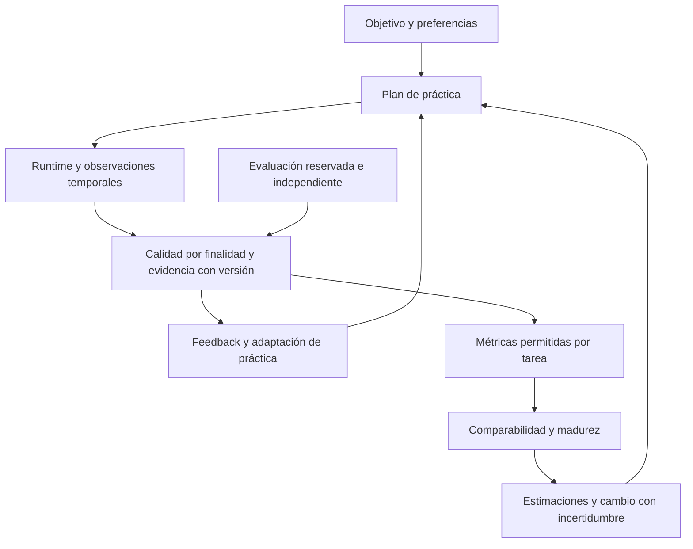

# Molvex · Motor de Enfoque antes de ampliar ejercicios

Fecha: 2026-09-16 · Tarea: `TASK-2026-09-16-EXER-MOTOR-ENFOQUE` · Versión: 1.0.

**Resultado:** el motor actual no reúne todavía las condiciones para sostener la precisión, personalización y eficacia solicitadas. Recomiendo una evolución incremental con contratos verificables y validación humana escalonada. Este documento completa la revisión focalizada y la propuesta conceptual; no certifica el motor, no crea ejercicios y no autoriza implementación.

| Campo | Estado |
|---|---|
| `document_completion` | COMPLETE para revisión focalizada y propuesta conceptual |
| `design_disposition` | CONDITIONAL: decisiones de adopción y contratos empíricos pendientes |
| `readiness` | DESIGN_ONLY |
| `decision_status` de los cambios | PROPOSED |
| Motor implementado o validado por esta tarea | Ningún cambio; ninguna validación humana nueva |
| Superioridad mundial | NO DEMOSTRADA; objetivo de investigación, no criterio ya satisfecho |

## 1. Encargo, alcance y conclusión

El encargo actual es revisar el motor **antes de crear ejercicios** y plantear las mejoras necesarias para un nivel de referencia. No adopta automáticamente las instrucciones ni las recomendaciones de la [auditoría recibida](../../audits/AUDITORIA_TOTAL_ENFOQUE_MOLVEX_2026-09-14.md). Gobiernan el encargo, EXER, las decisiones vigentes y el [charter científico](../../context_pack/03_SCIENTIFIC_MEASUREMENT_CHARTER.md).

Población de diseño heredada: adultos 18+, inicialmente España/español; personalización individual con robustez poblacional; modalidad sencilla dentro del mismo entrenamiento serio; núcleo sin IA generativa. No se reabren esas decisiones. Los ocho motores visibles no se convierten en ocho factores científicos independientes.

«Infalible» no es una especificación alcanzable. La alternativa exigente es saber cuándo el sistema puede decidir, con qué error, cuándo debe abstenerse y cómo se demuestra que una mejora pertenece al usuario. «El mejor» exige además definir población, uso, comparadores, versiones y resultados. No hay en este trabajo una comparación ejecutada que permita adjudicar ese título.

Hay una base aprovechable: generadores y pruebas existentes, gates de admisión, ausencia en memoria, bloqueo del perfil sin evidencia y contención de claims. La auditoría **reporta** 4468 tests correctos el 14 de septiembre; esta sesión no los ha vuelto a ejecutar. Eso no acredita precisión física, fiabilidad del cambio individual o beneficio humano.

## 2. Snapshot y procedencia

- Árbol observado: `product/focus2-v5`, HEAD `bdc252f496384e52e3ac14e451a139df57b47792`, con cambios anteriores sin confirmar. HEAD solo no identifica esos bytes.
- De las 26 fuentes del snapshot EXER previo, 23 conservan su hash inicial, incluida la auditoría; las otras tres (`AGENTS.md`, índice de memoria y ledger) coinciden con los hashes finales registrados por la preparación anterior. No se detectó un cambio posterior entre esas dependencias.
- Motor montado de referencia: `focus` v1. La situación de V5/focus2 se interpreta mediante [CURRENT_AUTHORITY_INDEX](../../engines/focus_v5/CURRENT_AUTHORITY_INDEX.md), no por nombres o contratos presentes en el árbol. Su montaje continúa bloqueado.
- Graphify declara base `8a06b9ac`, distinta de HEAD. Se usó su informe como orientación histórica y código directo para decisiones. No se refrescó el grafo ni se reparó su instalación. La integración previa documentó fallo del launcher; aquí no se repitió ese intento.
- Fuentes y hashes de esta ejecución: [snapshot](../integracion/MOTOR_ENFOQUE_SNAPSHOT_2026-09-16.json). Alcance de verificaciones: [comprobaciones](../integracion/MOTOR_ENFOQUE_CHECKS_2026-09-16.json).

**Clases de evidencia:** `REPO_VERIFIED` significa lectura del flujo concreto, no ejecución móvil; `REPORTED` remite al informe anterior; `PROPOSED` describe un cambio pendiente; las fuentes externas respaldan inferencias acotadas, nunca validan automáticamente Molvex.

## 3. Hallazgos que gobiernan la propuesta

Las rutas abreviadas `F/` corresponden a `shared/src/commonMain/kotlin/com/mindos/app/features/mindboost/focus/`. Las filas enlazan los hallazgos ya existentes del [ledger canónico](../../../MINDBOOST_AUDIT_LEDGER.md); no se inventan IDs de defectos duplicados.

| Situación actual | Evidencia y alcance | Consecuencia / protección que se conserva |
|---|---|---|
| Usuario sin base atrapado bajo defaults | `MB-FOCUS-0166/0101/0116`; `FocusHomeStateHolder:88`, `FocusHomeScreen:158–174`, `FeatureFlags:132`, `FocusBaselineStateHolder:215–222`; REPO_VERIFIED | Falta una ruta de práctica independiente. Se conserva la negativa a publicar una base sin observación suficiente. RC publicado hoy no se consultó; no extrapolar a todos los usuarios reales. |
| Calibración E1/E2/E3 agregada y guardada aun con sonda denegada | `0167/0174/0176`; `BaselineAssembler:42–59`, `DefaultCalibrationEngine:27–36`, `FocusBaselineStateHolder:203–221`; REPO_VERIFIED | La validez de la sonda no protege los parámetros previos. Separar admisión de calibración, identidad de umbral y madurez. |
| Señales de adaptación ausentes | `0168`; `FocusSessionStateHolder:520–533`, `AdaptiveEngine:74–107`; REPO_VERIFIED | Maestría, fatiga e histéresis no llegan; StepUp/StepDown de rendimiento no son alcanzables. El caller sí retiene sesiones denegadas y respeta FIXED. |
| Incremento unilateral del eje de inhibición | `AdaptiveEngine:74–76`, `DifficultyVector:64–65`, `E3GatilloGenerator:26`, `E12ReengancheGenerator:21`; REPO_VERIFIED | La expresión histórica «solo baja dificultad» de `0168` no describe la operación. Se suma `INHIBITORY_DEMAND`; su efecto real se verifica por familia. |
| RT sin evidencia del onset físico ni contexto suficiente | `0099`; `FocusSessionStateHolder:266–270`, `FocusFixedBlockRunner:93–96`, UI `detectTapGestures`; REPO_VERIFIED | El sello se toma antes de presentar. No se midió aquí el sesgo en ms. `Admitted` declara que no certifica timebase/jank. |
| Ausencia pierde razón al persistir | `0177`; `MetricKey:82–88`, `FocusDtos:47–52`, `FocusPersistenceMappers:87–96`; REPO_VERIFIED | Se serializa cero con `confident=false`; también se conserva admisión. Es pérdida de semántica y suficiencia, no prueba de que hoy se muestre cero como capacidad. |
| Exposición tratada en momentos distintos | `FocusBaselineStateHolder:138/163–167` frente a `FocusEvaluationStateHolder:153–155`; REPO_VERIFIED | Una forma parcialmente vista no puede volver a contar como fresca; agotamiento y admisión necesitan estados separados. |
| Medición por familia, dosis, práctica y linaje incompletos | `0169/0170/0173`, auditoría partes X–XIX/XXIV; REPORTED salvo contrastes anteriores | E1 se declara PVT sin implementar la misma tarea; métricas inadecuadas, SSD y formas necesitan revisión específica antes de uso oficial. No se repitió aquí toda la auditoría. |
| Perfil y cambio fiable retenidos | `FocusProfileSource:55` y call-site del scorer `FocusSessionStateHolder:464`; REPO_VERIFIED. Fiabilidad vacía: informe e integración previos | Es una protección. Conectar estimadores o activar flags no sustituye datos de validación. |

El gate `npm run check:governance` se ejecutó en esta tarea y falla por `CEO_FIELD_DISAGREEMENT` (`MB-FOCUS-0155`): las autoridades vivas difieren entre `GRANTED` y `NOT_GRANTED`. No se alteró ninguna para obtener un verde.

## 4. Recomendaciones de la auditoría que no adoptaría literalmente

| Recomendación original | Contrato corregido para esta propuesta |
|---|---|
| Liberar forma cuando la sesión se deniega | Liberar solo la reserva nunca expuesta. Desde el primer estímulo, registrar exposición aunque haya cancelación o denegación. La admisión no borra aprendizaje previo. |
| Tres administraciones equivalen al charter | El mínimo vigente para provisional → calibrado es **5 sesiones oficiales válidas, 3 días y 48 h**, más cobertura, integridad, comparabilidad y ausencia de dependencia crítica de una tarea. No basta para validar psicometría. |
| `SessionMode = OFFICIAL/TRAINING/RELAXED` | Finalidad, modalidad, plan comercial y elegibilidad son dimensiones distintas. Una modalidad sencilla no es por definición dato inválido ni evidencia equivalente. |
| d′ como primera versión de θ por subhabilidad | d′/criterio son métricas de una tarea de detección con sus condiciones. No son una escala común entre familias, ni una capacidad general acreditada. |
| Una puntuación agregada y priorizar el θ más bajo | No ordenar escalas nativas diferentes. Primero demostrar estructura, comparabilidad y utilidad de esa intervención; hasta entonces usar resultados separados y preferencias/cobertura explícitas. |
| Bootstrap de trials resuelve SEM/cambio | Su intervalo estima solo la incertidumbre cubierta por el muestreo/modelo. Dependencia temporal, días, práctica, estado y dispositivo requieren diseño/modelo apropiado. `±SD` no es automáticamente intervalo de confianza. |
| 80 % de acierto / 3-down-1-up universal | Candidatas para experimentación por familia. La prevalencia y los costes de error pueden hacer trivial ese porcentaje. No equivalen a dosis óptima. |
| Exactitud bajo deadline elimina sesgo de hardware | También depende del tiempo visible y de aceptación del input. Es una alternativa a comparar, con validación temporal propia. |
| n fijo, ICC .70/.80 o seis sesiones prueban suficiente evidencia | Son propuestas, no garantías. Definir precisión requerida, error de decisión, población y periodo; dimensionar el estudio y la medida para ese uso. |
| Añadir campos y `ignoreUnknownKeys` evita migración | Leer campos desconocidos no reconstruye la semántica perdida ni permite a lectores antiguos interpretar `null`. Versionar y probar lectores/escritores, legado y rollback. |
| Registrar eventos «sin PII» resuelve privacidad | Resultados cognitivos y trazas pueden seguir siendo sensibles. Finalidad, minimización, consentimiento, retención y borrado preceden a cualquier egreso. No hace falta nube para validar lógica local. |

Estas precisiones no editan el informe original ni sustituyen decisiones vigentes. Actualizan cómo se consume su propuesta.

## 5. Tres alternativas de arquitectura

| Opción | Qué cambia | Beneficio | Coste y riesgo | Disposición |
|---|---|---|---|---|
| A. Corregir acceso y mantener práctica conservadora | Acceso, fallos de integridad imprescindibles y feedback acotado | Permite evaluar usabilidad pronto | No satisface personalización o medición avanzada | Útil como primera etapa, insuficiente como destino |
| **B. Evolución incremental del motor actual** | Contratos de evidencia, calibración, métricas, comparabilidad y adaptación; reutilización selectiva del core tras revisar compatibilidad | Reduce duplicidad; cada cambio tiene gate y rollback | Requiere migraciones y evidencia por etapa; no promete eficacia | **Recomendada** |
| C. Reemplazo completo por V5/focus2 o un motor nuevo | Runtime, modelos y persistencia nuevos | Mayor libertad de arquitectura | Duplicación, migración más extensa, gobernanza V5 abierta, misma deuda empírica | No justificado como primera medida |

No propongo 17 servicios ni 17 módulos Gradle. Las capas de la auditoría se pueden expresar como responsabilidades dentro del KMP actual. No se reutiliza V5 por el mero hecho de existir: cada contrato, caller y autoridad requiere revisión; este diseño no autoriza su montaje.

Las flechas son contratos propuestos, no wiring ya implementado. La ruta a estimaciones oficiales permanece retenida hasta cumplir sus gates.

## 6. Contratos del motor propuesto

Todos los nombres nuevos son conceptuales, no APIs aprobadas. Cada paquete identifica el antes/después, dueño y aceptación. Los parámetros empíricos se fijarán en protocolos específicos; no se inventan constantes para activar ramas.

### P1. Permiso de práctica y elegibilidad separada

**Antes:** existencia de base gobierna el acceso; `Admitted` tiene un techo técnico limitado.

**Después propuesto:** una sesión declara finalidad de práctica/evaluación, modalidad profesional/sencilla, protocolo y versiones; Free/Elite no modifica la verdad cognitiva. La elegibilidad para guardar evidencia de uso, ajustar práctica y actualizar perfil se decide por separado, con razones tipadas y sin tratar sensores desconocidos como limpios. Practicar sin base oficial no crea una base ni entra en ranking.

La adaptación de práctica también necesita observaciones interpretables: no se permite adaptar sobre respuestas corruptas por llamar a la sesión «training». Las condiciones mínimas de ese uso se definen explícitamente. Se conserva C0 en distribución general hasta la decisión de activación descrita en P5; el piloto controlado tiene autorización y alcance separados. No se encienden flags como atajo.

**Dueño futuro:** arquitectura + producto. **Gate A1:** usuario nuevo bajo cada configuración/plataforma llega a la práctica autorizada; los mismos datos con sensor ausente no actualizan perfil; background, cancelación y proceso interrumpido no se reconstruyen como evidencia completa.

### P2. Tiempo, captura y calidad del instrumento

**Antes:** reloj monotónico antes de `presentAndAwait`, respuesta a través de callback de gesto; delta negativo colapsado a cero.

**Después propuesto:** contrato único para entrenamiento, calibración y retest: preparación, solicitud de presentación, frame observado, evento nativo de entrada, recepción y clasificación, con dominio de reloj/unidad/origen. Input pertenece a un ensayo y solo se consume una vez. Deltas imposibles, epochs incompatibles, pérdida de foco y presentación no demostrada generan ausencia o invalidez tipada. En stop-signal, distinguir SSD solicitada de onset STOP observado; una señal no presentada no cuenta como inhibición lograda.

Frame callback no significa fotones en pantalla. La precisión física se caracteriza externamente por plataforma, versión y condiciones. No restar un offset universal por modelo de teléfono. Un contexto local mínimo describe clase de input, refresco y configuración relevantes; no requiere fingerprint identificable de hardware.

**Dueño:** KMP/móvil. **Gate A2:** pipeline real bajo input tardío, duplicado, fuera de orden, cancelación y límite de ventana; equivalencia semántica Android/iOS. Ensayo físico con fotodiodo/actuador o referencia cuya resolución e incertidumbre se documenten. Una cámara de 240 fps por sí sola tiene pasos de ~4,17 ms; no puede justificar precisión arbitraria por debajo de su resolución sin otro método. Medir sesgo, variabilidad, colas y fallo bajo carga, refresco y ahorro de energía. El error admisible se deriva de la decisión pretendida y se aprueba antes de recoger resultados. Con error desconocido, RT oficial sigue retenido.

### P3. Métricas, almacenamiento y comparabilidad

**Antes:** métricas base compartidas entre paradigmas y DTO sin razón de ausencia ni procedencia suficiente.

**Después propuesto:** cada familia declara métricas permitidas, unidad, denominador, dirección, exclusiones, n válido por condición y usos autorizados. El resultado distingue valor medido —incluido cero— de ausencia con causa. Se conservan suficiencia, incertidumbre y método cuando existen; desconocido no se convierte en una banda inventada.

Guardar resúmenes cifrados con finalidad/modalidad, identidad de forma y exposición, parámetros/umbrales usados, calidad y versiones de generador/métrica/elegibilidad/adaptación. Los trials permanecen efímeros conforme al canon. El contrato transversal facts-only conserva su función: no introducir scores o proxies de perfil en ese canal. La inferencia vive detrás de su autoridad correspondiente.

Comparar exige un conjunto compatible de tarea, dificultad/protocolo, métrica, umbral, dispositivo/input, modalidad y exposición. Compartir modelo de teléfono no demuestra estabilidad; cambiar dispositivo tampoco se corrige promediando. Un puente es evidencia versionada, no una rama que devuelve `true`. Historial sin procedencia queda desconocido; no se recalcula como si se conocieran parámetros antiguos.

**Dueño:** métricas + datos. **Gate A3:** round-trip de cero válido y cada ausencia; consumidores sin bypass; migraciones viejo/nuevo y rollback; dos cuentas aisladas; duplicación/reintento no duplica evidencia. Cambiar scorer, forma o contexto sin puente produce comparabilidad desconocida/incompatible. No borrar historial para hacer pasar gates. No asegurar reproducibilidad exacta de cualquier análisis desde resúmenes: declarar qué reanálisis permite cada resumen.

### P4. Calibración y exposición

**Antes:** una administración crea la base; calibración previa mezcla familias; el momento de gasto de forma difiere entre carriles.

**Después propuesto:** calibración técnica/comprensión, punto inicial provisional y madurez del perfil son estados distintos. Cada bloque que aporte parámetros pasa por un gate adecuado al uso; cambios de umbral quedan ligados a su familia, evidencia y versión. Conservar el mínimo íntegro del charter 5/3/48, que no valida por sí solo el instrumento. La evidencia apta para acumular madurez se define sin exigir que el perfil ya sea maduro: se evita el ciclo «necesitas perfil calibrado para calibrarlo».

Exposición: `reservada → expuesta al primer estímulo → completada/abortada`, con admisión independiente. Una reserva demostrablemente nunca expuesta puede liberarse idempotentemente. Una exposición nunca se borra al denegar. Si un cierre de proceso impide saber si llegó a mostrarse, la exposición queda desconocida y se retiene la frescura; faltar confirmación durable no demuestra ausencia de exposición. El protocolo durable se especificará sin guardar trials crudos. Antes de exponer, comprobar que hay una forma utilizable para el propósito. Banco agotado permite práctica y explica que no hay evaluación fresca; no inventa independencia con otra seed. Equivalencia de formas y aprendizaje de la regla requieren evidencia propia.

El límite diario es independiente de madurez y frescura: charter §11.3 permite que solo una dosis predefinida de evidencia independiente actualice el perfil por día; los excedentes son `TRAINING_ONLY`. La cantidad se fija por ejercicio/bloque mediante ADR, no aquí mediante una constante universal. La política de día y cambio de zona debe quedar explícita antes de implementarla, sin elegir UTC por omisión.

**Dueño:** evaluación + persistencia. **Gate A4:** cancelación antes/después del primer estímulo, process death precisamente entre registro/presentación/confirmación, retry y wrap del banco; jamás recuperar frescura falsa. Umbrales de familia A no contaminan B; calibración inválida no actualiza parámetros. Fronteras de sesiones/días/48 h/cobertura y duplicados se prueban sin confundir conteo con fiabilidad. Probar varias formas/sesiones el mismo día, límite exacto, exceso y cambio de día según ADR; una forma fresca no elude el cupo oficial. Rebaseline versionado, motivo visible y sin escoger retrospectivamente el peor punto inicial.

### P5. Adaptación y prescripción útiles

**Antes:** C0 entrega tres señales nulas y queda una ruta de impulsividad anterior a las guardas de rendimiento.

**Después propuesto:** empezar por una política determinista pequeña, por familia, con observables reales. No hace falta inventar un detector de fatiga para subir o bajar un eje de práctica. Cada regla define métrica interpretable, muestra mínima, ventana, dirección, límite de cambio, suelo/techo, estabilidad tras cambio, recuperación, razón y versión. La ausencia retiene; una pausa solicitada siempre se respeta. Fatiga inferida, dificultad excesiva, mala comprensión y fallo técnico no se equiparan.

Un único eje gobernante por ajuste inicial facilita atribución. Validar que su incremento cambia la demanda prevista y no solo legibilidad o velocidad motora. Contención de impulsividad se revisa contra la semántica del generador; no se asume que `stepUp` ayude ni que «más errores → más nivel» sea correcto. Dificultad nunca se toma directamente como capacidad.

Entre sesiones, orden propuesto: compatibilidad e integridad → objetivo/preferencia → cobertura y exposición → carga viable → regla simple de selección con desempate determinista. La preferencia expresa interés, no evidencia de qué intervención beneficia más. Con perfil incierto se ofrece una ruta amplia conservadora o evaluación necesaria; no se asigna un déficit. Seleccionar la familia causalmente mejor para una persona requiere estudio; seis sesiones observacionales no lo demuestran.

Dosis de medida se deriva de oportunidades válidas por celda y precisión requerida; dosis de práctica se evalúa por aprendizaje, carga y adherencia. Mantener las opciones de duración del canon solo cuando preserven el procedimiento. No subir rareza para alcanzar n sin reconocer que cambió el paradigma. Una sesión breve puede servir para practicar y ser insuficiente para medir.

**Dueño:** adaptación + producto + experimentación. **A5-T, técnico:** caller y motor reales alcanzan subir/bajar/retener en familias elegibles, con recuperación del techo/suelo, sin ratchet ni oscilación incontrolada; trazas honestas lentas, expertas, aleatorias y ausentes. Prueba de propiedades, secuencias largas y mutaciones de guardas. Simulación prueba reglas, no dosis óptima ni eficacia.

**A5-P, piloto controlado:** después de A5-T y del gate técnico/plataforma/privacidad aplicable, un protocolo humano autorizado por separado permite ensayar la política en participantes consentidos y versiones acotadas. No exige demostrar antes su propio beneficio; mantiene C0 en la distribución general y no abre inferencia oficial. Evalúa comprensión, carga, abandonos y fallos de asignación.

**A5-B, beneficio comparativo:** con instrumento estable, comparar la candidata frente a política simple con carga equivalente y resultado independiente. La activación general de práctica adaptativa necesitará decisión de producto explícita, A5-T/A5-P y gates de plataforma/datos/release correspondientes; ningún verde de esta propuesta la autoriza. Para afirmar que esa personalización beneficia más, se exige además A5-B. Así, practicar con dificultad adaptativa y demostrar ventaja de personalización son decisiones distintas.

### P6. Estimación, crecimiento y evaluación independiente

**Antes:** scores de sesión y tendencias no constituyen una estimación validada; el cambio fiable está retenido.

**Después propuesto:** empezar por vectores de resultados específicos de tarea, con error y condiciones. Separar sensibilidad y criterio cuando SDT sea aplicable; velocidad, exactitud y costes entre condiciones no se fusionan con pesos intuitivos. Elegir modelo por identificación, ajuste, estabilidad y validación reservada. IRT, modelos jerárquicos o de difusión son opciones de investigación; su complejidad no garantiza constructo válido.

El perfil agregado solo se habilita si las tareas apoyan esa interpretación. Si no lo hacen, conservar resultados separados es una conclusión válida. Para cambio, modelar error entre administraciones, exposición/práctica, regresión a la media y comparabilidad. Separar «sin evidencia de cambio», «cambio pequeño dentro de un margen de equivalencia demostrado» y «no comparable». No etiquetar ruido como estabilidad.

La evaluación primaria para eficacia queda reservada y fuera del bucle que optimiza entrenamiento. Usar estímulos nuevos en la misma tarea mide generalización de ítems, no automáticamente transferencia. Compartir familia permite estudiar mejora específica, pero no demostrar por sí solo transferencia independiente. No desarrollar algoritmos mirando continuamente el outcome confirmatorio.

**Dueño:** medición + experimentación. **Gate A6:** estudio de repetición sin intervención para error, práctica y falsos avisos por periodo; modelos validados fuera de la muestra de ajuste; incertidumbre calibrada. Se fija de antemano cuántas veces se consulta el crecimiento y el presupuesto acumulado de falsas declaraciones. RCI con 95 % nominal no protege por sí solo un panel observado a diario.

### P7. Auditabilidad, privacidad y UX

**Después propuesto:** resúmenes suficientes para explicar qué se recomendó y por qué, versión de la política y calidad del dato. Registro local mínimo por defecto. Analítica de servicio e investigación tienen finalidades y consentimientos separados; no añadir egreso por etiquetarlo «sin PII». Cualquier estudio que necesite datos distintos del resumen permitido requiere protocolo y decisión separados, o debe restringir sus preguntas al dato disponible.

Guardar hechos de sesión una sola vez con idempotencia y vínculo de cuenta; retención y borrado deben cubrir nuevos campos/namespaces antes de activación. La ampliación del consentimiento al carril v1 es deuda a resolver antes del uso que lo requiera. No conectar sync dormido en esta fase.

Feedback por estado: qué se practicó, resultado específico cuando sea interpretable, motivo de ausencia y próximo paso. Ajustes accesibles se clasifican por equivalencia demostrada, equivalencia desconocida o demanda distinta; no penalizar la necesidad de otra interacción como menor capacidad. Modo sencillo y profesional mantienen calidad del entrenamiento, sin prometer equivalencia métrica antes de estudiarla.

**Dueño:** privacidad + UX + datos. **Gate A7:** propósito y consentimiento aplicables en todos los writers; datos minimizados, separación de cuentas y purga comprobada; ninguna ausencia se convierte en fracaso personal. Matriz Android/iOS de accesibilidad, interrupciones, offline, entrada y recuperación. Paridad de reglas no equivale a paridad de latencia física.

## 7. Orden y condiciones para avanzar

| Etapa | Entregable verificable | Depende de | Condición de salida y dueño |
|---|---|---|---|
| E0. Decisiones y contratos | Aprobación conceptual acotada, mapa de responsabilidades y criterios por uso | Este informe y decisiones §10 | Requisitos sin contradicción, alcance V5 explícito si se utiliza; CEO + arquitectura |
| E1. Integridad y práctica | P1, ausencia/procedencia de P3, calibración/exposición de P4 y garantías de datos de P7 | E0 | A1/A3/A4/A7 en el flujo real; usuario nuevo practicable sin abrir perfil oficial; ingeniería |
| E2. Instrumento | P2, métricas permitidas y dosis por condición | E1 | A2 y contrato de error físico por plataformas declaradas; móvil + medición |
| E3. Adaptación mínima | P5 con productores y trazas reales | E1/E2 según criticidad temporal | A5-T y A5-P para candidata de práctica; activación general separada, sin claim de ventaja; adaptación + UX |
| E4. Medición | P6, formas, comparabilidad y precisión de cambio | Instrumento estable y protocolo aprobado | A6 empírico para cada uso; medición |
| E5. Beneficio y comparación | Intervención congelada, control activo, evaluación reservada y seguimiento | E3/E4 y protocolo causal | A5-B y efecto con incertidumbre/relevancia práctica; replicación para claim comparativo fuerte |

**Antes de ampliar el catálogo:** cerrar las decisiones y contratos E0; resolver los defectos de integridad y alcanzabilidad E1; demostrar el funcionamiento del instrumento y adaptación que vaya a requerir el siguiente diseño, sin P0/P1 abiertos para ese uso. No convertir todos los estudios posibles en requisitos de cada tarea documental, pero tampoco declarar el motor listo porque existe este informe.

**Antes de prometer precisión oficial, mejora cognitiva o superioridad:** cerrar E2/E4/E5 para el uso y población correspondientes. Las familias ya existentes pueden servir a pilotos y a la primera intervención congelada; no hace falta crear ahora un catálogo nuevo. Cada ejercicio futuro que cambie demanda o medición necesitará su propia validación. La calidad del motor no puede garantizar eficacia de cualquier ejercicio futuro.

No hay estimación honesta de coste/plazo cerrada: faltan inventario físico, reclutamiento, margen de precisión y recursos de investigación. Complejidad relativa: P1 media; P2 alta; P3/P4 media-alta; P5 media técnica y alta empírica; P6 alta empírica; P7 media con dependencias de consentimiento. Ninguna suscripción, compra, reclutamiento ni estudio se inicia desde EXER.

## 8. Qué significaría ser de referencia y cómo demostrarlo

La excelencia propuesta tiene varios criterios que no se compensan con una media 0–100:

| Criterio | Prueba propuesta | Regla de decisión |
|---|---|---|
| Integridad | Suite adversaria del pipeline completo y mutaciones; replay/versiones; fallos/cancelación | Cero violaciones en el corpus acordado; no es prueba de ausencia universal de errores |
| Precisión técnica | Referencia externa por dispositivo/condición, con incertidumbre del instrumento | Error dentro del presupuesto aprobado para ese uso; fuera del presupuesto se restringe interpretación |
| Precisión individual | Repeticiones/días/formas; error condicional e intervalo; controles de práctica | Intervalos calibrados y error de decisión aceptable, fijados antes del estudio |
| Personalización | Política candidata frente a política simple, condiciones y carga comparables | Beneficio en resultado independiente, sin deterioro relevante de carga/abandono; una mejora del score entrenado no basta |
| Eficacia | Aleatorización, comparador activo creíble, análisis intention-to-treat y outcome reservado | IC y relevancia práctica preespecificados; publicar también resultado nulo o adverso |
| Accesibilidad y equidad | Comprensión y equivalencia/invariancia por condiciones de uso | Limitar comparaciones donde no haya evidencia; no ocultar exclusiones que inflen resultados |
| Ventaja comparativa | Comparadores actuales preseleccionados, versiones fijadas, mismo estimando y horizonte | IC de la diferencia supera margen práctico; replicación y ausencia de deterioro crítico |

**No adoptar cutoffs decorativos.** Tamaño humano, n por celda, ICC, margen de cambio, tasas de falsa declaración y tiempo máximo tolerable se calculan desde el uso. Si faltan varianza/práctica, el primer estudio estima esos supuestos y se hace análisis de sensibilidad. El aproximadamente 20 de la alpha del canon corresponde a QA/usabilidad, no valida causalidad. 30 días y seguimiento a 90 son objetivos protocolarios, no evidencia actual.

Diseño causal mínimo: adultos de la población objetivo; intervención/versiones congeladas; asignación aleatoria; control activo con expectativas/carga razonablemente comparables; evaluador y analista cegados cuando sea viable; outcome primario independiente; potencia o precisión calculadas; manejo previo de ausencias, adherencia, exclusiones y multiplicidad. La evaluación recurrente no alimenta el entrenamiento que luego se examina con ella. Hipótesis individuales de respuesta son exploratorias salvo diseño que permita otra interpretación.

**Comparadores para el protocolo, no un ranking actual:** NIH Toolbox Flanker como referencia de medición con sus límites de modalidad, versión y práctica; batería independiente que no coincida exclusivamente con lo entrenado; política Molvex simple como control de adaptación; producto de entrenamiento actual elegido por pertinencia a adultos españoles, acceso, versión, coste y protocolo. La página oficial de [NIH Toolbox](https://nihtoolbox.org/test/flanker-inhibitory-control-and-attention-test-age-12/) describe administración en iPad y por examinador, en español/inglés: no equivale directamente al uso móvil autónomo. Su [actualización de 2025](https://nihtoolbox.zendesk.com/hc/en-us/articles/36421110128788-Why-was-DCCS-Flanker-and-VR-updated-in-2025) obliga a fijar versión.

Los ensayos históricos de Lumosity/Peak son precedentes metodológicos, no mediciones de las versiones comerciales actuales. No se hizo un barrido exhaustivo del mercado. La afirmación final posible sería «superó a X e Y en Z, para esta población y periodo», no «superior a todo sistema existente».

## 9. Evidencia externa que modifica decisiones

Búsqueda focalizada consultada el 16-09-2026, sin enviar fuentes privadas del repo. No es revisión sistemática. Son fuentes primarias y páginas oficiales; ninguna estudia esta implementación de Molvex.

| Fuente / acceso consultado | Qué aporta al diseño | Límite y falsador aplicable |
|---|---|---|
| [Hedge, Powell y Sumner, 2018](https://link.springer.com/article/10.3758/s13428-017-0935-1), texto del editor | Un efecto experimental robusto no garantiza diferencias individuales fiables | Validar cada métrica y uso; no prohibir todas las diferencias de RT por principio |
| [Draheim, Tsukahara y Engle, 2023 online/2024 volumen](https://link.springer.com/article/10.3758/s13428-023-02140-2), abstract/metadatos | Evidencia favorable para el enfoque toolbox y varias medidas adaptativas/de exactitud | No demuestra equivalencia móvil ni eficacia; comprobar replicación con población y tarea Molvex |
| [Rey-Mermet, Singmann y Oberauer, 2025](https://link.springer.com/article/10.3758/s13423-025-02696-4), texto completo | Seis datasets reanalizados no sostuvieron un factor coherente de control atencional aun modelando error y speed–accuracy | Justifica comparar modelos y permitir resultados separados; no concluye que la atención no exista |
| [Nicosia et al., 2022 online/2023 volumen](https://link.springer.com/article/10.3758/s13428-022-01925-1), abstract/notas | Medición técnica en 26 smartphones mostró variabilidad de latencia de pantalla y tacto | No trasladar offsets a teléfonos actuales; medir el pipeline de Molvex |
| [Verbruggen et al., 2019](https://pmc.ncbi.nlm.nih.gov/articles/PMC6533084/), guía de consenso, acceso parcial durante consulta | SSRT exige diseño y análisis compatibles con supuestos de carrera | Releer protocolo completo al especificar E4; no cerrar precisión individual por superar un piso de stops |
| [Kable et al., 2017](https://www.kablelab.com/uploads/1/3/0/4/130439175/kable_caulfield_et_al_2017_jneurosci.pdf), manuscrito del laboratorio | Ensayo en jóvenes con control activo; no encontró beneficio relativo general en los outcomes examinados | Precedente para separar rendimiento entrenado de transferencia, no juicio sobre producto 2026 |
| [Sutton et al., 2025](https://link.springer.com/article/10.1007/s00426-025-02110-7), texto completo | Ensayo de tres meses con adultos mayores: mejora entrenada sin evidencia de transferencia a outcomes examinados | Población distinta; refuta asumir transferencia, no predice el resultado de Molvex |

La controversia científica no se resuelve con una votación de agentes. Se convierte en modelos y falsadores: si las métricas no convergen de forma replicable, no agregar; si el control mejora igual, no atribuir beneficio específico; si la adaptación solo sube el score entrenado, revisar su objetivo; si hardware o práctica explican el cambio, no adjudicarlo a capacidad.

## 10. Decisiones concretas de adopción

El usuario ya autorizó esta revisión y la formulación de alternativas. No se solicita permiso para completarlas. Las preguntas siguientes son para **adoptar** cambios de producto/arquitectura en una fase posterior; permanecen propuestas. La [entrada EXER](../comando/EXER.md) exige: «presenta la propuesta y pregunta al CEO antes de adoptarla» cuando cambie una decisión vigente. No se interpreta silencio como aprobación.

| ID | Decisión y recomendación | Alternativa / coste / reversibilidad | Pregunta de adopción |
|---|---|---|---|
| EXER-MOTOR-01 | **B, evolución incremental** (§5), con P1–P7 como responsabilidades propuestas | A limita ambición; C aumenta migración y duplicidad. Diseño reversible, datos migrados necesitan puente/rollback | ¿Adoptar B como dirección conceptual antes de ampliar ejercicios, sin autorizar todavía código? |
| EXER-MOTOR-02 / EXER-CEO-01 | Práctica accesible sin base oficial, manteniendo gates de evidencia y condiciones propias para adaptar | Mantener acceso actual preserva el bloqueo; encender RC solo no resuelve todos los targets. Coste de navegación/contratos medio | ¿Aprobar esa separación y mantener release sujeto a evidencia física independiente? |
| EXER-MOTOR-03 / EXER-CEO-02 | Punto inicial provisional, madurez 5/3/48 completa y parámetros por familia | Cambiar mínimo requiere decisión científica expresa; una base única tiene más variabilidad. Historial versionado, no sobrescrito | ¿Adoptar P4 sin rebajar el charter ni considerar sus mínimos validación? |
| EXER-MOTOR-04 / EXER-CEO-03 | Diseñar salida gradual de C0 por familia con reglas mínimas observables; no inventar fatiga/maestría | Mantener C0 conserva contención, pero no da personalización adaptativa completa. Piloto, activación y claim separados en A5-T/P/B | ¿Adoptar P5 con esas tres etapas y mantener C0 general hasta autorización de activación y gates aplicables? |
| EXER-MOTOR-05 | Resultados por tarea/familia antes de score agregado; estudiar estructura y evaluación reservada | Agregado directo es más simple de presentar pero carece de validez demostrada. Puede añadirse después con puente | ¿Aceptar que un motor de referencia pueda mostrar varias medidas fiables sin un único número de Enfoque? |
| EXER-MOTOR-06 | Seleccionar presupuesto de error, carga y comparadores mediante protocolo previo | Sin estudio humano solo se obtiene garantía técnica limitada. Recursos, retención y consentimiento por concretar | ¿Priorizar primero precisión del cambio individual y después ventaja de entrenamiento en adultos del canon, manteniendo ambos resultados separados? |

**Decisiones aún no absorbidas por una aprobación general:** E1 relabel frente a rediseño/sonda independiente; taxonomía CORE/SECONDARY/CROSS; retirada o conversión de E12/E13; fórmula/umbrales; retención/exportación para investigación; cualquier activación RC. Son decisiones específicas de sus contratos futuros, con las alternativas de la auditoría revisadas en §4. No se requiere renombrar namespaces para usar Molvex como marca.

`EXER-CEO-04 / MB-FOCUS-0155` conserva su pregunta exacta: ¿`EXECUTION_AUTHORIZATION` de V5 es `NOT_GRANTED` o `GRANTED` para qué plan/slices concretos? Aprobar esta propuesta de diseño no decide ese campo. `EXER-CEO-05 / 0101` conserva la necesidad de corrida física humana y evidencia iOS separada; aquí no se programa ni se ejecuta.

## 11. Revisión, límites y continuidad

- Principal: integración de fuentes, auditoría/charter, contratos, alternativas y registros.
- `/root/focus_engine_review`: revisión independiente de código, siete flujos concretos, sin escrituras ni Gradle.
- `/root/focus_science_review`: revisión independiente de inferencias y programa empírico, fuentes primarias consultadas. Son agentes de IA, no acreditaciones de revisión humana.
- Revisión integrada del documento: resultado y hash constan en el archivo de comprobaciones; los comentarios se integran sin promover readiness.
- No se reejecutaron builds/tests de app, no se inspeccionó RC remoto, no hubo Android físico/iOS ni participantes. Las simulaciones anteriores no se presentan como nuevas.
- No se crearon dossiers de ejercicios. No hay diseños nuevos que invalidar. El siguiente trabajo, tras decisiones, es cerrar contratos acotados P1/P3/P4 y protocolo del instrumento; implementación requiere un encargo específico posterior.
- Memoria: propuesta enlazada, checkpoint actualizado de forma aditiva y evento/checkpoint en ledger con sello recalculado. Estados de hallazgos existentes conservados. Grafo estructural sin refrescar; continuidad por Markdown y snapshot, sin fingir que se actualizó Graphify.

La invocación de chat `/exer` sí se ha observado en esta interacción y ha cargado su entrada. Esto verifica el alias conversacional para esta ejecución; no demuestra registro nativo ni una batería completa de comportamiento.

## Referencias directas de implementación

- [Home y acceso](../../../shared/src/commonMain/kotlin/com/mindos/app/features/mindboost/focus/presentation/FocusHomeStateHolder.kt), [UI de Home](../../../shared/src/commonMain/kotlin/com/mindos/app/features/mindboost/focus/presentation/ui/FocusHomeScreen.kt), [flags](../../../shared/src/commonMain/kotlin/com/mindos/app/core/config/FeatureFlags.kt).
- [Base](../../../shared/src/commonMain/kotlin/com/mindos/app/features/mindboost/focus/presentation/FocusBaselineStateHolder.kt), [BaselineAssembler](../../../shared/src/commonMain/kotlin/com/mindos/app/features/mindboost/focus/domain/evaluation/BaselineAssembler.kt), [calibración](../../../shared/src/commonMain/kotlin/com/mindos/app/features/mindboost/focus/domain/evaluation/DefaultCalibrationEngine.kt).
- [Caller de sesión](../../../shared/src/commonMain/kotlin/com/mindos/app/features/mindboost/focus/presentation/FocusSessionStateHolder.kt), [motor adaptativo](../../../shared/src/commonMain/kotlin/com/mindos/app/features/mindboost/focus/domain/adaptive/AdaptiveEngine.kt), [runner fijo](../../../shared/src/commonMain/kotlin/com/mindos/app/features/mindboost/focus/presentation/exercise/FocusFixedBlockRunner.kt).
- [Métricas/ausencia](../../../shared/src/commonMain/kotlin/com/mindos/app/features/mindboost/focus/domain/metrics/MetricKey.kt), [DTOs](../../../shared/src/commonMain/kotlin/com/mindos/app/features/mindboost/focus/data/dto/FocusDtos.kt), [mappers](../../../shared/src/commonMain/kotlin/com/mindos/app/features/mindboost/focus/data/mapper/FocusPersistenceMappers.kt).
- [Retest y exposición](../../../shared/src/commonMain/kotlin/com/mindos/app/features/mindboost/focus/presentation/FocusEvaluationStateHolder.kt), [repositorios](../../../shared/src/commonMain/kotlin/com/mindos/app/features/mindboost/focus/data/local/LocalFocusRepositories.kt), [gate de sesión](../../../shared/src/commonMain/kotlin/com/mindos/app/features/mindboost/focus/domain/quality/SessionQualityGate.kt), [barrera de perfil](../../../shared/src/commonMain/kotlin/com/mindos/app/features/mindboost/profile/data/adapter/FocusProfileSource.kt).
