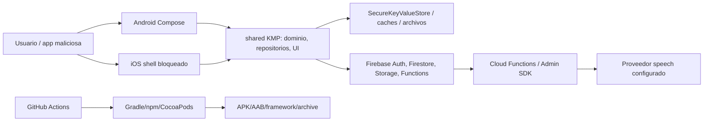

# Arquitectura y superficie de ataque

## Mapa de alto nivel

## Superficies clasificadas

| Superficie | Entrada/actor | Salida/activo | Control observado | Gap principal |
|---|---|---|---|---|
| Android launcher | Intent externo | UI real o harness QA | activity exportada, `FLAG_SECURE` release | extra de preview compilado en `main` |
| iOS entrypoint | usuario local | pantalla bloqueada | fail-closed | app, App Check, archive y paridad no verificadas |
| Auth | email/password, usuario remoto | token Firebase/UID | timeouts, errores normalizados parciales | Firebase alcanza release sin gate de entorno |
| Firestore/Storage | cliente autenticado | datos sociales/privados | default deny, owner, schema, limites, App Check en Storage | enforcement consola Firestore no verificable; reglas complejas rozan limite en negativos |
| Callables/HTTP | datos y tokens cliente | Admin SDK/proveedor | Auth, App Check, validadores, rate limits parciales | feed sin cuota; borrado async con contrato de completado |
| Persistencia cognitiva | sujeto, sesiones, scores | ciphertext/local DB | AES-GCM/Keystore, Keychain, caps, DTOs | AAD, durabilidad, revocacion, quarantine y subject erasure incompletos |
| Media | microfono/picker/URLs | archivos/cache/Storage | sandbox, TTL Android parcial | lifecycle logout/delete incompleto, iOS Documents |
| Telemetria | eventos/errores | Crashlytics/Analytics/Perf/logs | Throwable remoto sanitizado | consentimiento/retencion y logs locales incompletos |
| AI/voz | audio/texto | broker/proveedor | flags off, Auth, App Check, consentimiento, timeout | dossier proveedor/region/retencion y UI de consentimiento pendientes |
| CI/supply chain | commits/dependencias/secrets | binarios release | Actions por SHA, checkout sin credenciales, firma fail-closed | locks/verificacion, iOS real, SBOM y atestacion |

## Entry points y componentes

- Android: `MainActivity`, callbacks exportados de Firebase Auth, Play Services y permisos de camara, microfono y notificaciones.
- iOS: `iOSApp.swift` y `MainViewController`; sin URL schemes, universal links, pasteboard o push propios detectados.
- Backend: callables exportadas desde `functions/src/index.ts`, HTTP `speechAsrRecognize`, webhooks sandbox/reales fail-closed.
- Persistencia: SharedPreferences cifradas, Keychain indexado, SQLDelight, archivos temporales/media y caches Media3.
- CI: ocho workflows, npm root/Functions, dos wrappers Gradle y Podfile iOS.

## Controles positivos

Android no permite cleartext, excluye backups sensibles y no contiene WebView/trust-all TLS. Reglas Firebase prueban aislamiento y mass assignment. Los posts y snapshots publicos son backend-authoritative. Actions estan fijadas a SHA y usan permisos `contents: read`. El broker de voz esta deshabilitado por defecto y no hay LLM externo activo en el producto actual.
