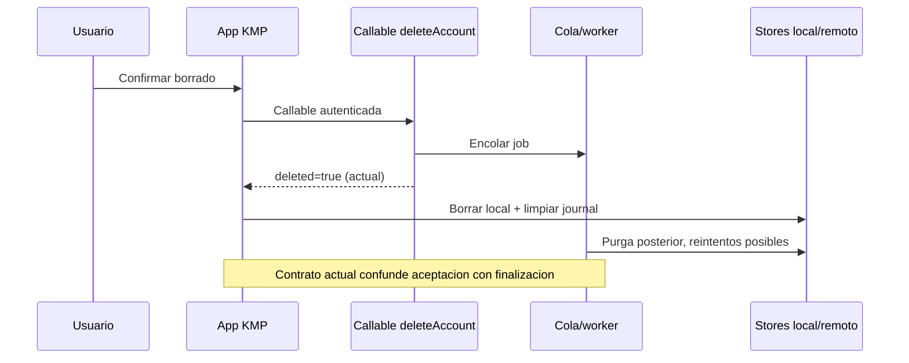
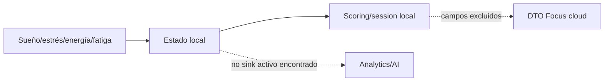

# Mapa de datos y privacidad

## Inventario operativo

| Clase de dato | Origen | Destino observado | Proteccion | Retencion/borrado | Estado |
|---|---|---|---|---|---|
| Credenciales/tokens Firebase | Auth UI/SDK | Firebase Auth, memoria SDK | TLS/SDK; no logging de password | logout no borra datos cognitivos en disco | P1/P0 por transicion de auth |
| UID/perfil/social | usuario/Firebase | Firestore, Storage, caches | Rules owner/backend authority | purga cloud incompleta y logs locales | P1/P2 |
| DMs/media/voz | picker/microfono | Storage, cache/archivo local | permisos, sandbox, Rules | Android parcial; iOS sin TTL/eraser | P1 |
| Sesiones/respuestas/scores | ejercicios | SecureKeyValueStore/SQLDelight; sync Focus opcional | AES-GCM/Keychain, DTOs | caps parciales; revocacion/erasure no uniforme | P0/P1 |
| Contexto sueño/estres/energia/fatiga | UI/estado local | memoria/store local | excluido de DTO cloud Focus | politica por clase incompleta | Control positivo con gap documental |
| Consentimiento | usuario | stores locales y `voice_consents` | cifrado local/Auth+App Check | voz no incluida en purge; tombstones indefinidos | P1 |
| Wallet/fraude/entitlements | backend | Firestore server-only | Rules deny, Admin SDK | excepciones legales requieren owner/TTL | PROVISIONAL |
| Logs/Crash/Analytics/Perf | SDK/callers | Logcat, stdout iOS, Firebase SDKs | Throwable remoto minimizado | finalidad/consentimiento/TTL no demostrados | P1/P2 |
| AI Coach | texto futuro | actualmente sin proveedor activo | gate fail-closed | arquitectura futura incompleta | BLOCKED/inactivo |
| Speech broker | audio con consent | Function -> proveedor configurado | Auth, App Check, rate limit, timeout | region/no-training/retencion externa no verificadas | Inactivo por flag |
| Jobs de borrado/pseudonimos | Function | Firestore/Cloud Tasks | HMAC, acceso backend | versionado/TTL/estado observable incompletos | P1/P2 |

## Flujos sensibles

## Controles de minimizacion verificados

- `FocusSessionCloudDto` no contiene sueño, cafeina, estado de animo o autoinformes equivalentes.
- El sync Focus esta desactivado por defecto y la ruta productiva es local.
- La camara Android usa ML Kit on-device sin persistencia/transmision de frames encontrada.
- El broker de voz no registra audio/transcripcion en el flujo inspeccionado y requiere consentimiento.
- La telemetria remota propia no acepta `Throwable` externo crudo.

## Gaps de derechos y gobernanza

- `DATA_INVENTORY.md` y declaraciones de tienda son historicos y no cubren todas las colecciones, namespaces, SDKs y procesadores actuales.
- No existe un flujo transversal de acceso/exportacion/correccion verificable.
- No hay owner, finalidad, TTL y ruta de borrado machine-readable por clase.
- Reautenticacion, estado del job y confirmacion final de borrado no estan integrados en UI.
- DPO/legal/producto deben decidir base juridica, DPIA, plazos, excepciones financieras, region, transferencias y contratos; esta auditoria solo identifica controles tecnicos ausentes.
